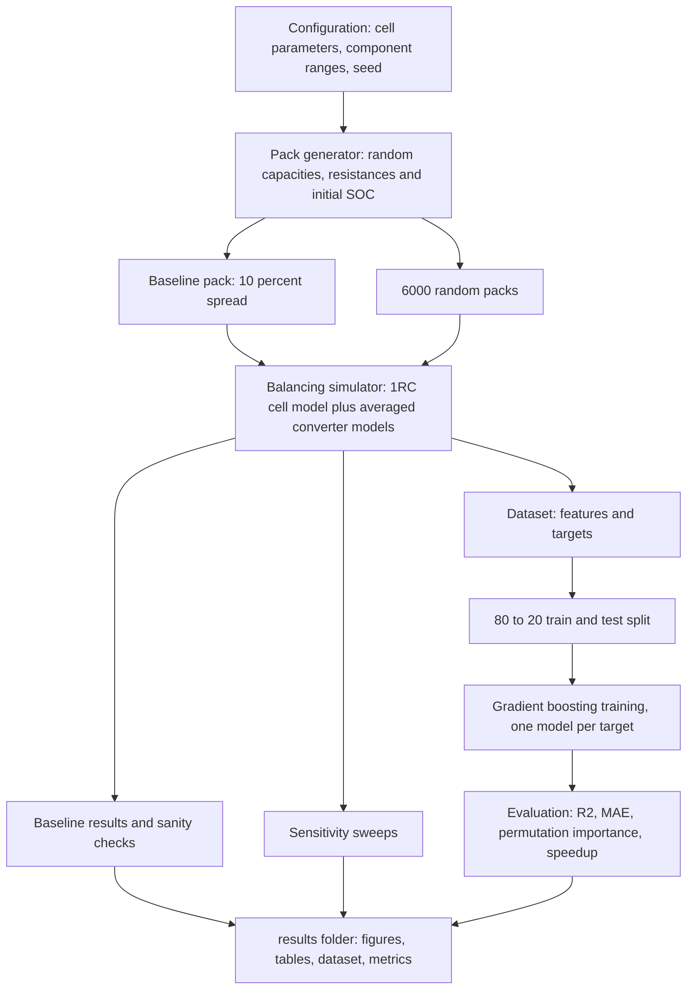
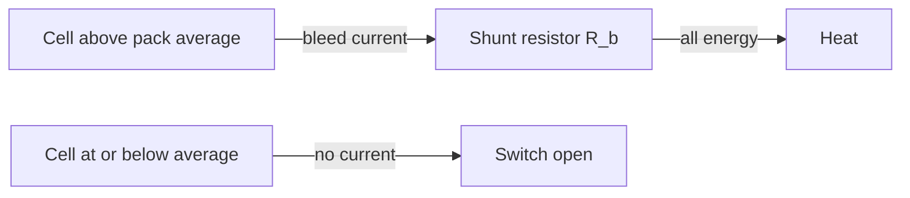
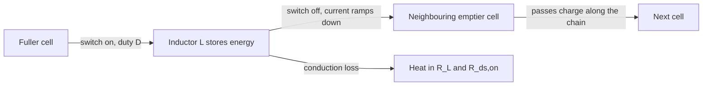
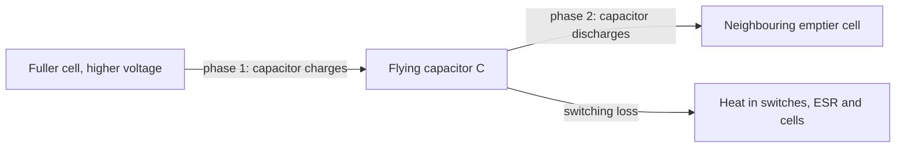

# Cell Balancing in EV Battery Packs: Simulation, LTspice Validation and Deep Surrogates

**Summary.** Passive shunt, inductor buck-boost and flying-capacitor balancing of a 4-cell series pack, with a cell model fitted to measured LG HG2 data (Mendeley dataset, DOI 10.17632/b5mj79w5w9.2, licence CC BY 4.0), checked against switching-level LTspice circuits with real MOSFETs, gate drive and dead time, and compared with learned surrogates, SOC estimators and RL controllers. Everything is deterministic: one simulation seed (2026) and seeds 0 to 2 for the learned models.

- **Baseline** (10 % SOC spread, mid-range components, circuit-calibrated default models): passive 4.19 h and 7176 J; buck-boost 1.09 h, 221 J, 96.2 % efficient; flying capacitor 2.00 h, 39.5 J, 99.3 % efficient. The technique ranking did not change (buck-boost fastest, flying capacitor lowest loss, passive slowest).
- **LTspice** (section ab): the midsem flying-capacitor series formula is wrong by up to 160 % and the coth form holds within 3.4 %; the averaged buck-boost currents hold within 4.9 % where the peak current is below a saturation rule, but the averaged losses miss gate drive and switching by up to 16 %, so a circuit-calibrated model is now the default.
- **Deep learning** (sections ac and ad): plain MLP, GRU and Transformer surrogates lose to gradient boosting (time R² 0.952 against 0.982); learning only the residual over the closed-form physics lifts every model to 0.9997 or better and boosting is as good as the networks to within 1e-4; an EKF plus GRU hybrid cuts SOC RMSE from 2.1 % to 0.9 % (Test A) and stays accurate at int8; a second RL attempt finds no controller better than the rule on every cycle.
- **Claims:** 264 rows in `results/claims.md`: 154 PASS, 86 FAIL, 0 NOT RUN, 24 NOT SUPPORTED. FAIL rows are findings and are kept.

**Repo map.** `src/` library code (simulator, converter models, `lt_*.py` LTspice netlists, runs and reports, `calibration.py` correction maps, deep models); `scripts/` downloads, LTspice sweeps (`ltspice_*.py`), training and long jobs, whose small outputs are committed; `ltspice/` one `.asc` schematic per circuit; `data/processed/` fitted parameters and result caches; `results/` metrics, claims, figures and `results/ltspice/*.csv`; `tests/`; `spice/` netlists of the earlier ideal-switch check. Section m has the full tree.

**Reproduce.**

```bash
pip install -r requirements.txt
python run_all.py                  # about 15 minutes on 16 threads, no LTspice needed
python -m scripts.report_claims
python -m pytest
ruff check .
```

`run_all.py` never calls a simulator or trains a network: it reads the committed caches (`results/ltspice/*.csv` for the circuit results, `data/processed/*.json` for the training runs). With LTspice 26.1.1 installed, `python -m scripts.ltspice_flying_cap`, `scripts.ltspice_buck_boost`, `scripts.ltspice_shunt` and `scripts.ltspice_checks` (run one after the other, about 15 minutes) rewrite the CSVs and `python -m scripts.ltspice_schematics` the `.asc` files. The training scripts (`train_deep_surrogates`, `train_trajectory`, `train_soc_hybrid`, `train_rl2` with `evaluate_rl2`) rewrite the deep-learning caches; `train_soc_hybrid` needs the HG2 drive-cycle files from `scripts/fetch_hg2.py`. Section l has the full list.

**Changelog.** Midsem: assumed cell parameters and the three techniques. Endsem phases 0 to 3: verification checks, fitted cell model, an ideal-switch LTspice comparison, ML against physics baselines. Final phase (sections r to v): drive cycles, temperature, SOC estimation, scaling, RL. Closing work (sections w to aa): net-current link model, 2RC EKF, midsem consistency, converter audit, voltage-based rest balancing, technique selector. This work (sections ab to ad): LTspice validation with real parts and gate drive, circuit-calibrated converter models as the default, buck-boost range pruned by an inductor saturation rule, dataset and surrogate regenerated, deep-learning surrogates, trajectory decoders, EKF plus GRU hybrid with weight quantisation, a second RL attempt, and a pre-final audit.


## What was achieved

This section lists what the project produced, what is a reproduction of known results, what we think is new, and what did not work. Every number is read from `results/metrics.json`, and every claim has a row (value, threshold, PASS or FAIL) in `results/claims.md`. Nothing here was tuned to pass: failing rows are kept and reported.

**Positive results, with their evidence**

| # | Result | Evidence | Kind |
|---|---|---|---|
| 1 | A cell model fitted to a measured LG HG2 cell (OCV, R0 and two RC branches from HPPC pulses) reproduces measured UDDS and LA92 terminal voltage without retuning: whole-cycle RMSE 28.5 mV and 28.8 mV against a 30 mV limit | `cell_validation`, claims rows "Fitted 2RC cell model" | Reproduced method, new data |
| 2 | The simulator reproduces the midsem baseline numbers exactly under the midsem assumptions, so the later changes are traceable | `physics_checks.midsem_regression` (PASS) | Reproduction |
| 3 | The passive balancing time follows the closed form t = max_i 3600 Q_i (R_b + R0_i + R1) times the OCV integral to 0.065 % over 200 random packs; flying-capacitor charge is conserved to 5.0e-13 | `physics_checks` | Verification |
| 4 | Circuit-level validation with LTspice (real MOSFET, diode and gate-driver models, dead time, ESR, DCR; 434 runs): the classical series formula for a flying-capacitor link is refuted by up to 160 %, and the exact switched-capacitor (coth) form is confirmed within 3.4 % on real parts and 1.0 % on ideal switches | `ltspice_validation.flying_capacitor` | New check of a known formula |
| 5 | The buck-boost stays in discontinuous conduction over the whole grid including 4.2 V into 3.0 V (D + D2 at most 0.961), and a small-inductor saturation rule shows that 56 of 96 (L, f, operating point) combinations are unrealistic and must be pruned | `ltspice_validation.buck_boost` | New design-space result |
| 6 | An LTspice-calibrated version of the averaged models (correction maps over C, L and f, gate-drive and switching overhead) lowers the buck-boost source-current error to 3.4 % and sink-current error to 3.9 %, the dissipated-power error from 16.5 % to 8.3 %, and the flying-capacitor current error to 0.11 % (in-sample), and is now the default | `ltspice_validation`, `calibration_effect` | New method |
| 7 | Balancing under measured driving current adds usable pack capacity: on the baseline pack 0.126 Ah (flying capacitor) and 0.092 Ah (buck-boost), the passive shunt none; medians over 200 random packs 0.074 and 0.072 Ah | `drive_cycle`, `drive_cycle_population` | New simulation study |
| 8 | Balancing time scales as the derived laws on a step-shaped imbalance: flying capacitor N to the power 2.00 (theory 2) and buck-boost N to the power 0.90 (theory 1), up to 96 cells | `scaling` | Derived and confirmed |
| 9 | Learning only the log residual over the closed-form physics lifts every deep surrogate to a balancing-time R² of 0.9997 or better (flying-capacitor time 0.9990), against 0.9818 for plain boosting (flying capacitor 0.860) | `deep_models.surrogates` | New use of an existing idea |
| 10 | An EKF plus GRU hybrid cuts the SOC estimation error from 2.06 % to 0.89 % (Test A) and from 2.11 % to 1.43 % on the unseen 10 degrees C set, and keeps that accuracy at int8 weights (4560 bytes) | `deep_models.soc` | New combination, measured |
| 11 | GRU and Transformer decoders predict the whole SOC-spread trajectory within 0.22 percentage points and reproduce the three shapes (linear passive, steady buck-boost, exponential-tail flying capacitor) | `deep_models.trajectory` | New |

**What we think is new, and the caveat.** Items 4 to 6 (validating the averaged balancer formulas against real-part circuit simulations, finding that the series approximation fails while the exact form holds, and turning the circuit results into correction maps with an inductor-saturation pruning rule), item 9 (physics-residual learning for a balancing surrogate) and item 10 (an EKF with a GRU correction, with a bit-width study) are our own constructions on one measured cell and one pack layout; we did not search the literature exhaustively, so "new" means "not taken from any source we cite", and the switched-capacitor resistance itself is the known result of Seeman and Sanders, which we verified rather than invented. Items 1 to 3 and 7 to 8 are reproductions or applications of established methods to the measured data.

**What did not work, and is reported as such.** Plain MLP, GRU and Transformer surrogates are worse than gradient boosting (balancing-time R² 0.954 to 0.957 against 0.982); the second RL attempt does not beat the hand-written rule on every cycle for 4 or 8 cells; the trajectory decoders are poor at the absolute time (13 to 15 % median error); the averaged buck-boost loss misses the 15 % tolerance; the energy ledger of the buck-boost and flying capacitor with the coupled-cell diagnostic is above 1 %. All of these are FAIL rows or caveats in section ab to ad and in `results/claims.md`.

**Claims tally.** 264 rows: 154 PASS, 86 FAIL, 24 NOT SUPPORTED (statements the project cannot support without hardware).

## The project in detail: a guided tour

**1. The problem.** A traction pack is a series string of lithium-ion cells. Cells drift apart in state of charge (SOC), and the string can only be used until its weakest cell hits a voltage limit, so a spread in SOC wastes capacity. Balancing circuits move or burn charge to bring the cells back within 1 % SOC spread. Three circuits are compared on a 4-cell pack: a **passive shunt** (a resistor and a MOSFET across each cell that burns the excess charge as heat), an **inductor buck-boost** converter between each pair of adjacent cells (energy is stored in an inductor and dumped into the neighbour), and a **flying capacitor** between each pair (a capacitor is switched across the high cell, then across the low cell). The questions: how fast does each balance, how much energy does each waste, how do the answers change with component values, and can a fast surrogate or a learned controller replace the simulation?

**2. Data and cell model.** The measured data are from a public LG 18650HG2 data set (Mendeley Data, DOI 10.17632/b5mj79w5w9.2, licence CC BY 4.0). From the C/20 discharge we extract the open-circuit-voltage (OCV) curve; from the HPPC pulse test we fit R0 and one or two RC branches (a 1RC and a 2RC model; R0 = 11.6 mΩ at 25 degrees C and 50 % SOC); the drive cycles UDDS and LA92 are held out and used only to validate. The 2RC model passes the 30 mV whole-cycle limit (28.5 and 28.8 mV), the 1RC model does not (claims file). Fits at 0, 10, 25 and 40 degrees C give an Arrhenius law for R0 (section s). The simulator uses a single-branch equivalent of the 2RC fit; that simplification fails its 30 mV limit (31.5 and 35.0 mV) and is reported as FAIL. Cell-to-cell variation (capacity plus or minus 5 %, R0 plus or minus 10 %) is assumed because the data set has one cell.

**3. Averaged converter models.** Each circuit is replaced by its switching-cycle average so a 48-hour balancing run needs 1 s steps instead of microsecond switching steps. Passive: current = emf / (R_bleed + R0). Buck-boost in discontinuous conduction with duty D = 0.4: G = D² / (2 L f), source current I = E G / (1 + G R0), peak current 2 I / D, sink duty D2 = D V_source / V_sink, conduction loss (R_L + Rds,on) I_pk² (D + D2) / 3, and the sink current from the power balance. Flying capacitor: the link behaves as a resistor R_eq between the two cell voltages; for two equal phases R_eq = (1 / f C) coth(1 / (4 f R C)) with R = R0 + 2 Rds,on + ESR (the switched-capacitor form of Seeman and Sanders), which tends to 1 / (f C) when slow and to 4 R when fast. The simulator (`src/balancing.py`, `src/stepper.py`) advances the RC branch of every cell, finds the link currents, moves charge, and stops when the spread falls below 1 %. An independent element-by-element energy ledger (`src/ledger.py`) checks that energy removed minus energy delivered equals the sum of every loss.

**4. Verification.** The simulator is checked against closed forms and conservation laws before anything else is built on it (section n): the midsem numbers are reproduced exactly with the midsem assumptions, the passive time matches its closed form to 0.065 %, the flying-capacitor charge balance closes to 5e-13, and the ledgers close for the passive shunt and, per link, for the active circuits. Known limits that fail strict diagnostics (the shared-R0 coupling between neighbouring links, and the buck-boost net-current ledger) are kept as FAIL rows.

**5. Circuit-level validation with LTspice.** Short steady-state windows (5 to 20 ms) of each converter are simulated in LTspice with each cell as a DC source at the fitted OCV in series with R0. Flying capacitor: four BSZ100N03LS MOSFETs per link with floating gate drivers (5 V, 2.2 Ω), 0.25 µs dead time, 5 mΩ ESR; sweeps over C (1 to 10 mF), f (1 to 10 kHz) and SOC spread (1 to 10 %), with real and ideal switches. Buck-boost: FDS4410 high-side switch and either a synchronous FDS4410 with zero-current turn-off or an MBRS340 Schottky diode, 80 mΩ inductor, L from 10 to 100 µH, f from 10 to 50 kHz, three operating points including 4.2 V into 3.0 V. Every run measures two whole-period windows after a start-up window, integrates V·I per device exactly for piecewise-linear signals, and splits MOSFET loss into conduction, transition and gate drive. Results are in section ab; they are cached as CSVs so `run_all.py` needs no simulator.

**6. Calibration and the new default.** The decision rule was fixed in advance: if the averaged formulas miss the claim tolerances (5 % current, 15 % loss) against the real-part circuits, a calibrated model becomes the default. They do for the loss, so the simulator now interpolates LTspice-derived maps (R_eff and gate power over C and f for the flying capacitor; current ratio and overhead power over L and f for the buck-boost). The effect on the baseline pack: buck-boost 1.07 h to 1.09 h and 200 J to 221 J; flying capacitor 1.96 h to 2.00 h and 29.9 J to 39.5 J; passive unchanged at 4.19 h and 7176 J. The ranking is unchanged.

**7. Data set and surrogates.** 6000 random packs (2000 per technique; 4 cell SOCs, capacities and R0s, circuit, component value and frequency; 19 features) are simulated for balancing time and dissipated energy, with the buck-boost range pruned by the saturation rule. A gradient-boosting model predicts both targets (time R² 0.9836, energy 0.9952, about 142 times faster than simulating, batched against batched). Section q compares it with closed-form physics baselines, a log-linear model and a hybrid, with 5-fold cross-validation, out-of-range tests and conformal intervals. Section ac adds MLP, cell-sequence GRU and cell-token Transformer models with an equal four-trial tuning budget and three seeds, a trajectory-prediction task, and the physics-residual variants.

**8. System-level studies.** Balancing under measured driving and charging current (section r); temperature (s); the effect of a biased SOC estimate on the final true spread (s); SOC estimation by coulomb counting, an EKF, a GRU and now an EKF plus GRU hybrid (t, w, ac); strings of 4 to 96 cells and the scaling laws (u); a PPO controller and its second attempt (v, ac); balancing from rest voltage with sensor error (z); and a technique selector under a parking-time budget (aa).

**9. How to read the evidence.** `results/claims.md` is generated from `results/metrics.json` by `scripts/report_claims.py`; each row names its evidence key, value and threshold. `scripts/check_readme.py` checks the numbers quoted in this README against the metrics. `results/FIGURES.md` describes every figure. Timings are in `results/timing.json` and are not claims.

**10. Limits.** One measured cell at 25 degrees C (and per-temperature fits), assumed cell-to-cell spreads, simulated converters validated only against circuit simulation (no hardware), a linear inductor without core loss, ideal gate drivers and a zero-current detector, 4-cell packs for the learned models, and training sets of 6000 simulated runs. Everything labelled NOT SUPPORTED in the claims file is outside what the project can show.

## a. Overview

A battery pack is only as good as its weakest cell. When cells in a series string drift to different charge levels, usable capacity shrinks and some cells get stressed. This project simulates three ways of pulling cells back into line (passive shunt, inductor buck-boost and flying capacitor balancing) on a 4-cell pack of 18650 lithium-ion cells. It compares how fast each one balances and how much energy it wastes. It then trains a machine learning model that predicts those results about 100 times faster than running the simulation.

> **Parameter sets.** The midsem results used assumed cell parameters (`ASSUMED`). Since endsem Phase 1 the default is `FITTED_HG2_25C`, fitted to measured data from one LG HG2 cell at 25 °C (section o). Sections a, e, g and i below were written for the midsem run: where they quote numbers, those are the `ASSUMED` values, kept in `results/midsem_reference/` and in `results/baseline_assumed_vs_fitted.csv`. The figures in `results/` are regenerated with the fitted set. A full rewrite of those sections is planned for the final phase.

> **ML evaluation.** Since endsem Phase 3 the surrogate is compared with physics formulas, a log-linear regression and a hybrid model (section q). The plain gradient-boosting model of section h is the weakest of the four; physics formulas match the simulator closely, and a hybrid that learns a correction on top of physics is the best model where the physics is imperfect.

> **Converter models.** Since endsem Phase 2 the averaged buck-boost and flying-capacitor current equations are checked against switching-level LTspice runs (section p). The buck-boost equations pass unchanged. The midsem flying-capacitor formula fails at the fast-switching points and is replaced by an exact two-phase formula; the midsem one stays available as `FlyingCapModel.MIDSEM`. Since the closing work the default is the LTspice-calibrated model (section ab); the numbers below use it unless a section says otherwise.

> **Final phase.** The last phase (sections r to v) adds balancing under measured drive-cycle and charging current (r), cell fits at four temperatures and the effect of SOC estimation error (s), SOC estimation with a GRU, an EKF and coulomb counting and what its errors do to balancing (t), scaling to strings of up to 96 cells (u) and a reinforcement-learning controller (v). Headline results, all limited to the one measured cell and the stated pack: under the measured Mixed 1 current the flying capacitor adds 0.126 Ah of usable pack capacity and the buck-boost 0.092 Ah on the maximum-spread baseline pack (medians over 200 random packs: 0.074 and 0.072 Ah), the passive shunt none; the fitted cell model fails the 30 mV validation limit at 0 and 10 °C; the GRU estimates SOC with 2.5 % RMSE (4.96 % for the EKF) yet balancing on either estimate leaves most packs above the 1 % true-spread target; balancing time follows the derived N and N² laws only for a step initial profile; and a PPO policy did not beat the simple rule (null result). `results/claims.md` lists every claim with its evidence, including the failed and unsupported ones, and `results/FIGURES.md` describes each figure.

Baseline from a 10 % charge imbalance (fitted parameters, with the midsem `ASSUMED` value in brackets):

- **Speed:** the inductor buck-boost balances in **1.09 h** (1.17 h), the flying capacitor in **2.00 h** (2.54 h) and the passive shunt in **4.19 h** (4.56 h).
- **Energy:** passive balancing burns **7176 J** (7680 J) as heat. The buck-boost loses **221 J** (221 J), 96.2 % efficient, and the flying capacitor **39.5 J** (20.5 J), 99.3 % efficient.
- **Prediction:** the machine learning model, trained on 6000 simulated runs, predicts balancing time with **R² = 0.984** (0.973) and wasted energy with **R² = 0.995** (0.995) on unseen packs. It is about **142x** faster than simulating them: about 26 µs per prediction vs 3.6 ms per simulated pack. Section q shows that it is not more accurate than closed-form physics formulas. The factor depends on the machine and is not a supported claim; timings live in `results/timing.json` and `results/claims.md` lists what is and is not supported.

## b. Motivation

An electric vehicle pack contains hundreds or thousands of lithium-ion cells. Many of them are connected in series to reach a high voltage, typically 400 V or 800 V. Every cell must stay inside a safe window of voltage, current and temperature. A **battery management system (BMS)** is the electronics and software that watches every cell and keeps the pack inside that window. It measures voltages, estimates how full each cell is, protects against faults and balances the cells.

No two cells are identical. Small manufacturing differences in capacity, internal resistance and self-discharge rate, plus temperature differences across the pack, make cells drift apart over hundreds of cycles. This drift is **cell imbalance**: cells in the same string end up holding different fractions of their charge.

In a series string, the same current flows through every cell. This has two consequences:

- **Charging must stop when the fullest cell reaches its upper voltage limit,** even though the others are not yet full.
- **Discharging must stop when the emptiest cell reaches its lower voltage limit,** even though the others still hold energy.

The weakest cell therefore sets the usable capacity of the whole pack. A 10 % imbalance can cost roughly 10 % of driving range.

Balancing matters for three reasons:

- **Range:** it restores the capacity that the weakest cell would otherwise lock away.
- **Safety:** it prevents individual cells from being overcharged or overdischarged, which can cause lithium plating, gas generation or thermal runaway.
- **Lifespan:** it stops a few cells from working harder than the rest and ageing faster, which would make the imbalance worse over time.

## c. Glossary

| Term | Definition |
| --- | --- |
| Active balancing | Balancing that moves charge from fuller cells into emptier cells instead of burning it off. It needs more circuitry but wastes little energy. |
| Averaged model | A model that replaces fast switching waveforms with their average value over one switching period. It captures behaviour over minutes and hours without simulating every microsecond pulse. |
| Balancing | Any method that equalises the state of charge of the cells in a series string. |
| Bleed current | The current drawn out of a cell through a shunt resistor during passive balancing. |
| BMS (battery management system) | The electronics and software that monitor, protect and balance a battery pack. |
| Buck-boost converter | A switching power converter that can transfer energy from a source to a load at a higher or lower voltage. Here it stores energy from one cell in an inductor and releases it into the neighbouring cell. |
| C rate | Current expressed relative to cell capacity. 1C on a 3 Ah cell is 3 A, a current that would fully discharge it in one hour. |
| Cell | A single electrochemical unit, here a cylindrical 18650 lithium-ion cell (18 mm diameter, 65 mm long). |
| Cell imbalance | A difference in state of charge between cells in the same series string. |
| Coulomb counting | Estimating state of charge by integrating the current flowing in or out of a cell over time. |
| Drive cycle | A standard speed-versus-time profile, such as WLTP or UDDS, used to test vehicles under repeatable driving conditions. |
| Dataset | A table of examples used to train and test a model. Here each row is one simulated balancing run. |
| Deadband | A small band inside which a controller does nothing, to avoid switching back and forth. Here a converter link turns off when its two cells differ by less than 0.2 % SOC. |
| Decision tree | A model that predicts a value by asking a sequence of yes or no questions about the inputs, such as "is the SOC spread above 6 %?", and returning the average answer stored in the leaf it reaches. |
| Discontinuous conduction mode (DCM) | An operating mode of an inductor converter where the inductor current falls to zero before each new switching cycle starts. |
| Duty cycle | The fraction of each switching period during which a switch is on. This project uses D = 0.4. |
| EMI (electromagnetic interference) | Unwanted electrical noise radiated or conducted by fast-switching circuits. |
| Efficiency | Energy delivered into the receiving cells divided by energy taken from the source cells, as a percentage. |
| Energy dissipation | Energy turned into heat instead of being stored, in joules (J). |
| Equivalent circuit model | A model that represents a battery's electrical behaviour with ideal circuit elements (voltage source, resistors and capacitors) instead of chemistry equations. |
| ESR (equivalent series resistance) | The small unavoidable resistance of a real capacitor. |
| Feature | One input variable given to a machine learning model, such as SOC spread or inductance. |
| Flying capacitor | A capacitor that is switched back and forth between two cells. It charges from the fuller cell and discharges into the emptier one. |
| GRU (gated recurrent unit) | A type of neural network designed for sequences, able to remember past measurements when estimating a present quantity such as SOC. |
| Gradient boosting | A machine learning method that builds many small decision trees one after another, each correcting the errors left by the trees before it. |
| Inductor | A coil that stores energy in its magnetic field. Its current cannot change instantly, which is what lets switching converters move energy. Unit: henry (H). |
| Internal resistance | The resistance inside a cell that causes its terminal voltage to drop under load and turns part of the energy into heat. Unit: ohm (Ω). |
| Learning rate | In gradient boosting, the weight given to each new tree's correction. Small values learn slowly but generalise better. |
| Log transform | Training a model on the logarithm of a target instead of the raw value, so that errors on small and large values carry similar weight. |
| MAE (mean absolute error) | The average size of the prediction error, in the same unit as the target (seconds or joules). |
| MOSFET | A transistor used as a fast electronic switch in power circuits. |
| NMC | Lithium nickel manganese cobalt oxide, a common high-energy cathode chemistry for EV cells, with an operating voltage of about 3.0 V to 4.2 V. |
| OCV (open circuit voltage) | The voltage of a cell at rest with no current flowing. It rises with state of charge and is the main clue a BMS uses to estimate SOC. |
| On resistance | The small resistance of a MOSFET when it is switched on, written R_ds,on. |
| One-hot encoding | Representing a category such as "technique" as several 0 or 1 columns, one per option, with exactly one set to 1. |
| Parasitic resistance | Unwanted resistance in real components, such as inductor winding resistance, MOSFET on resistance and capacitor ESR. It causes conduction losses. |
| Passive balancing | Balancing by burning off excess charge from fuller cells as heat in resistors. |
| PCHIP interpolation | A smooth curve through table points that never overshoots between them, used here to turn the OCV table into a smooth curve. |
| Permutation feature importance | A way to measure how much a model relies on an input. The input's values are shuffled randomly and the drop in accuracy is recorded. |
| PWM (pulse width modulation) | Controlling a switch by varying how long it stays on in each fixed-length period. |
| R² (coefficient of determination) | A score of how much of the variation in the true values a model explains. 1 is perfect, 0 is no better than always guessing the average. |
| Reinforcement learning | A machine learning approach where an agent learns a control policy by trial and error, guided by a reward signal. |
| RMS (root mean square) | The effective value of a varying current. The resistive loss of a waveform equals RMS current squared times resistance. |
| RC pair | A resistor and a capacitor in parallel. In a cell model it represents slow voltage effects that build up and relax over tens of seconds. |
| Seed | A fixed starting number for the random number generator, so that every run produces identical results. |
| Series pack | Cells connected end to end so their voltages add and the same current flows through all of them. |
| Shunt resistor | A resistor switched in parallel with a cell to drain current from it. |
| SOC (state of charge) | How full a cell is, from 0 % (empty) to 100 % (full). |
| SOC spread | The highest cell SOC minus the lowest cell SOC in a pack. This project calls a pack balanced when the spread is below 1 %. |
| SOH (state of health) | A cell's present capacity compared with its capacity when new. It describes ageing. |
| Speedup | Simulation time per pack divided by model prediction time per pack. |
| Surrogate model | A fast approximate model trained to reproduce the outputs of a slower, more detailed model. |
| Switched capacitor | The general family of circuits that move charge by switching capacitors between nodes. A flying capacitor balancer is one example. |
| Switching frequency | How many on and off cycles a converter performs per second. Unit: hertz (Hz). |
| Target | The quantity a model is trained to predict. Here: balancing time and energy dissipated. |
| Thermal runaway | A self-accelerating overheating reaction inside a lithium-ion cell that can lead to fire. |
| Thevenin model | An equivalent circuit made of a voltage source, a series resistor and one or more RC pairs. This project uses one RC pair (a 1RC model). |
| Time constant | The time an RC circuit takes to cover about 63 % of a step change, τ = R·C. Unit: seconds (s). |
| Training and test split | Dividing the dataset so the model learns from one part (80 %) and is scored on a part it has never seen (20 %). |
| Vectorization | Writing code that processes whole arrays at once instead of looping over elements one by one. This project simulates thousands of packs in parallel this way. |

## d. System architecture



## e. Cell model

Each cell is an LG HG2 18650 (about 2.8 Ah at C/20), modelled as a first-order Thevenin equivalent circuit. An ideal voltage source gives the open circuit voltage, which depends on state of charge. A series resistor R0 captures the instant voltage drop when current flows. One parallel R1 and C1 pair captures the slower voltage change that builds up over tens of seconds.


The terminal voltage is the OCV minus the drop across R0 and across the RC pair:

$$
V = \text{OCV}(\text{SOC}) - i \, R_0 - V_1
$$

The voltage across the RC pair relaxes toward i·R1 with time constant τ:

$$
\frac{dV_1}{dt} = -\frac{V_1}{R_1 C_1} + \frac{i}{C_1}, \qquad \tau = R_1 C_1
$$

Over one simulation step Δt the current is held constant, which gives an exact update that stays stable for any step size:

$$
V_1[k+1] = V_1[k] + \left(1 - e^{-\Delta t / \tau}\right)\left(i \, R_1 - V_1[k]\right)
$$

State of charge follows from coulomb counting:

$$
\text{SOC}(t) = \text{SOC}_0 - \frac{1}{3600 \, Q} \int_0^t i \, dt
$$

| Symbol | Meaning | Unit | Value in this project |
| --- | --- | --- | --- |
| $V$ | Terminal voltage | V | |
| $\text{OCV}$ | Open circuit voltage, from a 101-point table measured at C/20 (2.88 V at 0 % to 4.19 V at 100 %) with PCHIP smoothing | V | about 3.74 V at 50 % |
| $\text{SOC}$ | State of charge | fraction, 0 to 1 | starts near 0.5 |
| $i$ | Cell current, positive when discharging | A | |
| $R_0$ | Series (ohmic) resistance | Ω | 11.6 mΩ, ± 10 % cell to cell (assumed) |
| $R_1$ | Polarisation resistance | Ω | 35.2 mΩ (two measured branches combined, section o) |
| $C_1$ | Polarisation capacitance | F | 919 F |
| $V_1$ | Voltage across the RC pair | V | starts at 0 V (cell at rest) |
| $\tau$ | Time constant of the RC pair | s | 32 s |
| $\Delta t$ | Simulation step | s | 1 s |
| $Q$ | Cell capacity | Ah | 2.78 Ah, ± 5 % cell to cell (assumed) |
| $3600$ | Seconds per hour, converting Ah to coulombs | s/h | |

The pack is 4 cells in series at rest, with no external load. For each pack, capacities are drawn within ± 5 % and R0 within ± 10 % of nominal. The four initial SOCs are spread around 50 % with a max-minus-min spread between 2 % and 10 %.

## f. Balancing techniques

All three techniques are simulated with averaged models at a fixed 1 s step. A run stops when the SOC spread falls below 1 %, or at a 48 h cap; no run reached the cap. For every technique the same energy bookkeeping is used, counted as chemical energy (OCV times current):

$$
E_\text{removed} = \int \sum_\text{sources} \text{OCV}_s \, I_s \, dt, \qquad
E_\text{delivered} = \int \sum_\text{sinks} \text{OCV}_k \, I_k \, dt
$$

$$
E_\text{dissipated} = E_\text{removed} - E_\text{delivered}, \qquad
\eta = \frac{E_\text{delivered}}{E_\text{removed}}
$$

Here $\text{OCV}_s$, $I_s$ are the open circuit voltage (V) and current (A) of each cell giving up charge. $\text{OCV}_k$, $I_k$ are the same quantities for each cell receiving charge. $E$ is energy in joules and $\eta$ is efficiency (dimensionless). Because the bookkeeping uses chemical energy, the dissipated energy includes both the balancing circuit losses and the cells' own resistive losses.

### Passive shunt balancing

**Principle.** Every cell has a resistor and a MOSFET switch across it. When a cell's SOC is above the pack average, its switch closes and the resistor drains current from it until it drops to the level of the others. The excess charge is simply turned into heat.



The resistor sees the cell's terminal voltage, so the bleed current and resistor loss are:

$$
I = \frac{V}{R_b} = \frac{\text{OCV} - V_1}{R_b + R_0}, \qquad P_\text{loss} = I^2 R_b
$$

| Symbol | Meaning | Unit |
| --- | --- | --- |
| $I$ | Bleed current | A |
| $V$ | Cell terminal voltage | V |
| $R_b$ | Bleed (shunt) resistance | Ω |
| $\text{OCV}$, $V_1$, $R_0$ | Cell quantities from section e | V, V, Ω |
| $P_\text{loss}$ | Power turned into heat in the resistor | W |

**Advantages:** very simple, cheap and small. Control is a single on or off decision per cell, and it is used in most production BMS designs.

**Drawbacks:**
- All excess energy is wasted as heat, so efficiency is 0 %.
- Balancing is slow, because the bleed current must stay small to limit heat.
- It can only lower the fuller cells, never raise the emptier ones.

**Range used:** R_b from 20 Ω to 100 Ω, which gives bleed currents of about 185 mA down to 37 mA.

### Inductor buck-boost balancing

**Principle.** A small buck-boost converter sits between each pair of neighbouring cells, three converters for four cells. In the first part of each switching cycle a MOSFET connects the fuller cell across an inductor, and current ramps up as energy builds in the inductor's magnetic field. The MOSFET then opens and the inductor current flows into the neighbouring cell, ramping down to zero. Charge reaches distant cells by passing along the chain. A link switches on only when its two cells differ by more than 0.2 % SOC.



In discontinuous conduction mode the peak and average source currents are:

$$
I_\text{pk} = \frac{V_\text{src} \, D \, T_s}{L}, \qquad
I_\text{avg} = \frac{V_\text{src} \, D^2 \, T_s}{2L} = \frac{D}{2} \, I_\text{pk}, \qquad T_s = \frac{1}{f}
$$

The inductor releases its energy into the sink cell over a second interval, and the conduction loss follows from the RMS value of the two triangular current pulses:

$$
D_2 = D \, \frac{V_\text{src}}{V_\text{sink}}, \qquad
P_\text{cond} = \left(R_L + R_\text{ds,on}\right) I_\text{pk}^2 \, \frac{D + D_2}{3}
$$

$$
P_\text{out} = V_\text{src} \, I_\text{avg} - P_\text{cond}
$$

| Symbol | Meaning | Unit | Value or range |
| --- | --- | --- | --- |
| $V_\text{src}$, $V_\text{sink}$ | Terminal voltage of the giving and receiving cell | V | about 3.7 V |
| $D$ | Duty cycle of the charging switch | dimensionless | 0.4 |
| $D_2$ | Fraction of the period the inductor spends discharging | dimensionless | about 0.4 |
| $T_s$ | Switching period | s | 20 µs to 100 µs |
| $f$ | Switching frequency | Hz | 10 kHz to 50 kHz |
| $L$ | Inductance | H | 10 µH to 100 µH |
| $I_\text{pk}$ | Peak inductor current | A | |
| $I_\text{avg}$ | Average current drawn from the source cell | A | 0.06 A to 3 A |
| $R_L$ | Inductor winding (parasitic) resistance | Ω | 80 mΩ |
| $R_\text{ds,on}$ | MOSFET on resistance | Ω | 20 mΩ |
| $P_\text{cond}$ | Conduction loss | W | |
| $P_\text{out}$ | Power delivered into the sink cell | W | |

**Advantages:**
- Fast, because currents of hundreds of milliamps to amps are possible.
- High efficiency, 96.4 % at mid-range values.
- Transfer does not depend on the voltage difference, so it stays fast right to the end.

**Drawbacks:**
- The most components and the highest cost: inductors, MOSFETs and gate drivers.
- The most complex control: PWM, direction selection and current limits.
- Magnetic components are bulky.
- At small L·f products the peak currents become large and efficiency drops sharply (47 % in the worst dataset case).

**Ranges used:** L from 10 µH to 100 µH, f from 10 kHz to 50 kHz and D fixed at 0.4. The inductor resistance is 80 mΩ and the MOSFET on resistance 20 mΩ.

### Flying capacitor balancing

**Principle.** A capacitor is switched back and forth between two neighbouring cells, three capacitors for four cells. Connected to the fuller cell, it charges to that cell's voltage. Connected to the emptier cell, it discharges into it. Each cycle moves a packet of charge proportional to the voltage difference. As the cells converge, the difference shrinks and so does the current, which is why this technique slows down sharply near the end.



The average current is the charge moved per cycle times the number of cycles per second. The midsem model treated the capacitor as settling to the full voltage difference in every phase, with the loop resistances simply added in series:

$$
I = \frac{\Delta E}{\dfrac{1}{f C} + R_s}, \qquad R_s = 2 R_\text{ds,on} + R_\text{ESR} + R_{0,a} + R_{0,b}
\qquad \text{(midsem formula, `FlyingCapModel.MIDSEM`)}
$$

Phase 2 showed that this is only right when the capacitor settles completely in each half period (the slow-switching limit). At the baseline point (5.5 mF, 5.5 kHz) the phase resistance $R = R_0 + 2R_\text{ds,on} + R_\text{ESR} = 36.6$ mΩ gives a time constant $RC = 0.20$ ms, which is longer than the half period of 0.091 ms. The link is in the fast-switching limit, where the capacitor never settles and the resistance in the loop limits the current much more than $1/(fC)$ does.

**Two-phase derivation.** Let the capacitor be connected to cell a (voltage $V_a$, phase resistance $R_1 = R_{0,a} + 2R_\text{ds,on} + R_\text{ESR}$) for half a period $T/2 = 1/(2f)$, then to cell b ($V_b$, $R_2 = R_{0,b} + 2R_\text{ds,on} + R_\text{ESR}$) for the other half. In each phase the capacitor voltage relaxes exponentially towards the connected cell, so with $a_i = e^{-1/(2 f R_i C)}$:

$$
v_\text{after a} = V_a + (v_0 - V_a)\,a_1, \qquad v_0 = V_b + (v_\text{after a} - V_b)\,a_2
$$

The periodic steady state is $v_0 = \dfrac{V_b (1-a_2) + V_a a_2 (1-a_1)}{1 - a_1 a_2}$. The charge drawn from cell a per period is $Q = C(1-a_1)(V_a - v_0)$, which simplifies to $Q = C\,\dfrac{(1-a_1)(1-a_2)}{1-a_1 a_2}\,\Delta V$, so the mean current is $I = f Q = \Delta V / R_\text{eq}$ with

$$
R_\text{eq} = \frac{1}{f C}\,\frac{1 - a_1 a_2}{(1-a_1)(1-a_2)} = \frac{1}{f C}\left(\frac{1}{1-a_1} + \frac{1}{1-a_2} - 1\right)
$$

For equal phase resistances this is $R_\text{eq} = 1 / \bigl(f C \tanh(1/(4 f R C))\bigr)$. It tends to $1/(fC)$ at low frequency (slow-switching limit) and to $4R$, or $2(R_1 + R_2)$ for unequal phases, at high frequency (fast-switching limit). These two limits correspond to the slow- and fast-switching limits discussed in M. D. Seeman and S. R. Sanders, "Analysis and optimization of switched-capacitor DC-DC converters," IEEE Transactions on Power Electronics, 2008. The exact two-phase interpolation between the limits is derived here, not taken from the paper, and is verified against SPICE in section p.

$R_\text{eq}$ already contains both cell resistances, the switches and the ESR, so there is no separate series term. The energy dissipated per link is $I \Delta E = I^2 R_\text{eq}$ whatever the current waveform. The simulator books $I^2 (R_\text{eq} - R_{0,a} - R_{0,b})$ as converter loss and the cell resistances with the mean link current, as before.

$$
I = \frac{\Delta E}{R_\text{eq}}, \qquad \Delta E = (\text{OCV}_a - V_{1,a}) - (\text{OCV}_b - V_{1,b})
\qquad \text{(default, `FlyingCapModel.TWO_PHASE`)}
$$

| Symbol | Meaning | Unit | Value or range |
| --- | --- | --- | --- |
| $I$ | Average transfer current | A | |
| $f$ | Switching frequency | Hz | 1 kHz to 10 kHz |
| $C$ | Flying capacitance | F | 1 mF to 10 mF |
| $\Delta V_c$ | Voltage swing on the capacitor per cycle | V | |
| $\Delta E$ | Difference in internal cell voltage between cells a and b | V | about 60 mV at 10 % SOC difference |
| $R_s$ | Series resistance of the midsem formula | Ω | about 0.038 Ω |
| $R_\text{eq}$ | Equivalent link resistance of the two-phase formula | Ω | 0.149 Ω at 5.5 mF and 5.5 kHz |
| $R_\text{ds,on}$ | MOSFET on resistance | Ω | 10 mΩ |
| $R_\text{ESR}$ | Capacitor equivalent series resistance | Ω | 5 mΩ |
| $R_{0,a}$, $R_{0,b}$ | Series resistance of the two cells | Ω | about 11.6 mΩ each |

**Advantages:**
- Highest efficiency (99.4 % at mid-range values), because losses scale with the square of a small voltage difference.
- No magnetics and simple fixed-clock control.
- Self-regulating, because current automatically stops when the cells are equal.

**Drawbacks:**
- Balancing slows sharply as the voltage difference shrinks, especially on the flat middle part of the NMC OCV curve.
- Current is limited when cells have similar voltage but different SOC.
- Large capacitors are needed.

**Ranges used:** C from 1 mF to 10 mF and f from 1 kHz to 10 kHz. The MOSFET on resistance is 10 mΩ and the capacitor ESR 5 mΩ.

## g. Comparison

Baseline results for the same pack, which starts with a 10 % SOC spread, using mid-range component values. Component counts are for a 4-cell pack in the adjacent-cell layouts simulated here. Cost and control complexity are qualitative engineering judgements.

| Property | Passive shunt | Inductor buck-boost | Flying capacitor |
| --- | --- | --- | --- |
| Component values | R_b = 60 Ω | L = 55 µH, f = 30 kHz | C = 5.5 mF, f = 5.5 kHz |
| Balancing time | 4.19 h (15068 s) | **1.09 h** (3907 s) | 2.00 h (7182 s) |
| Energy dissipated | 7176 J | 221.0 J | **39.5 J** |
| Efficiency | 0 % | 96.2 % | **99.3 %** |
| Time for last 2 % vs first 2 % of spread | 1.0x | 2.7x | 7.6x |
| Component count | 4 resistors, 4 MOSFETs | 3 inductors, 6 MOSFETs | 3 capacitors, 8 MOSFETs |
| Cost | Low | High | Medium |
| Control complexity | Low: on or off per cell | High: PWM, direction and current limits per link | Low to medium: fixed complementary clock |

Across all 6000 dataset runs, the median balancing time was 1.92 h for passive, 0.47 h for buck-boost and 0.97 h for flying capacitor. The median dissipated energy was 3516 J, 78.7 J and 15.6 J respectively. These numbers and the table above use the fitted parameters; the midsem table is in `results/midsem_reference/baseline_table.csv`.

## h. ML predictor

**What it predicts and why.** Given a pack's state and a candidate balancing circuit, the model predicts how long balancing will take and how much energy it will waste. A real BMS could use this to choose, schedule or tune balancing in real time without running a physics simulation. For example, it could decide whether there is enough parking time to finish balancing, or which of several balancing modes costs the least energy.


**How the dataset is generated.** For each technique, 2000 random packs are created. Each pack's capacities, resistances and initial SOCs are sampled as described in section e. A component value and switching frequency are drawn uniformly from that technique's range. All 2000 packs are simulated together in one vectorized batch, and each pack drops out of the batch as soon as it balances. This takes about 3.6 ms per pack, while the trained model predicts both targets for a pack in about 38 µs (the best of 20 timed repeats).

**Features (model inputs):**

| Feature | Meaning | Unit |
| --- | --- | --- |
| `soc_spread` | Highest minus lowest initial SOC | fraction |
| `soc_std` | Standard deviation of the four initial SOCs | fraction |
| `soc0_1` to `soc0_4` | Initial SOC of each cell, which tells the model where the high and low cells sit in the string | fraction |
| `capacity_1_ah` to `capacity_4_ah` | Capacity of each cell | Ah |
| `r0_1_ohm` to `r0_4_ohm` | Series resistance of each cell | Ω |
| `is_passive`, `is_buck_boost`, `is_flying_capacitor` | One-hot technique flags | 0 or 1 |
| `component_value` | R_b in Ω, L in H or C in F, depending on technique | SI unit |
| `switching_frequency_hz` | Converter switching frequency, 0 for passive | Hz |

**Targets (model outputs):** `balancing_time_s` (seconds until the SOC spread falls below 1 %) and `energy_dissipated_j` (joules turned into heat).

**How gradient boosting works.** The first small decision tree makes a rough guess. The next tree is trained to predict what the first one got wrong, and its correction is added on with a small weight (the learning rate, 0.05). This repeats 500 times. Each tree is simple, but together they model complex, non-linear relationships. The project uses scikit-learn's `HistGradientBoostingRegressor`, one model per target. Because balancing time and energy span several orders of magnitude (from under 1 J to over 10 kJ), each model learns the logarithm of its target. That way small and large values are fitted with equal care.

**Why R² and MAE.**
- **R²** is scale-free and answers "how much of the variation does the model explain?" This makes it comparable across targets with different units.
- **MAE** is in physical units (seconds or joules) and answers "how far off is a typical prediction?" This is what an engineer needs to judge usefulness.

Reporting both, overall and per technique, shows whether a high overall score hides a weak technique.

| Target | Overall | Passive | Buck-boost | Flying capacitor |
| --- | --- | --- | --- | --- |
| Balancing time R² | 0.973 | 0.994 | 0.959 | 0.888 |
| Balancing time MAE | 415 s | 292 s | 181 s | 771 s |
| Energy dissipated R² | 0.995 | 0.984 | 0.954 | 0.996 |
| Energy dissipated MAE | 72.9 J | 201 J | 17.4 J | 0.1 J |

**How to read the feature importance plot.** Each bar shows how much the test R² drops when that one input is randomly shuffled, which breaks its link to the target. A long bar means the model depends heavily on that input. A bar near zero means the model barely uses it. The black whisker shows the variation over 10 shuffles. Importance reflects what *this model* relies on, not physical causation. When two inputs carry overlapping information, such as SOC spread and SOC standard deviation, the credit is shared between them.

## i. Results

The narrative below was written for the midsem `ASSUMED` run. The qualitative behaviour is unchanged with the fitted parameters; the quoted times and ratios are the midsem ones (fitted values are in section g and `results/metrics.json`).


The fuller cells (3 and 4) bleed down at a nearly constant rate while the emptiest cell (1) stays still. Cell 2 joins in once the falling pack average passes it. Passive balancing works by lowering everyone to the weakest cell's level, and it takes 4.56 h to reach the shaded 1 % band.


Charge flows from cells 3 and 4 into cells 1 and 2 at a steady rate. The kinks show neighbouring links switching on or off as cells cross each other. All cells meet near the pack average in 1.17 h, the fastest of the three, because the transfer current does not depend on how close the cells already are.


The curves bend like exponential decays. They move fast at first, then flatten as the voltage differences driving the current shrink. The cells converge toward the average without charge being thrown away, balancing in 2.54 h.


On a logarithmic scale the flying capacitor is a straight line, which confirms exponential decay: its last 2 % of spread takes 8.3 times longer than its first 2 % in the midsem run (7.5 times with the fitted parameters and the two-phase formula). Passive and buck-boost curves bend downward instead, because their current stays roughly constant. The buck-boost is fastest overall and passive is slowest.


Balancing time rises linearly with bleed resistance, from 1.52 h at 20 Ω to 7.59 h at 100 Ω, because bleed current is inversely proportional to R_b. A smaller resistor balances faster but must dissipate more power as heat at any one moment.


In the midsem run, raising the frequency from 1 kHz to 10 kHz cut balancing time from 5.44 h to 2.25 h, with diminishing returns. With the fitted parameters and the two-phase formula the time falls from 2.70 h at 1 kHz to 1.94 h at 10 kHz (the plot in `results/` is the current one). Above a few kHz the link is in the fast-switching limit, where the equivalent resistance tends to the constant 4R and further frequency increases barely help.


Each point is one test pack the model never saw during training. Points on the dashed line are perfect predictions. Passive and buck-boost points hug the line, while flying capacitor points scatter more, because their exponential tail makes the time sensitive to small differences.


Energy is predicted almost perfectly (R² = 0.995) across four orders of magnitude, from under 1 J to about 10 kJ. The three techniques form separate clusters: flying capacitor at the bottom, buck-boost in the middle and passive at the top.


The component value (R_b, L or C) matters most for balancing time, followed by the SOC spread, the technique and the switching frequency. The individual cell SOCs, especially of the end cells 1 and 4, add useful information about how far charge has to travel along the chain. Cell capacities and resistances barely matter within their ± 5 % and ± 10 % tolerances.


Whether the technique is passive dominates energy, because in the dataset passive wastes a median of about 45 times more than the buck-boost and about 225 times more than the flying capacitor. The SOC spread and the individual cell SOCs come next, since together they set how much charge has to be removed or moved.

## j. Limitations

- **Measured cell, simulated balancers.** Cell parameters, the SOC-estimation data and the drive-cycle currents come from one measured LG HG2 cell (sections o, r, s, t); every balancing result is a simulation of averaged converter models checked against LTspice (section p), not against built hardware. The ML model is only as accurate as the simulator it imitates.
- **Averaged models.** Converters are represented by their average current and simplified conduction losses, not switching-level waveforms. Gate drive losses, switching transition losses, core losses, dead time and EMI are not modelled.
- **Load.** Balancing under load was simulated for one baseline pack and measured 25 °C Mixed currents (section r) and for the RL study (section v). There is no constant-voltage charge phase, no thermal model and no ageing.
- **Temperature.** The simulator runs at 25 °C. Cell fits at 0, 10, 25 and 40 °C exist (section s); the low-temperature fits fail validation and there is no balancing-versus-temperature study.
- **Other simplifications:**
  - SOC errors are a fixed bias per cell (section s) or drawn from the measured estimator errors (section t); the balancing controllers themselves still act on SOC.
  - Cell parameters do not change with SOC or age.
  - Only adjacent-cell topologies are compared.
  - Strings of 4 to 96 cells are simulated, but the ML surrogate is 4-cell only.
- **Shared cell resistance in the active links (found in endsem Phase 0).** The averaged buck-boost and flying-capacitor link equations each use the cell's R0 as if that link were the only current through the cell. A middle cell that feeds both neighbours, or passes charge through, really carries the net current, so the R0 loss the model books (R0 times the sum of the squared link currents) differs from the physical loss (R0 times the squared net current). The reported dissipated energy is therefore only as good as this approximation: at the time of the Phase 0 finding it was 220.8 J vs 212.3 J from a net-current ledger for the buck-boost (3.9 %), and 20.5 J vs 15.3 J for the flying capacitor (25 %); the current baseline gives 199.9 J vs 196.9 J (1.5 %) and 29.9 J vs 27.7 J (7.4 %). See section n. Phase 2 did not change this: with the two-phase flying-capacitor formula the per-link ledger of that technique closes to 0.055 % of the dissipated energy, but the net-current ledger still differs from the reported dissipation by 9.5 % (flying capacitor) and 2.1 % (buck-boost) in the worst of 200 random packs, because the shared cell resistance is still booked per link.

### Claims we do not make

- The fitted parameters, the SOC estimators or the balancing gains describe other cells, cell lots, aged cells, chemistries or temperatures other than those measured.
- The balancing gains under load hold for other packs, spreads or cycles than the baseline pack and the measured Mixed, UDDS and US06 cycles used here, or in a vehicle.
- Efficiencies and energy losses match a built converter (switching, gate-drive, dead-time and core losses are absent).
- The GRU or EKF would reach the quoted errors on another cell or in a vehicle: labels come from integrated tester current and one cell was measured.
- A real BMS using these estimators would reach the 1 % true spread: in this model it does not.
- The flying capacitor is robust to SOC error in general: its behaviour in section s is a property of the model.
- The N² law holds for random strings, or the 4-cell surrogate works for N != 4.
- Learned control improves balancing: the PPO policy did not beat the simple rule.

## k. Future work

- **Closed-loop technique selection:** connect the surrogate model to the BMS so that it predicts time and energy for each available balancing mode in real time and picks the best one for the current pack state and available time.
- **Better learned control:** the PPO study of section v is a null result; reward shaping, a model-based method or imitation of the rule might do better.
- **Temperature-dependent balancing:** bring the 0 to 40 °C fits into the simulator once a model that passes validation in the cold exists (for example SOC-dependent branches).
- **Ageing and thermal models, other cells:** out of scope here; needed before any vehicle-level claim.

## l. How to run

Requires Python 3.13 or newer. It's best to install into a virtual environment:

```bash
pip install -r requirements.txt
```

```bash
python run_all.py
```

To run the tests, the linter and the claims report, install the development requirements:

```bash
pip install -r requirements-dev.txt
```

```bash
python -m pytest
```

```bash
ruff check . && ruff format --check .
```

```bash
python scripts/report_claims.py
```

To re-download and re-fit the measured cell data of section o (needs network access, about 47 MB; the raw files go to the git-ignored `data/raw/hg2/`):

```bash
python scripts/fetch_hg2.py
```

```bash
python -m scripts.identify_hg2
```

To re-run the converter check of section p (needs LTspice or another SPICE; the driver looks for LTspice in its default install folders and prints install steps if it finds nothing), and to verify the vendor datasheet files used for the range checks (needs network access for a missing file; the TI file downloads from a script, the Analog Devices server did not respond, so save that PDF from the vendor page into `data/raw/datasheets/` yourself):

```bash
python -m scripts.run_spice
```

```bash
python scripts/fetch_datasheets.py
```

To re-run the final-phase caches (needs the raw data of the groups below; each script writes a small committed file in `data/processed/`):

```bash
python scripts/fetch_hg2.py --group mixed25
python scripts/fetch_hg2.py --group temperature_fits
python scripts/fetch_hg2.py --group soc_cycles
python -m scripts.prepare_drive_profiles
python -m scripts.identify_temperature
python -m scripts.make_soc_splits
python -m scripts.train_gru
python -m scripts.evaluate_soc
python -m scripts.run_scaling
python -m scripts.train_rl
python -m scripts.evaluate_rl
```

The PyTorch (CPU), gymnasium and stable-baselines3 packages are pinned in `requirements-dev.txt` (`pip install -r requirements-dev.txt` uses the CPU wheel index). `run_all.py` only reads the caches and never imports them for training.

`run_all.py` never downloads anything and never calls a circuit simulator. It reads the small committed files in `data/processed/` written by those scripts (`spice_measurements.json` holds the LTspice results), and marks the stages that need them `"status": "not_run"` if they are missing, or `"stale_cache"` if the parameters changed since the SPICE run.

The run reproduces every result from the committed inputs and takes about 1.5 to 2 minutes (104 s measured on a 4-core cloud machine; about 1.5 minutes on a 16-thread laptop) (it uses several worker processes: the physics checks of section n run in a second process while the main process generates the dataset, trains the models and runs the evaluation of section q). Results do not depend on the number of workers. It prints a short summary and writes everything into `results/`, creating the folder if needed. The seed is fixed, so two consecutive runs give a byte-identical `metrics.json`, identical CSV files and identical figures. All wall-clock measurements go to `timing.json`, which is the only output that changes between runs.

| Output file | Content |
| --- | --- |
| `soc_passive.png`, `soc_buck_boost.png`, `soc_flying_capacitor.png` | Baseline per-cell SOC vs time for each technique |
| `soc_spread_comparison.png` / `.svg` | SOC spread vs time for all three techniques |
| `sweep_passive_r_bleed.png` / `.svg` | Passive balancing time vs bleed resistance |
| `sweep_flying_capacitor_frequency.png` / `.svg` | Flying capacitor balancing time vs switching frequency |
| `ml_parity_balancing_time_s.png` / `.svg` | Predicted vs simulated balancing time |
| `ml_parity_energy_dissipated_j.png` / `.svg` | Predicted vs simulated energy dissipated |
| `ml_importance_balancing_time_s.png` | Permutation feature importance for balancing time |
| `ml_importance_energy_dissipated_j.png` | Permutation feature importance for energy dissipated |
| `baseline_table.csv` | Balancing time, energy dissipated and efficiency per technique |
| `dataset.csv` | 6000 simulated runs: features, targets, technique code, efficiency and a balanced flag |
| `metrics.json` | Baseline table, sanity checks, sweep data, ML metrics per technique and physics checks (deterministic; no timings) |
| `timing.json` | Simulation and prediction time per pack, speedup, per-method latency at batch 1 and 1000, physics-check and total runtime (machine dependent) |
| `baseline_assumed_vs_fitted.csv` / `.png` | Baseline time, energy and efficiency with the assumed and the fitted parameters |
| `hg2_raw_overview.png`, `hppc_params_vs_soc.png`, `cell_validation_udds.png`, `cell_validation_summary.png` | Measured-data overview, fitted parameters vs SOC, UDDS validation trace and RMSE per drive cycle (written by `scripts/identify_hg2.py`) |
| `ml_cv_comparison.png`, `ml_out_of_range.png`, `ml_conformal_coverage.png` | Cross-validated MAE of the four models, out-of-range predictions, conformal coverage (section q) |
| `spice_vs_averaged.csv` / `.png` | LTspice vs averaged-model currents and losses at every operating point, parity plot of the mean currents |
| `spice_buckboost_waveform.png`, `spice_flyingcap_waveform.png` | Steady-state LTspice waveforms at the three operating points (written by `scripts/run_spice.py`) |
| `drive_cycle_*.png`, `params_vs_temperature.png`, `soc_error_true_spread.png`, `soc_est_*.png`, `scaling_time_vs_n.png`, `rl_*.png` | Final-phase figures (sections r to v); `FIGURES.md` has one line per figure |
| `claims.md` | Each claim with its evidence key in `metrics.json`, value, threshold and PASS/FAIL/NOT RUN/NOT SUPPORTED (written by `scripts/report_claims.py`) |
| `midsem_reference/` | Read-only copy of the midsem outputs for before/after comparison |

All PNG figures are 300 dpi, and all figures are saved with empty metadata.

## m. Project structure

```text
.
├── .gitattributes               Line ending normalisation for text files
├── .gitignore                   Excludes caches, virtual environments, raw data and LTspice raw files
├── README.md                    This document
├── pyproject.toml               ruff and pytest configuration
├── requirements.txt             Pinned versions of the libraries run_all.py needs
├── requirements-dev.txt         Adds pinned pytest, ruff, PyTorch, gymnasium, stable-baselines3
├── run_all.py                   Runs the full pipeline and writes every output
├── src/
│   ├── __init__.py                  Marks src as a Python package
│   ├── balancing.py                 Averaged balancing models, the calibrated parameter stack and the batched simulator
│   ├── baselines.py                 Closed-form physics baselines (time and energy per technique)
│   ├── calibration.py               Correction maps built from results/ltspice, saturation rule and range pruning
│   ├── cell.py                      1RC Thevenin cell model: OCV curve, RC update, coulomb counting
│   ├── cell_plots.py                Figures for the measured data, fits and validation
│   ├── checks.py                    Physics checks written to metrics.json
│   ├── cold_model.py                Cell model at 0, 10 and 40 degrees C
│   ├── config.py                    Project config (seed, parameter set, specs), constants and plot style
│   ├── converter_audit.py           Converter model audit in Python (RMS current flag, peak current, coth form)
│   ├── coupled_links.py             Net-current link model, overhead booking and calibration parameter unpacking
│   ├── dataset.py                   Randomized dataset generation with features, targets and the pruned buck-boost range
│   ├── deep_plots.py                Figures for the surrogates, trajectories, SOC hybrid and second RL attempt
│   ├── deep_report.py               Reads the deep-learning caches into metrics.json with verdicts
│   ├── deep_surrogate.py            MLP, cell GRU and cell Transformer surrogates, splits, training loop and scores
│   ├── drive_cycle.py               Balancing under measured drive and charge current (block A)
│   ├── drive_plots.py               Drive-cycle figures
│   ├── experiments.py               Seeded random streams, baseline pack and baseline runs
│   ├── fingerprint.py               Newline-normalised file hashes for cache freshness
│   ├── fitted.py                    Loads FITTED_HG2_25C (circuit-calibrated converter models) from data/processed
│   ├── flow.py                      Per-step currents and powers returned by each balancing model
│   ├── hg2.py                       Parser for the measured HG2 cycler CSV files
│   ├── identification.py            Identification pipeline, model selection and validation
│   ├── identify.py                  OCV extraction, HPPC 1RC and 2RC fits, bootstrap
│   ├── ledger.py                    Independent element-by-element loss ledger
│   ├── lt_asc.py                    Writes one .asc schematic per netlist, one net label per pin
│   ├── lt_circuits.py               LTspice netlists: flying capacitor, buck-boost (sync and diode), shunt
│   ├── lt_measure.py                spicelib runner, raw parsing, windowed means, per-device losses
│   ├── lt_plots.py                  LTspice waveform, parity and loss-breakdown figures
│   ├── lt_report.py                 ltspice_validation block of metrics.json and the default-model decision
│   ├── lt_runs.py                   Run timing, steady-state windows and result rows for each converter
│   ├── midsem.py                    Midsem consistency check
│   ├── ml_eval.py                   Cross-validation, out-of-range, conformal and ablation protocols and timing
│   ├── ml_plots.py                  Figures for the ML evaluation
│   ├── pack.py                      Random 4-cell series pack generation
│   ├── params.py                    Frozen parameter dataclasses and the ASSUMED parameter set
│   ├── plots.py                     Shared figure style and every chart
│   ├── predictor.py                 Gradient boosting training, metrics, importance and timing
│   ├── quantize.py                  Post-training weight quantisation to 8, 4 and 1 bits
│   ├── resample.py                  Charge-preserving averaging of the 0.1 s cycler data
│   ├── rl_env.py                    Gymnasium environment, rule-based and greedy controllers
│   ├── rl_plots.py                  RL figures
│   ├── rl_report.py                 Cached RL results and verdicts
│   ├── rl_residual.py               Residual and imitation PPO environments with potential-based shaping
│   ├── rl_sim.py                    Vectorised pack simulator with commanded buck-boost links
│   ├── scaling.py                   Strings of 4 to 96 cells, theory slopes and block builder
│   ├── scaling_plots.py             Scaling figure
│   ├── selector.py                  Technique selector under a parking time budget
│   ├── selector_plots.py            Technique selector figure
│   ├── soc_error.py                 SOC-error sensitivity study (fixed bias per cell)
│   ├── spice.py                     Earlier ideal-switch check: netlist generation, raw reader, period averaging
│   ├── spice_check.py               Averaged-vs-SPICE comparison, hypothesis test and datasheet range checks
│   ├── spice_plots.py               Figures of the earlier ideal-switch check
│   ├── stepper.py                   Reusable vectorised step(state, pack_current, control) with the loss ledger
│   ├── switched_cap.py              Midsem, two-phase, coth and circuit-calibrated flying-capacitor link resistance
│   ├── table_io.py                  Deterministic CSV writing and reading for results/ltspice
│   ├── temperature.py               Cached per-temperature fits, Arrhenius fit and block builder
│   ├── temperature_plots.py         Temperature and SOC-error figures
│   ├── trajectory.py                Trajectory dataset and the GRU and Transformer decoders
│   ├── uncertainty.py               Propagation of parameter intervals through the baseline
│   ├── validate.py                  Replay of measured current through a fitted cell model
│   ├── voltage_balancing.py         Voltage-based rest balancing with sensor error
│   ├── voltage_plots.py             Voltage-balancing figure
│   └── soc_estimation/          EKF, GRU, hybrid, evaluation and reports:
│       ├── __init__.py              Marks the package
│       ├── coulomb.py               Coulomb counting
│       ├── data.py                  Cycle loading from the HG2 recordings
│       ├── ekf.py                   1RC extended Kalman filter
│       ├── ekf2.py                  2RC extended Kalman filter with hysteresis, returns all four states
│       ├── evaluate.py              Scenarios, error sums and EKF runs
│       ├── feedthrough.py           Effect of SOC error on balancing
│       ├── gru.py                   Plain GRU estimator
│       ├── hybrid.py                EKF plus GRU hybrid and augmented GRU sequences
│       ├── plots.py                 SOC estimation figures
│       ├── report.py                Cached SOC results and freshness check
├── ltspice/                     One .asc schematic per LTspice circuit (generated)
├── spice/                       Netlists of the earlier ideal-switch check
├── scripts/
│   ├── check_readme.py                  Checks README, FIGURES and claims numbers against metrics.json
│   ├── claims_base.py                   Claim dataclass and threshold helpers
│   ├── claims_deep.py                   Claims about the deep-learning comparison
│   ├── claims_ltspice.py                Claims about the LTspice validation
│   ├── evaluate_rl.py                   Evaluates the first controllers on the test episodes
│   ├── evaluate_rl2.py                  Evaluates the second-attempt controllers against the rule
│   ├── evaluate_soc.py                  EKF tuning, all estimator metrics, feed-through, caches results
│   ├── fetch_datasheets.py              Verifies the vendor datasheet files and records them in provenance.json
│   ├── fetch_hg2.py                     Verified download of HG2 file groups into data/raw/hg2
│   ├── identify_hg2.py                  Fits and validates the cell model, writes data/processed and figures
│   ├── identify_temperature.py          Fits the cell at 0, 10, 25, 40 degrees C, Arrhenius fit, bootstrap
│   ├── ltspice_buck_boost.py            Buck-boost sweep (L, f, operating point, 4 variants) to results/ltspice/buck_boost.csv
│   ├── ltspice_checks.py                Timestep and tolerance sensitivity, hand checks, waveforms, schematic netlist check
│   ├── ltspice_flying_cap.py            Flying-capacitor sweep (C, f, dV, real and ideal) to results/ltspice/flying_cap.csv
│   ├── ltspice_schematics.py            Writes ltspice/*.asc from the generated netlists
│   ├── ltspice_shunt.py                 Passive shunt check at 20, 60 and 100 ohm to results/ltspice/shunt.csv
│   ├── make_soc_splits.py               Writes the fixed SOC-estimation splits before any training
│   ├── midsem_consistency.py            Reproduces the midsem numbers under the assumed model
│   ├── prepare_drive_profiles.py        1 s measured current profiles cached in data/processed
│   ├── report_claims.py                 Writes results/claims.md from results/metrics.json
│   ├── run_scaling.py                   Runs the string-length study and caches it
│   ├── run_spice.py                     Earlier ideal-switch check: generates netlists, runs LTspice, caches the measurements
│   ├── run_voltage_balancing.py         Voltage-based balancing study
│   ├── train_deep_surrogates.py         Trains boosting, MLP, cell GRU, cell Transformer and physics-residual versions
│   ├── train_gru.py                     Trains the plain GRU (3 seeds, two window lengths)
│   ├── train_rl.py                      Trains the first PPO policies
│   ├── train_rl2.py                     Trains residual and imitation PPO for 4 and 8 cells (2 configurations each)
│   ├── train_soc_hybrid.py              Trains the EKF plus GRU hybrid and the augmented GRU, evaluates, quantises
│   ├── train_trajectory.py              Trains the GRU and Transformer trajectory decoders
├── data/
│   ├── raw/                     Downloaded dataset files and LTspice scratch (git-ignored)
│   └── processed/               Provenance, fitted parameters, result caches, small checkpoints
├── tests/                       pytest suite (ledger, closed form, charge, LTspice harness, calibration, deep models)
└── results/
    ├── ltspice/                 CSV results of every LTspice sweep and the waveforms
    ├── midsem_reference/        Read-only midsem outputs
    ├── metrics.json             All deterministic numeric results
    ├── timing.json              Wall-clock timings (not deterministic)
    ├── claims.md                Generated claims table
    ├── FIGURES.md               One line per figure
    ├── dataset.csv              Simulated training data
    ├── baseline_table.csv       Baseline comparison table
    └── *.png / *.svg            Figures
```

## n. Verification checks (endsem Phase 0)

The numbers in this section were measured in Phase 0 under the `ASSUMED` parameter set (with the midsem flying-capacitor formula). The checks are re-run on every `run_all.py` under whichever set is active (now the fitted one); current values are in `results/metrics.json` and `results/claims.md`.

Phase 0 freezes the midsem behaviour and adds automated physics checks before any physics is changed. No model equation was changed: under the `ASSUMED` parameter set every baseline time, energy and efficiency, every sweep point and every ML metric equals the midsem values exactly (`results/midsem_reference/`, test `test_midsem_regression`).

**Parameters.** All physical and numerical parameters now live in frozen dataclasses in `src/params.py` (`CellParams`, `OCVTable`, `PackSpec`, `PassiveSpec`, `BuckBoostSpec`, `FlyingCapSpec`, `SimSpec`, `MLSpec`, `CheckSpec`), grouped into a named `ParameterSet`. `ASSUMED` holds the midsem values; since Phase 1 the default is `FITTED_HG2_25C` (section o).

**Control rules as implemented.**

- Passive: at every step each cell whose SOC is strictly above the pack mean bleeds through R_b, with I = (OCV - V1) / (R_b + R0), which is the terminal voltage over R_b. The lowest cell is never above the mean, so it never bleeds, and the highest cell always bleeds. Cells that start below the mean join in once the falling mean passes them. In effect every cell drains to within 1 % of the lowest cell.
- Buck-boost and flying capacitor: each adjacent link is on when its two cells differ by more than 0.2 % SOC (the deadband applies to both active schemes) and moves charge from the higher-SOC cell to the lower one.
- Stop: when max SOC minus min SOC is below 1 %, checked at the start of each 1 s step, or at the 48 h cap.

**Independent loss ledger.** Alongside the existing E_dissipated = E_removed - E_delivered, the simulator now integrates I²R over every resistive element the model contains: the bleed resistor, the inductor resistance and switch on-resistance over the on and demagnetising intervals, the switch on-resistance, ESR and 1/(fC) term of the flying capacitor, each cell's R0 on its net current, and the R1 branch as V1²/R1 (integrated exactly over each step for the zero-order-hold current). It adds the energy left in each C1 (½·C1·V1²) at the end.

| Baseline (J) | Removed - delivered | Net-current ledger | Converter or bleed elements | Cell R0, net current | Cell R0, booked per link | R1 branch | C1 stored |
| --- | --- | --- | --- | --- | --- | --- | --- |
| Passive | 7679.87 | 7679.87 | 7674.09 | 4.06 | 4.06 | 1.72 | 0.001 |
| Buck-boost | 220.85 | 212.30 | 199.46 | 9.75 | 18.33 | 3.08 | 0.007 |
| Flying capacitor | 20.50 | 15.35 | 8.82 | 4.45 | 9.60 | 2.08 | 0.000 |

Over 200 seeded random packs per technique (random component values and frequencies in range):

| Technique | max discrepancy / E_removed (threshold 1 %) | max discrepancy / E_dissipated | median / E_dissipated | per-link ledger, max / E_dissipated |
| --- | --- | --- | --- | --- |
| Passive | 0.0002 % (PASS) | 0.0002 % | 0.00005 % | 0.0002 % |
| Buck-boost | 0.70 % (PASS) | 5.4 % | 2.2 % | 0.038 % |
| Flying capacitor | 0.19 % (PASS) | 34 % | 8.4 % | 0.030 % |

The specified check (relative to E_removed) passes for all three techniques. Measured relative to the much smaller dissipated energy, the active schemes do not close. The cause is identified exactly: when R0 is booked per link, as the averaged link equations do, the ledger matches removed minus delivered to 0.03 % or better. The gap is therefore not numerical. Each link equation treats the cell's R0 as carrying only that link's current, while a middle cell carries the net current of both links. The flying capacitor is hit hardest because the two cell R0 values are more than half of its link resistance. A coupled solution of the link currents through the shared R0 would remove the inconsistency; it is a physics change and was not made in Phase 2 either (see section p).

Time-step dependence (20 packs per technique; max discrepancy relative to E_removed):

| Technique | Ledger | dt = 1 s | dt = 0.5 s | dt = 0.25 s |
| --- | --- | --- | --- | --- |
| Passive | net = per link | 2.1e-6 | 1.1e-6 | 5.3e-7 |
| Buck-boost | per link | 9.5e-5 | 4.7e-5 | 2.4e-5 |
| Buck-boost | net | 6.2e-3 | 6.2e-3 | 6.3e-3 |
| Flying capacitor | per link | 1.3e-6 | 6.3e-7 | 3.1e-7 |
| Flying capacitor | net | 1.4e-3 | 1.4e-3 | 1.4e-3 |

The numerical part halves each time dt halves (first order, from evaluating OCV and V1 at the start of each step), while the shared-R0 part does not depend on dt.

**Passive closed form.** The highest cell bleeds without interruption, and a cell that starts below the mean has less to drain. So the balancing time is set by the slowest cell draining continuously from SOC_i to SOC_min + 1 %. With dSOC/dt = -OCV(SOC) / (3600·Q_i·(R_b + R0_i + R1)) once the RC branch has settled (τ = 30 s):

t = max over cells of 3600·Q_i·(R_b + R0_i + R1) · ∫ dSOC / OCV(SOC), from SOC_min + 0.01 to SOC_i

evaluated with the simulator's own OCV curve (`src/baselines.py`). Baseline: 16399.1 s vs 16400 s simulated (0.005 %). Over 200 random packs and random R_b the maximum error is 0.088 % and the median 0.005 % (threshold 3 %). The largest errors are underestimates, which fits cells that start below the mean pausing before they begin to bleed.

**Charge conservation.** For the flying capacitor, charge leaving source cells equals charge entering sink cells, computed from each cell's Q_i·ΔSOC_i, to 5.0e-13 relative over 200 random packs (threshold 1e-9).

**Determinism.** `metrics.json` no longer contains wall-clock values. The midsem `speedup` block holds a pointer to `timing.json`; the key itself is kept so existing keys are never removed. Two consecutive runs give byte-identical `metrics.json`, CSV files and figures (`test_determinism` checks this on a reduced configuration).

**Effect on runtime.** The ledger adds work to every simulation step. Mean simulation time per pack in the dataset rose from about 3.6 ms to about 4.9 ms on the same laptop, so the midsem speedup figure is not comparable with the current timing file and is listed as not supported in `results/claims.md`.

## o. Fitted cell model (endsem Phase 1)

The tables and the explanation of the flying-capacitor numbers in this section are the Phase 1 results, which used the midsem flying-capacitor link formula. Phase 2 (section p) replaced that formula, so the current flying-capacitor baseline is 7069 s, not 4251 s; the other two techniques are unchanged.

Phase 1 replaces the assumed cell parameters with values fitted to measured data and checks the result against drive cycles that were not used in the fit.

**Data.** "LG 18650HG2 Li-ion Battery Data", Mendeley Data, version 2, DOI 10.17632/b5mj79w5w9.2, licence CC BY 4.0. One new 3 Ah LG HG2 cell, tested on a Digatron cycler with 0.1 % of full scale voltage and current accuracy. `scripts/fetch_hg2.py` lists the folders through the public Mendeley API, downloads the 25 °C files that this project uses plus the readme and technical PDF, and checks HTTP status, size and sha256 against the API listing for all 13 files (47 MB). Results are recorded in `data/processed/provenance.json`. The `Mixed1` to `Mixed8` cycles and the charge files were not downloaded.

**What the files contain.** Discharge current is negative in the cycler CSV files (found from the C/20 discharge). Two things differ from the readme:

- The 25 °C HPPC file holds 12 SOC points, not 15. It ends before the 5 %, 2.5 % and 0 % points; the last block sits at 3 % true SOC. The 5 % SOC steps are defined against 3 Ah, so the measured SOC values (from ampere-hour counting against 2.78 Ah) are 100, 94.6, 89.2, 78.4, 67.6, 56.8, 46.0, 35.2, 24.4, 13.6, 8.2 and 2.8 %.
- `551_HWFET.csv` has zero current for its entire 600 s (voltage constant at 4.185 V). It cannot be replayed, so HWFET is excluded and reported as such in `results/claims.md` and `metrics.json`. The matching `.mat` file (37 kB, sha256 equal to the API listing) was downloaded once for a one-off check and also has current, Ah and power identically zero over its 6002 samples; it is not kept in `data/raw/`.

**Capacity.** C/20 discharge 2.781 Ah (the cycler counter; 2.779 Ah by integrating the current), C/20 charge 2.968 Ah, 1C discharges 2.726 Ah and 2.693 Ah. SOC uses the C/20 discharge capacity. The 6.7 % gap between C/20 discharge and charge throughput is larger than expected for a healthy cell, and the two 1C discharges differ by 1.2 %. The data cannot say whether this is current-measurement offset or cell behaviour, so capacity is treated as uncertain; it is not included in the parameter intervals below.

**OCV.** The C/20 discharge and charge curves are corrected for the R0 drop (one iteration: R0 from the HPPC fit, then OCV, then refit; the table moved by at most 0.7 mV), averaged at equal SOC and resampled to 101 points. The measured endpoints are kept: 2.879 V at 0 % and 4.189 V at 100 %. The charge curve is placed on the SOC axis with its own total charge as denominator. Dividing the charge Ah by the discharge capacity instead, as the method note reads literally, puts the charge curve below the discharge curve between 60 and 90 % SOC (negative hysteresis), which is not physical; that variant gives 2.6 mV at 50 % SOC and is stored in `metrics.json` as a diagnostic. Hysteresis (half the charge-minus-discharge gap) at 50 % SOC is **17.0 mV**. The OCV slope at 50 % SOC is **9.35 mV per % SOC**, against **5.93 mV per % SOC** in the assumed table. The HPPC rest voltages before each 1C pulse differ from the OCV table by at most 40.1 mV and 16.1 mV RMS over the 12 points. This is large, because the HPPC and C/20 tests were counted from separate full charges and rest only one hour per step.

**HPPC fit.** For each SOC point the 1C discharge pulse (3 A, 10 s) and its 40 s rest are isolated. R0 is the voltage step across the current step, using the samples 0.10 s apart (the limit on R0 accuracy: a fast branch with a time constant of about 0.2 s has already started to respond). R1 and C1 are fitted with `scipy.optimize.least_squares` on the exact discrete 1RC response to the measured current, in log space, with the time constant bounded to 1 to 300 s. No 1RC fit ends on a bound. Constants are the median over 30 to 70 % SOC (4 points).

| SOC (%) | R0 (mΩ) | 1RC R1 (mΩ) | 1RC τ (s) | 1RC RMSE (mV) | 2RC fast | 2RC slow | 2RC RMSE (mV) |
| --- | --- | --- | --- | --- | --- | --- | --- |
| 100.0 | 13.12 | 16.9 | 2.5 | 8.1 | 11.2 mΩ, 0.21 s | 22.7 mΩ, 35.7 s | 1.6 |
| 94.6 | 12.40 | 14.7 | 1.9 | 6.2 | 10.5 mΩ, 0.26 s | 15.7 mΩ, 30.0 s (at bound) | 1.3 |
| 89.2 | 11.95 | 16.2 | 2.9 | 7.0 | 10.2 mΩ, 0.29 s | 18.8 mΩ, 30.0 s (at bound) | 1.4 |
| 78.4 | 11.61 | 22.1 | 7.0 | 8.7 | 9.9 mΩ, 0.28 s | 27.8 mΩ, 34.5 s | 1.4 |
| 67.6 | 11.55 | 26.2 | 10.6 | 9.4 | 10.0 mΩ, 0.32 s | 36.9 mΩ, 47.3 s | 1.3 |
| 56.8 | 12.22 | 13.7 | 2.9 | 6.6 | 8.7 mΩ, 0.23 s | 18.8 mΩ, 36.6 s | 1.2 |
| 46.0 | 11.55 | 15.6 | 3.7 | 7.7 | 9.3 mΩ, 0.23 s | 23.3 mΩ, 40.2 s | 1.0 |
| 35.2 | 11.60 | 16.9 | 5.0 | 8.4 | 9.2 mΩ, 0.20 s | 25.0 mΩ, 49.6 s | 1.3 |
| 24.4 | 11.77 | 14.7 | 3.1 | 7.8 | 9.3 mΩ, 0.19 s | 25.6 mΩ, 49.5 s | 1.3 |
| 13.6 | 12.55 | 41.9 | 19.4 | 10.8 | 10.8 mΩ, 0.36 s | 74.6 mΩ, 79.3 s | 2.7 |
| 8.2 | 13.62 | 57.9 | 23.1 | 13.0 | 13.1 mΩ, 0.49 s | 123.5 mΩ, 107.4 s | 3.5 |
| 2.8 | 15.06 | 72.6 | 20.8 | 15.0 | 18.7 mΩ, 0.54 s | 171.7 mΩ, 118.7 s | 4.0 |


A single RC branch leaves 6 to 19 mV of fit error because the voltage response has a fast part (about 0.2 s) and a slow part (30 to 120 s). Open markers in the figure and "at bound" in the table mark 2RC fits where the slow time constant sits on its lower bound of 30 s (the bounds for the 2RC fit, 0.1 to 30 s and 30 to 3000 s, were chosen before looking at validation results).

**Validation (external check).** The measured current of each drive cycle at 25 °C is replayed through the model with no retuning. The initial SOC comes from inverting the OCV table at the rest voltage before the cycle, and SOC then follows coulomb counting with the fitted capacity. The cycles were not used in any fit. RMSE is over the whole cycle and over the part of the cycle where the model SOC is between 20 and 80 % (57 to 64 % of the samples).

| Cycle | Assumed: whole / window (mV) | Fitted 1RC | Fitted 2RC | 2RC single branch |
| --- | --- | --- | --- | --- |
| UDDS | 92.9 / 56.6 | 37.8 / 28.1 | 28.5 / 16.6 | 31.5 / 21.1 |
| LA92 | 106.7 / 62.0 | 42.5 / 33.7 | 28.8 / 14.4 | 35.0 / 24.7 |
| US06 | 129.3 / 72.6 | 63.5 / 59.5 | 29.9 / 16.6 | 42.6 / 35.1 |

- **Pass limits:** at most 30 mV over the whole cycle and at most 20 mV in the 20 to 80 % window, on UDDS and LA92. US06 is reported without a limit; HWFET cannot be replayed.
- **Result:** the 1RC model fails (UDDS 37.8 mV whole cycle, LA92 42.5 mV). The 2RC model fitted on the same HPPC data passes (UDDS 28.5 / 16.6 mV, LA92 28.8 / 14.4 mV) and is kept. The margin on the whole-cycle limit is small (1.5 and 1.2 mV). Fitted parameters cut the error by a factor of 3 to 4 against the assumed values (93 to 129 mV whole cycle).
- **Systematic errors remain:** the model voltage sits about 10 to 30 mV above the measurement for most of UDDS and drifts up to 100 mV and more below 10 % SOC, where the constant R0 and polarisation values (taken from 30 to 70 % SOC) are too low (see `results/cell_validation_udds.png`). Temperature, hysteresis and diffusion are not modelled.


**What the simulator uses.** The balancing simulator has one RC branch, so the 2RC model cannot be used as it is. `FITTED_HG2_25C` takes the fitted R0 and replaces the two branches by one with the same DC resistance (R1 = 35.2 mΩ, the sum of both) and the resistance-weighted time constant (32 s, C1 = 919 F). Replayed through the drive cycles this single-branch form gives 31.5 mV on UDDS and 35.0 mV on LA92 over the whole cycle, so it does not meet the 30 mV limit by itself. `claims.md` lists that as FAIL. The balancing currents are tens of milliamps and change over hours, so the time constants have little effect there; the DC resistance and OCV slope matter. The simulator's R0, R1, C1 and OCV are constant in SOC. The SOC-dependent tables are stored in `data/processed/hg2_25c_params.json` behind a flag (`enabled`, false) and the loader refuses to enable it.

**What is still assumed.** The dataset has one cell, so the cell-to-cell spreads (capacity ± 5 %, R0 ± 10 %) and the balancing hardware values (inductor, MOSFET, capacitor, bleed resistor ranges) remain assumed. This is labelled in `claims.md`.

**Uncertainty.** The HPPC residuals were bootstrapped 500 times with a fixed seed (moving blocks of 50 samples, so that autocorrelated misfit is kept together; R0 also gets noise drawn from the voltage scatter during the preceding rest). Each resample re-fits the blocks in the 30 to 70 % window and takes the median. The OCV slope at 50 % SOC is bootstrapped from the dense C/20 data between 45 and 55 % SOC. The 500 resampled parameter sets were pushed through the baseline simulation as one batch of 500 packs per technique:

| Quantity | Median | 95 % interval |
| --- | --- | --- |
| R0 (mΩ) | 11.78 | 11.37 to 12.20 |
| R1, both branches (mΩ) | 36.6 | 34.9 to 35.0 |
| C1, equivalent (F) | 937 | 864 to 997 |
| OCV slope at 50 % SOC (mV per %) | 9.28 | 9.17 to 9.38 |

| Baseline | Balancing time (h) | Energy dissipated (J) |
| --- | --- | --- |
| Passive shunt | 4.186 (4.186 to 4.186) | 7175.8 (7175.4 to 7176.0) |
| Inductor buck-boost | 1.068 (1.068 to 1.069) | 200.3 (199.9 to 200.7) |
| Flying capacitor | 1.195 (1.174 to 1.217) | 30.0 (29.6 to 30.3) |

These intervals are narrow because they contain only the scatter of the HPPC fit and of the OCV slope. They do not include the 6.7 % capacity question above, instrument accuracy (0.1 % of full scale), temperature or cell-to-cell spread. They are not a measure of how well the model predicts a different cell.

**Baseline with assumed and fitted parameters.** `results/baseline_assumed_vs_fitted.csv` and the figure below hold the numbers.


| | Passive | Buck-boost | Flying capacitor |
| --- | --- | --- | --- |
| Time, assumed to fitted | 16400 s to 15068 s (0.90x) | 4203 s to 3845 s (0.91x) | 9140 s to 4251 s (0.47x) |
| Energy dissipated, assumed to fitted | 7680 J to 7176 J (0.93x) | 220.8 J to 199.9 J (0.91x) | 20.5 J to 29.9 J (1.46x) |

Why each number moved:

- **Capacity (3.0 to 2.78 Ah)** shrinks every SOC difference per ampere-hour moved, so each technique is about 7 % faster. It explains most of the passive change: bleed current is set by the absolute cell voltage and R_b, not by R0 or the OCV slope, so passive time follows capacity and the slightly lower mid-SOC voltage (3.74 V is the measured value at 50 % SOC against the assumed 3.71 V, so bleed current is a little higher).
- **Buck-boost** also tracks capacity. Its source current depends on the source cell's own voltage and the inductor, not on the voltage difference between cells. Lower R0 (11.6 against 30 mΩ) makes the source terminal voltage a little higher, which adds to the speedup.
- **Flying capacitor** is the only technique whose current depends on the voltage difference between neighbouring cells. Two things raise its current: the OCV slope at 50 % SOC is 1.58 times steeper (9.35 against 5.93 mV per %), so the same SOC gap gives a bigger voltage gap, and the loop resistance falls from 0.118 Ω to about 0.081 Ω because the two cell resistances drop by 37 mΩ together. Together these raise the link current about 2.3x, and the smaller capacity adds 1.08x to the rate of SOC change; the deadband and the slow tail reduce the net effect to the observed 2.15x speedup.
- **Flying-capacitor energy** rises by 1.46x. The energy lost moving charge dq across a voltage difference ΔE is the integral of ΔE dq. The charge moved scales with capacity (0.93x) and ΔE with the slope (1.58x), and 0.93 x 1.58 = 1.46. A steeper OCV curve makes the same charge transfer cost more energy; lower resistance does not offset it, because the loss depends only weakly on resistance.
- **Buck-boost energy** falls by 0.91x, in line with the smaller capacity (less charge to move) and the lower cell-resistance loss.

The machine learning surrogate is retrained on the new simulations. Its R² for balancing time rose from 0.973 to 0.984, and for energy stayed at 0.995 (MAE 308 s and 63 J).

**Re-run checks under the fitted set (Phase 1, with the midsem flying-capacitor formula).** The ledger discrepancy against the energy removed was 0.0005 % (passive), 0.27 % (buck-boost) and 0.10 % (flying capacitor), all within 1 %. The passive closed form was within 0.065 % over 200 packs and the midsem regression under `ASSUMED` was unchanged. One diagnostic that passed in Phase 0 failed in Phase 1: the per-link ledger of the flying capacitor differed from the reported dissipation by 0.156 % against a 0.1 % limit, which was reported and not tuned away. Phase 2 replaced the flying-capacitor formula (section p) and that diagnostic now passes at 0.055 %.

## p. Converter models checked against LTspice (endsem Phase 2)

**Tool.** LTspice 26.1.1 in batch mode (`LTspice -b`). ngspice was not installed, so LTspice was used. It is a switching-level simulator: the switches open and close in time and the inductor and capacitor currents are solved at every step. `scripts/run_spice.py` writes one netlist per operating point into `spice/`, runs it and stores the averaged results in `data/processed/spice_measurements.json`. `run_all.py` reads that file and never calls the simulator.

**Circuits.** Two cells are DC sources at the fitted OCV for 55 % and 50 % SOC (second case 51 % and 50 %), each with the fitted series R0 (11.58 mΩ); the cell RC branch is slow (32 s) and is not part of a microsecond-scale switching circuit.

- *Buck-boost link:* the source cell charges the 80 mΩ inductor through a voltage-controlled switch (Ron 20 mΩ, Roff 1 MΩ) for D·Ts with D = 0.4, and the inductor then discharges into the sink cell through a freewheel path. The freewheel path is an **ideal-diode approximation** (an LTspice diode with Ron 20 mΩ, Roff 1 MΩ and zero forward voltage), not a synchronous switch, so its conduction interval is set by the circuit rather than by the averaged equations.
- *Flying-capacitor link:* the capacitor (5 mΩ ESR) sits across the source cell in phase 1 and across the sink cell in phase 2, through four switches with Ron 10 mΩ, on two complementary 50 % phases. No dead time was needed or added; the two phase signals are exact complements and the measured overlap is 0.
- *Measurement:* maximum step Ts/400, 60 periods averaged after a settling run, results compared at the same OCV difference as the averaged equations.

**Quality of the SPICE runs** (all pass): cycle-to-cycle change in mean current at most 3.8e-04 (limit 1e-3); halving the maximum step changes the means by at most 3.1e-06; the power balance (OCV power out minus power in, against the I²R of every resistor) closes to 0.10 % of the removed power (diagnostic limit 0.5 %, chosen after the first runs and not part of the plan; the residual is largest at the 10 µH point and was not traced to a single cause); the buck-boost is in discontinuous conduction, with the inductor current idle for at least 21 % of every period.

**Results at the 55 % / 50 % SOC link.** Currents are the mean current into the sink cell (the source-cell current is checked in `metrics.json` too). Loss is the total power dissipated in the link (cell R0, switches, inductor, ESR) as measured from I²R in SPICE and as `removed − delivered` in the averaged model. The pass rule from the plan is 5 % on the current and 15 % on the loss at all three points.

| Link | SPICE (A) | Averaged (A) | Current error | SPICE loss (mW) | Averaged loss (mW) | Loss error | Verdict |
| --- | --- | --- | --- | --- | --- | --- | --- |
| Buck-boost, 10 µH, 50 kHz | 0.5306 | 0.5454 | +2.79 % | 241.25 | 253.23 | +5.0 % | PASS |
| Buck-boost, 55 µH, 30 kHz | 0.1778 | 0.1798 | +1.14 % | 24.23 | 23.39 | -3.5 % | PASS |
| Buck-boost, 100 µH, 10 kHz | 0.2852 | 0.2899 | +1.63 % | 64.38 | 63.56 | -1.3 % | PASS |
| Flying capacitor (midsem), 1 mF, 1 kHz | 0.0391 | 0.0368 | -4.59 % | 2.41 | 2.30 | -4.6 % | PASS |
| Flying capacitor (two-phase), 1 mF, 1 kHz | 0.0391 | 0.0391 | +0.01 % | 2.41 | 2.41 | -0.0 % | PASS |
| Flying capacitor (midsem), 5.5 mF, 5.5 kHz | 0.3300 | 0.6046 | +83.21 % | 16.20 | 29.69 | +83.2 % | FAIL |
| Flying capacitor (two-phase), 5.5 mF, 5.5 kHz | 0.3300 | 0.3300 | +0.00 % | 16.20 | 16.20 | +0.0 % | PASS |
| Flying capacitor (midsem), 10 mF, 10 kHz | 0.3351 | 0.8443 | +151.98 % | 16.45 | 41.46 | +152.0 % | FAIL |
| Flying capacitor (two-phase), 10 mF, 10 kHz | 0.3351 | 0.3351 | +0.00 % | 16.45 | 16.45 | +0.0 % | PASS |

At the 51 % / 50 % link the results are the same in kind (buck-boost within 2.9 % and the two-phase flying capacitor within 0.03 % on the mean currents, total loss within 4.9 % and 0.0 %); all 18 rows are in `results/spice_vs_averaged.csv`.


**Buck-boost: passes unchanged.** The averaged equations are within 2.9 % of SPICE on the mean currents and 5.0 % on the total loss. The waveforms confirm discontinuous conduction. The measured freewheel interval is a little shorter than the averaged D·V_source/V_sink (for example 0.371 against 0.405 of the period at 10 µH and 50 kHz), because the averaged equations neglect the resistive voltage drops in the volt-second balance; the mean currents still agree within the limit. The split of the loss between cells and converter differs by up to 14 % at the 10 µH point, which is not part of the pass rule.

**Flying capacitor: the midsem formula fails, the two-phase formula passes.** The hypothesis was tested, not assumed. At the baseline point the phase time constant (0.201 ms) exceeds the half period (0.091 ms), so the link is in the fast-switching limit and the midsem formula should overstate the current. SPICE agrees: the midsem formula is +83 % off at the baseline point and +152 % off at 10 mF and 10 kHz, so it overstates the current by a factor of 1.83 at the baseline. It passes only in the slow-switching case (1 mF, 1 kHz, -4.6 %). The two-phase formula of section f is within 0.03 % of SPICE at all six points. It is an exact solution of the ideal circuit, so agreement to the SPICE solver tolerance is expected; the agreement also confirms that the netlists and the averaging are correct.

| Point | Phase RC vs half period | Regime | Midsem R (Ω) | Two-phase R_eq (Ω) | SPICE ΔV/I (Ω) |
| --- | --- | --- | --- | --- | --- |
| 1 mF, 1 kHz | 0.037 ms vs 0.500 ms | slow | 1.0482 | 1.0000 | 1.0001 |
| 5.5 mF, 5.5 kHz | 0.201 ms vs 0.091 ms | fast | 0.0812 | 0.1268 | 0.1268 |
| 10 mF, 10 kHz | 0.366 ms vs 0.050 ms | fast | 0.0582 | 0.1465 | 0.1465 |

The 0.22 Ω against 0.118 Ω in the plan were estimated with the midsem assumed R0; with the fitted R0 the corresponding numbers are 0.149 Ω and 0.081 Ω.

**Effect on the baseline and sweep.** The corrected formula is the default; the midsem formula is `FlyingCapModel.MIDSEM` and is used by `ASSUMED` so that the midsem regression test is unchanged. Under the fitted parameters:

| Flying capacitor baseline | Midsem formula | Two-phase formula | Ratio |
| --- | --- | --- | --- |
| Balancing time (s) | 4251 | 7069 | 1.66x |
| Energy dissipated (J) | 29.94 | 29.94 | 0.9999x |

The time is 1.66 times longer, a little less than the 1.83 times lower current because the SOC deadband and the slow tail do not scale with the current. As predicted, the energy dissipated does not change: the energy lost moving charge dq across a voltage difference ΔE is the integral of ΔE dq, which does not depend on how long it takes. The frequency sweep flattens, because in the fast-switching limit the resistance no longer falls with frequency:

| Frequency (kHz) | Balancing time, midsem (s) | Balancing time, two-phase (s) | Ratio |
| --- | --- | --- | --- |
| 1 | 10343 | 9736 | 0.94x |
| 3.25 | 5188 | 7253 | 1.40x |
| 5.5 | 4251 | 7069 | 1.66x |
| 7.75 | 3857 | 7019 | 1.82x |
| 10 | 3641 | 6999 | 1.92x |

The dataset (6000 runs) and the surrogate were regenerated. The surrogate's R² is 0.984 for balancing time and 0.995 for energy. The per-link ledger diagnostic of the flying capacitor that failed in Phase 1 now passes (0.055 % against 0.1 %). The shared-R0 coupling described in section n is not fixed: the net-current ledger still differs from the reported dissipation (stricter diagnostic in `claims.md`).

**Datasheet range checks.** These are range checks only; the topologies differ. Values quoted from the documents (page numbers are the printed page numbers, the same as the PDF page index); they are transcribed in `data/processed/datasheet_values.json`, and the files are recorded in `data/processed/provenance.json`.

- *TI BQ76952* (SLUSE13B, January 2020, revised November 2021, `https://www.ti.com/lit/ds/symlink/bq76952.pdf`). Section 7.20 Cell Balancing, page 18: internal cell balancing resistance R(CB) = 15 Ω (min), 28 Ω (typ), 46 Ω (max), measured as the RDS(ON) of the internal FET at V(VC(n)) − V(VC(n−1)) = 1.5 V. Absolute maximum ratings, page 8: maximum cell balancing current through a single cell 100 mA. Page 18 also states that the balancing current must be limited by sizing the off-chip cell input resistors. Our passive bleed range of 20 to 100 Ω gives 37 to 187 mA at 50 % SOC (up to 209 mA at 100 % SOC). Only the part of the range with a total resistance above 37.4 Ω (78 % of it) stays within the 100 mA limit. Through the internal FET alone at 50 % SOC the current would be 249, 134 and 81 mA at 15, 28 and 46 Ω, so the shunt designs above about 100 mA need an external resistor or an external bypass FET. The application note "Cell Balancing With BQ769x2 Battery Monitors" is listed in the datasheet (page 79) and was not downloaded.
- *ADI LTC3300-1* (Rev. C, `https://www.analog.com/media/en/technical-documentation/data-sheets/LTC3300-1.pdf`). Page 1 (features): "Up to 10A Balancing Current (Set by Externals)" and "Up to 92% Charge Transfer Efficiency"; page 10 has a "Balancer Efficiency vs Cell Voltage" figure for the DC2064A demo board at 2.5 A whose efficiency axis runs from 89 % to 93 %. The curve values were not read. It is a transformer-based bidirectional flyback balancer, a different topology from ours. The SPICE efficiency of our buck-boost is 89.1 % at 0.53 A; 96.4 % at 0.18 A; 94.3 % at 0.29 A at the three operating points. The two operating points above 92 % exceed the vendor's best figure. This is expected, because the averaged model and the SPICE circuit omit switching-transition, gate-drive and core losses, so our efficiency is an upper bound; it should not be read as better than the commercial part. Our currents (0.18 to 0.53 A) are far below the 10 A the part supports.

**Limits of this check.** The six points per converter do not cover continuous-conduction operation, other duty ratios, other voltage differences or other capacitors; the SPICE circuits use ideal DC sources and ideal-threshold switches, so the check validates the averaged equations against a switching circuit, not against hardware. The split of the flying-capacitor loss between cell R0 heating and converter heating differs by 23 to 43 % from SPICE, because the averaged model books R0 loss with the mean current while the real current is pulsed; the total dissipated power agrees to 0.03 %. The converter component values themselves (inductor and switch resistances, ESR, duty) remain assumed.

## q. ML against physics baselines (endsem Phase 3)

The midsem reported that the gradient-boosting model predicts balancing time and wasted energy with R² of 0.97 to 0.995, but never compared it with a simple formula that uses the same inputs. Phase 3 adds physics baselines, trains three more predictors and evaluates all four honestly: cross-validation, extrapolation, calibrated intervals, timing and a feature ablation. The dataset is the 6000 simulated runs of section h, regenerated with the fitted parameters and the two-phase flying-capacitor formula. Code: `src/baselines.py`, `src/ml_eval.py`, `src/ml_plots.py`.

### Physics baselines

All three are vectorised over packs and use the same inputs as the simulator (initial SOCs, capacities, R0, component value, frequency). Two identities carry most of the derivations.

*Energy identity.* Every technique moves charge between cells, and the energy dissipated (energy removed from the cells at their OCV minus energy delivered at their OCV, the quantity the simulator reports) is exactly the energy that left the cells: $E = 3600\sum_j Q_j\,[G(x_{0,j}) - G(x_{T,j})]$, where $G(s) = \int_0^s \text{OCV}(u)\,du$, $Q_j$ is in Ah and $x_{0}, x_{T}$ are the initial and final SOCs. Each baseline therefore only has to predict the final SOCs and the time. (For the flying capacitor this equals $\sum_\text{links} \int \Delta E\, dq$ from the linear solution; the form above uses the actual OCV curve instead of its tangent.)

*Passive.* Time is the closed form of section n. The bleed rule drives every cell above the running mean down to that mean, so at the stop the last cell (the initial maximum) sits at min + 1 % and the other bleeding cells at the mean, min + 0.5 %; the energy follows from the identity. With "all cells at min + 1 %" the median energy error was 8 %; with this final state it is 0.01 %.

*Buck-boost.* In discontinuous conduction the source cell supplies $I_s = V G/(1 + G R_0)$ with $G = D^2/(2 L f)$, the leading-order $I = V D^2 T_s / (2 L)$. The link delivers $I_\text{sink} < I_s$ (the efficiency correction), taken from the averaged equations at the pack's mean OCV. The charge that must cross each link comes from the capacity-weighted SOC excess, $C_k = \sum_{i \le k} Q_i (x_{0,i} - x_{T,i})$, where $x_T$ is the minimal-transport end state that puts every cell inside a 1 % band: each cell is clipped to $[L, L + 0.01]$ with $L$ fixed by charge conservation. The time is $\max_k 3600\,|C_k| / I_\text{sink}$. The energy uses the same identity, with the source cells drawing $I_s/I_\text{sink}$ times the charge the sink cells receive. It sees only the net charge across each link, so where neighbouring cells exchange charge in opposite directions (those flows cancel in the net) it under-predicts.

*Flying capacitor.* Linearise the OCV at the capacity-weighted mean SOC with slope $m$. With the link resistances $R_k$ of section f and the cell RC branch at its steady state ($v_1 = R_1 i_\text{cell}$), the link currents satisfy $A\,i = m\,\Delta x$ with $A = \text{diag}(R_k) + R_1 \Delta\Delta^\top$, and the SOCs obey $Q\,\dot x = -K x$ with $K = (m/3600)\,\Delta^\top A^{-1} \Delta$ symmetric. Symmetrising with the capacity matrix, $S = Q^{-1/2} K Q^{-1/2} = U \Lambda U^\top$, gives $x(t) = Q^{-1/2} U e^{-\Lambda t} U^\top Q^{1/2} x_0$ exactly (a batched `eigh`). The balancing time is the first time the SOC spread falls below 1 %, found on a log time grid and refined by vectorised bisection; the energy comes from the identity at $x(T)$.

Accuracy against the simulator (positive means the formula over-predicts):

| Technique | Baseline pack: time error | energy error | Dataset median % error: time | energy | 95th percentile: time | energy |
| --- | --- | --- | --- | --- | --- | --- |
| Passive | -0.00 % | -0.00 % | 0.01 % | 0.01 % | 0.0 % | 6.5 % |
| Buck-boost | -0.80 % | +3.96 % | 6.39 % | 10.12 % | 36.7 % | 32.8 % |
| Flying cap. | -0.74 % | -0.03 % | 1.04 % | 0.05 % | 6.2 % | 0.5 % |

The passive time and energy and the flying-capacitor energy are essentially exact, the flying-capacitor time is within 1 % in the median, and the buck-boost is the weak one (-0.8 % and +4.0 % on the baseline pack, with long tails). The passive check of the plan (within 3 % on the baseline pack) passes for time (-0.0002 %) and for energy (-0.0010 %).

### Four models

(a) the physics formula; (b) per-technique linear regression of log y on log spread, log component value, log frequency (not for passive, where it is constant) and log of the physics prediction; (c) the midsem HGB on the 19 features (log target); (d) the hybrid: an HGB with the same settings on the 19 features plus log of the physics prediction, trained to predict log(y / physics), so the physics formula is the starting point and the HGB learns the correction.

### 5-fold cross-validation

Stratified by technique, fixed seed. Metrics are R², MAE and median absolute percentage error per technique, mean ± std over folds.

Mean absolute error, mean ± std over the 5 folds (balancing time):

| Model | Overall MAE (s) | Passive | Buck-boost | Flying capacitor | Overall R² | Overall median % error |
| --- | --- | --- | --- | --- | --- | --- |
| Physics formula | 51.2 ± 2.62 | 0.462 ± 0.00898 | 93.5 ± 7.06 | 59.7 ± 2.34 | 0.9995 | 0.81 % |
| Log-linear regression | 39.9 ± 1.33 | 0.299 ± 0.00329 | 70.1 ± 2.98 | 49.4 ± 2.09 | 0.9997 | 0.98 % |
| HGB (midsem model) | 299 ± 16.9 | 304 ± 24 | 172 ± 20.2 | 421 ± 24.8 | 0.9860 | 6.74 % |
| Hybrid (HGB on log(y / physics)) | 32.6 ± 0.748 | 14.1 ± 1.21 | 46.9 ± 2 | 36.9 ± 1.81 | 0.9998 | 0.69 % |

Mean absolute error, mean ± std over the 5 folds (energy dissipated):

| Model | Overall MAE (J) | Passive | Buck-boost | Flying capacitor | Overall R² | Overall median % error |
| --- | --- | --- | --- | --- | --- | --- |
| Physics formula | 15.3 ± 1.25 | 27.7 ± 1.79 | 18.3 ± 4.03 | 0.00806 ± 0.000532 | 0.9995 | 0.13 % |
| Log-linear regression | 19.1 ± 0.747 | 45.1 ± 1.57 | 12.1 ± 2.05 | 0.00831 ± 0.000753 | 0.9997 | 0.96 % |
| HGB (midsem model) | 65.8 ± 2.15 | 180 ± 7.47 | 16.9 ± 4.83 | 0.208 ± 0.0117 | 0.9953 | 3.46 % |
| Hybrid (HGB on log(y / physics)) | 13.6 ± 1.08 | 31.4 ± 1.72 | 9.46 ± 2.27 | 0.0306 ± 0.00219 | 0.9997 | 0.62 % |

A model "beats" another only if its MAE is lower in all 5 folds and the mean fold-by-fold gain exceeds one fold standard deviation (the larger of the two models' fold standard deviations is used, the conservative reading of the rule). The verdicts are written to `claims.md`; the three that matter are:

| Target | Technique | HGB beats physics | Hybrid beats HGB | Hybrid beats physics |
| --- | --- | --- | --- | --- |
| balancing time | Passive | no | yes | no |
| balancing time | Buck-boost | no | yes | yes |
| balancing time | Flying cap. | no | yes | yes |
| energy dissipated | Passive | no | yes | no |
| energy dissipated | Buck-boost | no | yes | yes |
| energy dissipated | Flying cap. | no | yes | no |


What this shows. The midsem HGB alone is the worst model in nearly every cell of the table: for balancing time its error is about 2 times (buck-boost), 7 times (flying capacitor) and 650 times (passive) that of the physics formula, and it never beats the physics formula on time. Its high R² (0.986) hid this, because R² over four orders of magnitude is dominated by the large values. A log-linear regression that only rescales the physics prediction already beats the physics formula on time for every technique. The hybrid has the lowest overall MAE for both targets and beats the plain HGB in all six cases, but it is not the best for every technique, and it beats the physics formula only where the formula is imperfect (the buck-boost time and energy, and the flying-capacitor time): for the passive shunt and for the flying-capacitor energy the physics is already accurate to a small fraction of a percent in the median and no ML model improves on it. So the honest statement is that the ML adds value as a correction on top of physics, not as a replacement for it.

### Out of range

For each technique the models are trained on component values up to the 80th percentile of that technique and tested above it, and separately trained on initial spreads up to 8 % and tested above. Median absolute percentage error over all three techniques:

| Model | Component > p80: time | energy | Spread > 8 %: time | energy |
| --- | --- | --- | --- | --- |
| Physics formula | 0.85 % | 0.13 % | 0.59 % | 0.05 % |
| Log-linear regression | 0.99 % | 1.09 % | 0.65 % | 0.86 % |
| HGB (midsem model) | 12.73 % | 3.72 % | 15.64 % | 11.78 % |
| Hybrid (HGB on log(y / physics)) | 0.65 % | 0.68 % | 0.50 % | 0.63 % |


The plain HGB degrades by an order of magnitude and flattens at the edge of its training range: for the 8 % spread split, 17 % of the passive test times exceed the largest time seen in training, yet 0 % of the HGB predictions do, and its median prediction-to-truth ratio falls from 0.91 near the edge to 0.77 at the far end (flying capacitor energy: 21 % of the truth above the training maximum, none of the predictions). Trees cannot predict above the largest value they saw. The hybrid, the log-linear regression and the physics formula do not have this problem, because the physics prediction carries the trend.

### Prediction intervals

Split-conformal intervals on the best model per target (chosen by cross-validated MAE: the hybrid for both), with the training data split into a fit set (75 %) and a calibration set (25 %), Mondrian by technique, absolute residuals of log y, nominal 90 %. The pass rule is test coverage between 87 % and 93 % for each technique. A single test set of 400 packs per technique has a standard error of about 2 percentage points, so the table also shows the coverage over 10 further random splits.

| Target (best model) | Technique | Test coverage, spec split | Coverage over random splits | Interval factor | Verdict |
| --- | --- | --- | --- | --- | --- |
| balancing time (Hybrid) | Passive | 88.00 % | 90.8 ± 1.7 % | x1.006 | PASS |
| balancing time (Hybrid) | Buck-boost | 90.00 % | 88.5 ± 2.4 % | x1.132 | PASS |
| balancing time (Hybrid) | Flying cap. | 88.25 % | 91.2 ± 1.6 % | x1.035 | PASS |
| energy dissipated (Hybrid) | Passive | 85.25 % | 89.4 ± 1.6 % | x1.029 | FAIL |
| energy dissipated (Hybrid) | Buck-boost | 86.50 % | 90.0 ± 2.8 % | x1.159 | FAIL |
| energy dissipated (Hybrid) | Flying cap. | 91.50 % | 90.3 ± 1.0 % | x1.011 | PASS |


On the specified split two of the six cases (energy for the passive shunt and the buck-boost) fall just below 87 % and are reported as FAIL; the rule and the split were not changed. Over repeated splits the mean coverage is 88.5 to 91.2 % for every case, so the intervals are calibrated and the misses are sampling noise at this test-set size, not a systematic shortfall. The interval factors are tight: the 90 % interval is within a few percent of the prediction for the passive shunt and the flying capacitor, and about ±13 to 16 % for the buck-boost, the technique with the least exact physics.

### Timing

Per-pack latency on the host CPU (labelled "host CPU, not target hardware"), median of repeated runs, same machine; the simulator is timed once at batch 1000 because one run takes about 8 s. Batch 1 is the median over one pack per technique. Full numbers are in `results/timing.json`.

| Method | Batch 1: µs per pack | speedup | Batch 1000: µs per pack | speedup |
| --- | --- | --- | --- | --- |
| Simulator | 747,125 | 1x | 8,120 | 1x |
| Physics formulas | 2,444 | 306x | 24 | 341x |
| HGB (both targets) | 7,244 | 103x | 50 | 163x |
| Hybrid (physics + HGB) | 9,743 | 77x | 114 | 71x |

The speedups are machine- and batch-dependent. The physics formulas are faster than the HGB model and the hybrid costs the sum of both. The comparison is also flattered by the simulator being a Python loop over 1 s steps.

### Feature design

Retraining the HGB without the four individual cell SOCs (15 instead of 19 features) on the current data:

| Target | Overall MAE change (CV) | Passive | Buck-boost | Flying capacitor | Overall R² change |
| --- | --- | --- | --- | --- | --- |
| balancing time | +124 % | +16 % | +112 % | +206 % | -0.035 |
| energy dissipated | +300 % | +321 % | +74 % | +41 % | -0.077 |

The error rises for both targets and for every technique (the holdout split of section h gives the same picture, +134 % for time and +294 % for energy), so the individual SOCs carry information that spread and standard deviation alone do not: which cells are high and which are low, and so how much charge crosses each link. This replaces the midsem "before" numbers, which are not in the results files.

### What this does and does not show

All of it is about the simulator: the models predict the output of the averaged-equation simulation, so "physics formula" means a closed form of the same equations, not of a real pack. The conclusions are that (1) the midsem HGB should not be presented as better than physics, (2) a hybrid is the right way to use the ML, and (3) the intervals are calibrated for this simulated distribution. They say nothing about real packs, other cells or longer strings.

## r. Balancing under measured drive-cycle current (final phase, block A)

**Method.** The rest simulator of section f is now the special case of a reusable vectorised function `step(state, pack_current_a, control)` in `src/stepper.py` with an explicit frozen `PackState`. With zero (or no) pack current it reproduces the earlier results bit for bit; a test checks this and `metrics.json` was byte-identical before and after the refactor on the same machine. Under load the converter sees each cell's open-circuit voltage minus the load drop across R0, so the same averaged link equations apply. The measured 25 °C "Mixed" cycles of the LG HG2 dataset (CC BY 4.0, DOI 10.17632/b5mj79w5w9.2, fetched and checksummed by `scripts/fetch_hg2.py --group mixed25`) are averaged to 1 s with a charge-preserving time-weighted mean (`scripts/prepare_drive_profiles.py`, cached in `data/processed/drive_profiles_25c.json`) and applied as the series current of the baseline 4-cell pack (10 % SOC spread, fitted parameters, mid-range components). Balancing switches off while the spread is below 1 %.

Scenarios, per technique and without balancing: (a) rest balancing until the spread is below 1 %, then drive without balancing; (b) driving, Mixed 1 repeated until the first cell reaches its lower voltage limit; (c) constant-current charging at 0.5C (1.39 A) until the first cell reaches 4.2 V. Usable Ah is the net pack charge passed until the first cell hits a limit.

**Limits.** The datasheet in the dataset (technical PDF, page 2, printed page 1) gives 4.2 V charge and a 2.0 V end voltage; the dataset readme and the CSV headers give a 4.2 V maximum voltage. The tester stopped every discharge at 2.8 V (minimum voltage in the C/20 and 1C files), and this project uses 2.8 V as the lower limit, which is inside the datasheet window.

**Key numbers** (this pack, Mixed 1; full table in `results/metrics.json` under `drive_cycle`):

| Scenario | None | Passive | Buck-boost | Flying capacitor |
| --- | --- | --- | --- | --- |
| Driving: usable Ah | 1.232 | 1.232 | 1.324 | 1.358 |
| Driving: final spread (%) | 12.4 | 10.3 | 3.8 | 1.0 |
| Driving: energy dissipated (J) | 0 | 1514 | 162 | 60 |
| Charging: usable Ah | 1.217 | 1.287 | 1.281 | 1.262 |
| Charging: final spread (%) | 7.7 | 5.4 | 0.86 | 2.7 |
| Rest then drive: usable Ah | 1.232 (no rest) | 1.185 | 1.315 | 1.319 |

The 1 % criterion is met only by the buck-boost during charging. Passive balancing cannot raise the usable Ah while driving because it only drains fuller cells; the limiting cell is untouched. Resting first costs the passive pack 0.037 Ah (it burns 7176 J). The "ideal-transfer reference" in the figure equalises the stored charge of all cells before the run (1.395 Ah driving, 1.289 Ah charging); it is a reference, not a strict bound, because cell resistances differ. Results for all eight Mixed cycles are in `cycle_sensitivity_driving_usable_ah`; the ordering none = passive < buck-boost < flying capacitor holds on every one of them (equal for the last two on Mixed 8).

**Checked.** With balancing off each cell's SOC change equals -integral(I dt)/(3600 Q_i) to 1.7e-13 relative (threshold 1e-9, PASS). The balancing energy ledger (net chemical energy removed against converter loss, R0 cross term and RC terms) closes to 0.09 % of the removed energy under load (threshold 1 %, PASS); relative to the dissipated energy the flying capacitor gap is 8 %, because its dissipation is small.

**Assumptions.**
- Only status `TABLE` rows (the drive) are used; the 600 s pauses are excluded, and the cycle repeats from its start.
- Lower limit 2.8 V (tester cut-off), not the 2.0 V datasheet end voltage, which the model's open-circuit table (2.88 V at 0 %) could never reach before SOC 0.
- The limit is checked on the modelled terminal voltage after each 1 s step, so detection can overshoot by one step.
- Scenario (a) is rest balancing followed by an unbalanced drive; this is how usable Ah is defined for a rest scenario.
- Charging is constant current only (no constant-voltage phase); 0.5C uses the fitted capacity.
- One pack and one cycle support the headline numbers: the claims are limited to this pack and these measured cycles.

Figures: `results/drive_cycle_spread.png`, `results/drive_cycle_usable_capacity.png`.

## s. Temperature fits and SOC-error sensitivity (final phase, block B)

### Temperature fits

**Method.** The Phase 1 pipeline (C/20 OCV, HPPC pulse fits, 1RC then 2RC, same selection rule and thresholds: UDDS and LA92 at most 30 mV over the whole cycle and 20 mV in the 20 to 80 % SOC window) was run on the 0, 10, 25 and 40 °C folders of the dataset (`scripts/fetch_hg2.py --group temperature_fits`, `python -m scripts.identify_temperature`). Nothing is fitted on the cycles used for validation. The cached tables are in `data/processed/hg2_temperature.json`; the simulator itself stays at 25 °C.

| Temperature | Capacity C/20 (Ah) | OCV at 50 % (V) | R0 (mΩ) | R1, single branch (mΩ) | Kept model | UDDS whole / window RMSE (mV) | Result |
| --- | --- | --- | --- | --- | --- | --- | --- |
| 0 °C | 2.599 | 3.768 | 30.2 | 59.4 | 2RC | 38.5 / 33.2 | FAIL |
| 10 °C | 2.649 | 3.767 | 18.0 | 48.3 | 2RC | 38.4 / 28.1 | FAIL |
| 25 °C | 2.781 | 3.740 | 11.6 | 35.2 | 2RC | 28.5 / 16.6 | PASS |
| 40 °C | 2.690 | 3.759 | 10.1 | 28.8 | 2RC | 27.3 / 12.8 | PASS |

The 1RC model fails at every temperature, so the 2RC model is kept as in Phase 1. The low-temperature failures (also LA92 at 0 °C: 45.2 mV) are a result: a SOC-independent two-branch model does not capture the stronger SOC dependence of the resistance in the cold. R0 over temperature is fitted with an Arrhenius form by least squares on ln R0 against 1/T: Ea = 0.201 eV, bootstrap 95 % interval 0.194 to 0.206 eV (500 resamples of the HPPC pulse fits). The Arrhenius form describes the data poorly: the largest deviation of the fit from a measured R0 is 13.5 % (FAIL against a 10 % limit), since R0 flattens above 25 °C. The interval therefore only reflects measurement noise, not this misfit. The OCV at 50 % SOC is 27 mV (0 °C), 27 mV (10 °C) and 19 mV (40 °C) higher than at 25 °C; it does not vary monotonically with temperature (linear slope -0.38 mV/K), and each OCV is normalised by that temperature's own C/20 capacity.

**Data issue.** `582_LA92.csv` (10 °C) is spliced: the first rows run out of time order with blanks, so the file fails the monotonic-time check and is rejected, not repaired. 10 °C is therefore validated on UDDS only.

### SOC-error sensitivity

**Method.** The controller acts on SOC_est = SOC_true + b with b fixed per cell per run, b ~ N(0, σ²), σ in {0, 1, 3} % SOC, on 200 random packs (random 2 to 10 % spreads, same packs and same unit draws for every σ and technique), baseline component values, and stops when the estimated spread is below 1 %. The cap is 12 h (`SocErrorSpec.max_balancing_h`) instead of 48 h to keep `run_all.py` fast.

| Technique | σ (% SOC) | True final spread median / 95th pct (%) | Packs above 1 % | Extra energy, median (J) | Time ratio, median |
| --- | --- | --- | --- | --- | --- |
| Passive | 1 | 1.87 / 3.75 | 86 % | +322 | 1.09 |
| Passive | 3 | 5.54 / 10.2 | 99 % | +1889 | 1.52 |
| Buck-boost | 1 | 1.91 / 3.62 | 87 % | +8.7 | 1.10 |
| Buck-boost | 3 | 5.68 / 10.3 | 100 % | +50 | 1.50 |
| Flying capacitor | 1 | 0.73 / 2.91 | 40 % | +0.10 | 10.5 (censored) |
| Flying capacitor | 3 | 0.00 / 3.54 | 23 % | +0.27 | 13.9 (censored) |

A 10 mV cell voltage error is 1.09 % SOC at 50 % SOC (fitted OCV slope 9.35 mV per % SOC), so ordinary voltage-sensing error already acts like the σ = 1 % row. In this model the flying-capacitor link current follows the true voltage difference while the controller waits for the estimated spread, so 78 % (σ = 1 %) to 98 % (σ = 3 %) of packs never reach the estimated criterion before the cap; their true spread ends near zero (the cell voltages are equalised) and their times are censored. That is a property of the model, not a result to trust for hardware. With σ = 0 the study reproduces the deterministic simulation exactly (bitwise, 20 packs per technique, checked by a test and by `soc_error.sigma_zero_reproduces_deterministic`).

**Assumptions.**
- Nominal chamber temperatures (0, 10, 25, 40 °C) are used in the Arrhenius fit; per-temperature OCV is built from that temperature's own C/20 data.
- The bootstrap for Ea resamples each temperature's pulse fits (same procedure as Phase 1) and refits the line per resample.
- One bias per cell per run, no drift and no dependence on current or SOC.
- 48 h cap reduced to 12 h for this study only; packs that reach the cap are reported through `estimated_criterion_reached_fraction`.

Figures: `results/params_vs_temperature.png`, `results/soc_error_true_spread.png`.

## t. SOC estimation: GRU against EKF and coulomb counting (final phase, block C)

**Data and labels.** The drive cycles of the dataset (UDDS, HWFET, LA92, US06 and Mixed 1 to 8) at 0, 10, 25 and 40 °C, only the drive part of each file (status `TABLE`), downsampled to 1 s: current is the charge-preserving mean over the second, voltage and case temperature are taken at the end of the second. The reference SOC is 1 at the start of each file (the cell was charged to 4.2 V with a 50 mA cut-off before) minus the integrated tester current over the C/20 discharge capacity at that temperature (2.599, 2.649, 2.781, 2.690 Ah). The tester accuracy is 0.1 % of a 75 A full scale (dataset readme), so the label can itself drift by up to 75 mA times the cycle time; reported errors include that label uncertainty.

**Fixed splits** (`data/processed/soc_splits.json`, committed before any training, with a test that train, validation and test files are disjoint). Train: Mixed 1 to 6 at 0, 25, 40 °C. Validation: Mixed 7. Test A: Mixed 8, UDDS, HWFET, LA92, US06 at 0, 25, 40 °C. Test B: every cycle at 10 °C. Nothing in Test A or B is used for training, tuning, early stopping or EKF tuning. Files that do not exist or are unusable are listed in the splits file and in `metrics.json`: Mixed 3 is absent at 0 and 10 °C; `562_Mixed4` to `Mixed8` (40 °C) are aborted runs (0.19 Ah, case at 23 °C), so 40 °C has train Mixed 1 to 3 but no validation or Mixed 8 file; HWFET at 25 °C has no current; LA92 at 10 °C is the spliced file of section s. The result is 14 train, 2 validation, 13 Test A and 10 Test B files.

**Estimators.** (1) Coulomb counting from a correct and from a 20 % wrong start, with an injected current offset of 0.5 % of the tester full scale (0.375 A, the value the task prescribes) and, as a fairer baseline, 0.1 % (75 mA, the tester's stated accuracy). Without any offset it equals the label by construction. (2) EKF on the 1RC model (states SOC and V1), per-temperature OCV, capacity and 1RC parameters from the HPPC fits of section s; the process and measurement noise and the choice between constant and SOC-dependent 1RC parameters were grid-searched on the validation files only, by the mean RMSE over the nominal, wrong-start and injected-offset runs (chosen: SOC-dependent table, process std 1e-4, measurement std 20 mV). (2b) A second EKF added in the final phase: two RC branches and a one-state hysteresis term, SOC-dependent HPPC parameters, tuned on the validation files only (process std 1e-4, measurement std 10 mV, hysteresis rate 500); its RMSE is 3.33 % at 0 °C, 0.93 % at 25 °C and 0.84 % at 40 °C. (3) GRU in PyTorch (CPU, deterministic algorithms, one thread): inputs V, I, case temperature over a sliding window, 1 layer, hidden size 32, output SOC at the window end, 3 seeds. The window was chosen on validation from {100, 300} s (RMSE 2.40 ± 0.06 % against 2.24 ± 0.11 %): 300 s. 3585 parameters, 1.008 M MACs per estimate (window 300 s), weights 17 kB each. Training took 130 to 165 s per model (`results/timing.json`); all runs used the full 12 epochs.

**Metrics** (RMSE, MAE, max error over the time after the first 300 s, so every estimator is scored on the same samples; from `metrics.json` under `soc_estimation`). Test A pools 0, 25, 40 °C; Test B is the unseen 10 °C.

| Estimator (nominal inputs unless noted) | Test A RMSE / MAE / max (% SOC) | Test B RMSE / MAE / max (% SOC) |
| --- | --- | --- |
| Coulomb counting, 0.5 % FS offset | 25.2 / 20.6 / 59.2 | 20.2 / 16.5 / 56.2 |
| Coulomb counting, 0.1 % FS offset | 5.05 / 4.12 / 11.8 | 4.03 / 3.29 / 11.2 |
| EKF | 4.96 / 4.14 / 16.9 | 6.18 / 5.70 / 15.0 |
| 2RC EKF with hysteresis (final phase) | 2.06 / 1.24 / 15.1 | 2.11 / 1.66 / 9.6 |
| GRU (mean of 3 seeds) | 2.49 ± 0.10 / 1.97 / 10.8 | 2.97 ± 0.07 / 2.44 / 9.9 |

Robustness (RMSE, Test A / Test B): with 5 mV voltage noise the EKF is unchanged (4.96 / 6.17) and the GRU is unchanged (2.50 / 2.98). With the 0.5 % FS offset on the input current the EKF gives 4.09 / 5.34 and the GRU 3.48 / 4.64. From a start 20 % too low the EKF error 300 s later is 1.79 % (Test A) and 1.95 % (Test B) mean absolute, about the same as from a correct start, because with the prior used here the first voltage measurement already pulls the state; coulomb counting keeps the 20 % error (21 %). The GRU has no state to initialise: its first estimate comes at 300 s and its error there is 2.4 % (Test A), 1.25 % (Test B). By temperature the GRU RMSE is 3.14 (0 °C), 2.09 (25 °C), 2.09 (40 °C) and 2.97 (10 °C, unseen); the EKF 7.44, 3.27, 2.75 and 6.18.

**Who beats whom** (rule: wins on RMSE on both Test A and Test B by more than the seed spread of the GRU, zero spread for the EKF and coulomb counting): the GRU beats the EKF (margins 2.5 and 3.2 points against spreads of 0.10 and 0.07) and coulomb counting at either offset; the EKF beats coulomb counting with the 0.5 % FS offset but has no verdict against coulomb counting with the 0.1 % FS offset (margin +0.08 on Test A, -2.1 on Test B). With the 0.5 % FS offset injected into all three, the GRU still beats the EKF (margins 0.6 and 0.7). The EKF is limited by its model: the 1RC model that feeds it misses the 30 mV validation limit at 25 °C and fails it more at 0 and 10 °C (section s).

**Second EKF.** With two RC branches and hysteresis the EKF reaches 2.06 % RMSE on Test A and 2.11 % on Test B (maximum 15.1 and 9.6 %), which beats the 1RC EKF (margins 2.9 and 4.1 points) and the GRU (margins 0.43 and 0.86 points, GRU seed spread 0.10 and 0.07). It is insensitive to 5 mV voltage noise, gives 2.76 and 2.40 % with the 0.5 % FS offset, and its mean error 300 s after a 20 % wrong start is 1.59 % (Test A) and 2.39 % (Test B, FAIL against the 2 % limit used for the 1RC EKF). With the injected offset on all estimators it still beats the GRU by 0.72 and 2.24 points. The GRU is better only at 0 °C (3.14 % against 3.33 %). Its parameters come from the HPPC fits at each temperature, so at 10 °C it uses parameters measured at 10 °C and not any 10 °C drive cycle.

**Feed-through to balancing.** The SOC-error machinery of section s was rerun with the cell biases drawn from the measured error distribution (signed errors between 30 and 70 % SOC after 300 s, all Test A and B cycles, nominal inputs; std 3.0 % for the 1RC EKF, 2.0 % for the 2RC EKF and 1.8 % for the GRU) instead of a synthetic sigma. True final spread, median and 95th percentile, 200 packs: passive 5.5 / 10.8 % (1RC EKF), 2.9 / 5.9 % (2RC EKF) and 3.4 / 6.3 % (GRU); buck-boost 5.6 / 11.0 %, 3.0 / 6.2 % and 3.6 / 6.3 %. At least 94 % of passive and buck-boost packs end above the 1 % target with every estimator, and the extra dissipated energy is +1951 J, +622 J and +930 J for passive, +44 J, +14 J and +22 J for buck-boost. The flying-capacitor result again reflects the model (links follow true voltage, the estimate only stops the run): 2 %, 10.5 % and 5.5 % of packs reach the estimated criterion within 12 h. A real BMS built on any of these estimators would therefore not reach a 1 % true spread; section z tests balancing on rest voltage instead.

**Assumptions.**
- SOC reference from C/20 capacity per temperature; the cycle start is taken as 100 % SOC.
- The 0.5 % full-scale injected offset is 0.375 A (full scale 75 A), a very large offset: coulomb counting without it is the label, so the 0.1 % row is the realistic coulomb-counting baseline.
- The metric window starts at 300 s for all estimators (the GRU needs a full 300 s window); GRU and EKF are scored on the same cycles, the GRU every 2 s (6 s for robustness runs).
- The GRU is trained on clean inputs only (no augmentation) and early stopping on the validation files never triggered within 12 epochs.
- The best GRU for the feed-through is the seed with the lowest validation RMSE; the best EKF is the tuned one.

Figures: `results/soc_est_test_traces.png`, `results/soc_est_error_summary.png`, `results/soc_est_wrong_init.png`. Reproduce with `python -m scripts.make_soc_splits` (already committed), `python -m scripts.train_gru` and `python -m scripts.evaluate_soc`.

## u. Scaling to longer strings (final phase, block D)

**Method.** All three techniques on N = 4, 8, 16, 32 and 96 cells in series (adjacent-cell links only), 200 random packs per N with the per-cell statistics of the 4-cell study (capacity ±5 %, R0 ±10 %, 2 to 10 % max-minus-min SOC spread over the whole string), baseline component values, 1 s steps, cap 1500 h (every pack balanced within it). Results are cached by `python -m scripts.run_scaling` in `data/processed/scaling_results.json` (about 65 minutes with N = 96 on 4 cores, 3 minutes without it).

**Needed model change.** With the fixed 0.2 % link deadband a long string can stall: 15 links each just under the deadband leave a 2.85 % spread that no link acts on (a test shows this). For N > 4 the deadband is therefore min(0.2 %, 0.9 × 1 % / (N - 1)); N = 4 is unchanged.

**Theory.** Flying capacitor: the SOC dynamics are a path-graph diffusion, whose slowest mode decays at a rate proportional to 2 - 2 cos(π/N), so time ∝ N² for a smooth initial profile that excites that mode. Buck-boost: each link carries a fixed current, so time = largest charge crossing a link / link current; for a step profile (top half high) the middle link must pass N/2 cells' excess, time ∝ N; for independent random SOCs the crossing charge is a random-walk bridge, ∝ √N. Passive: cells drain independently to the lowest one, so time depends on the spread and component extremes, not on N. Both profiles were run: random SOCs (project statistics) and the step profile (same packs, SOCs replaced by a half-high, half-low step of the same spread).

**Fitted log-log slopes of median time, N = 8 to 96** (agreement means within 0.25 of theory; the N = 8 to 32 fit gave nearly the same values):

| Technique | Random: fitted / theory | Step: fitted / theory | Step agrees |
| --- | --- | --- | --- |
| Passive | -0.01 / 0 | 0.00 / 0 | yes (random: yes) |
| Buck-boost | 0.22 / 0.5 | 0.90 / 1 | yes (random: no) |
| Flying capacitor | 0.90 / none | 2.00 / 2 | yes (random: n/a) |

Median times (h), N = 4 / 8 / 16 / 32 / 96, random: passive 2.21 / 2.33 / 2.38 / 2.17 / 2.33, buck-boost 0.392 / 0.479 / 0.51 / 0.578 / 0.83, flying capacitor 0.937 / 1.71 / 2.77 / 4.97 / 16. Step: buck-boost 0.794 / 1.76 / 3.56 / 6.41 / 16.9, flying capacitor 1.73 / 6.64 / 26.5 / 103 / 962. The laws are confirmed for the smooth step profile over a factor 24 in N. For random SOCs the N² law does not apply: most modes start below the 1 % target, so the flying capacitor grows much more slowly (0.90), and the buck-boost grows less than √N (0.22) because links work in parallel instead of through one planned crossing.

**ML and physics baselines.** The 4-cell surrogate cannot represent N != 4 (fixed 4-cell inputs). The Phase 3 physics baselines are written for any N and were run unchanged. Median time error at N = 32 on random packs: passive 0.0 % (95th percentile 0.0 %), buck-boost 40.3 % (95th percentile 154.7 %), flying capacitor 3.3 % (95th percentile 25.7 %); at N = 96 the buck-boost planned-crossing formula is off by 116 % (median), the flying-capacitor eigen-model by 1.8 % (95th percentile 26 %). On step packs the largest median time error over all N is passive 0.0 %, buck-boost 18.6 %, flying capacitor 8.3 %. Median energy error on random packs, largest over N: passive 2.5 %, buck-boost 30.3 %, flying capacitor 5.8 %.

**Assumptions.** Medians use balanced packs only (all packs balanced within the cap). The slope tolerance 0.25 and the N >= 8 fit range were fixed before looking at agreement. Figure: `results/scaling_time_vs_n.png`.

## v. Reinforcement learning for active balancing under load (final phase, block E)

**Environment** (`src/rl_env.py`, `src/rl_sim.py`, gymnasium 1.4.0, built on the `step` function of section r). Four cells with the inductor buck-boost links, fitted 25 °C parameters, random cell variation and a random 2 to 10 % initial spread. An episode is the measured 25 °C cycle repeated until the first cell reaches 2.8 V; the control step is 10 s (ten 1 s physics steps). Observation: estimated cell SOCs (true SOC plus a fixed per-episode error of 1 % standard deviation), terminal voltages, pack current, its 60 s mean and the elapsed fraction (scaled to order one). Action: one value in [-1, 1] per link, mapped to direction and duty in [0, D_max]. D_max = 0.4 keeps every link in discontinuous conduction for any cell voltage ratio up to 1.5, and the duty is also clipped at run time to 0.95 / (1 + V_source / V_sink); a test checks the clip and checks that a full rule command reproduces the averaged link model of section f. Reward = pack Ah delivered until the first cell hits its limit minus lambda times the balancing energy lost, with lambda = 1e-4 Ah per joule (1 kJ of loss costs 0.1 Ah; about 0.6 % of the pack energy per 100 J).

**Controllers on identical seeded test episodes** (Mixed 7, Mixed 8, UDDS, US06, 100 fresh packs each): no balancing, the midsem rule-based controller (deadband 0.2 %, stops below 1 % estimated spread, duty 0.4), greedy maximum transfer (every link at full duty toward the lower estimated SOC, no deadband, never stops), PPO (stable-baselines3 2.9.2, 64 by 64 MLP, 3 seeds, trained on Mixed 1 to 6, deterministic actions at test time), and a reference pack whose stored charge is equalised before the run with balancing off.

| Delivered Ah, mean over packs | No balancing | Rule-based | Greedy | PPO (3 seeds) | Ideal-transfer reference |
| --- | --- | --- | --- | --- | --- |
| Mixed 7 | 1.291 | 1.335 | 1.334 | 1.289 ± 0.003 | 1.356 |
| Mixed 8 | 1.257 | 1.307 | 1.302 | 1.253 ± 0.000 | 1.347 |
| UDDS | 1.299 | 1.355 | 1.347 | 1.267 ± 0.033 | 1.385 |
| US06 | 1.268 | 1.315 | 1.315 | 1.266 ± 0.002 | 1.354 |

Balancing loss (J) is 0 / 96 / 241 / 21 / 0 on Mixed 7 (none, rule, greedy, PPO, reference) and the final SOC spread 6.5 / 2.3 / 2.2 / 6.6 / 0.1 %; the other cycles are similar (`metrics.json`, key `rl_control`). No cell left its voltage window in any episode (seconds above 4.2 V: 0).

**Result: a null result.** PPO does not beat no balancing, the rule-based controller or the greedy controller on any test cycle (mean paired gains of -0.003 to -0.037 Ah against no balancing and -0.039 to -0.082 Ah against the rule, none above two standard errors). The learned policy converged to almost doing nothing: it avoids the loss term but does not move enough charge to extend the drive. A first configuration (150 000 steps per seed, discount 0.99, default action noise) was worse than no balancing (for example 1.243 Ah against 1.291 on Mixed 7, with 73 J of loss and a 9.7 % final spread, larger than without balancing, so the actions moved charge the wrong way); the reported one (300 000 steps, discount 0.999, GAE lambda 0.98, initial action standard deviation 0.37) was chosen from the training curves and the arguments of the credit-assignment problem, not from test results, and was run once. The reward carries the benefit of balancing only at the end of the episode (a longer drive), so credit assignment over roughly 400 control steps is hard. A better algorithm or reward shaping might do better; this study does not show that.

**Assumptions.** One lambda (above). The per-episode estimation error is 1 % SOC standard deviation for all controllers. Greedy and rule-based controllers see the same estimated SOCs as the policy. The reference pack removes the unbalance by construction (resistance differences remain).

Figures: `results/rl_training_curves.png`, `results/rl_vs_baselines.png`. Reproduce with `python -m scripts.train_rl` (about 12 minutes per seed) and `python -m scripts.evaluate_rl` (under a minute).

## w. Cell and link model additions (final phase, gap fixes)

**Calibrated nonlinear cold-temperature model** (`src/cold_model.py`, `scripts/identify_temperature.py`). The HPPC tables of section s are kept (SOC-dependent R0 and two RC branches). Six scale factors (R0, two RC resistances, two time constants and a current scale for an arcsinh current law) are fitted on drive cycles other than the validation cycles (HWFET, US06, Mixed 1 and Mixed 2 at the same temperature) and the model is validated on UDDS and LA92 at full 0.1 s resolution with the same thresholds as before.

| Temperature | UDDS whole / window (mV) | LA92 whole / window (mV) | Result |
| --- | --- | --- | --- |
| 0 °C | 21.3 / 21.2 | 32.4 / 34.0 | FAIL (window and LA92) |
| 10 °C | 22.0 / 20.03 | not available | FAIL (window by 0.03 mV) |
| 25 °C | 16.6 / 14.2 | 14.4 / 13.4 | PASS |
| 40 °C | 13.1 / 11.5 | 11.8 / 10.7 | PASS |

This improves every temperature (0 °C UDDS from 38.5 mV, 10 °C from 38.4 mV) and brings 25 and 40 °C well inside the limits, but the cold cases still fail and are reported as FAIL. Two of the time-constant scales reach the upper bound of 10, which suggests a slow diffusion branch is missing. The model is nonlinear, so the simulator keeps its linear single-branch parameters.

**R0(T) forms.** The single Arrhenius form misses by 12.5 % at worst (13.5 % in the log fit of section s); a log-quadratic form in 1/T has a worst error of 0.7 % when one temperature is left out (Arrhenius plus a constant: 10.1 %, Arrhenius alone: 32 %). It has three parameters on four temperatures, so this is a descriptive fit and not a physical law. The baseline balancing with the simulator cell at each temperature (`temperature.balancing_by_temperature`) gives passive 3.89 h (0 °C), 3.96 h (10 °C), 4.19 h (25 °C), 4.03 h (40 °C); the 0 and 10 °C rows come from parameter sets that failed validation.

**Net-current link model** (`src/coupled_links.py`). The averaged link equations of section f book each cell's R0 per link. The net-current option solves the shared resistance exactly for the flying capacitor (a tridiagonal system) and by fixed-point iteration for the buck-boost, so every cell sees its net current. On 100 random packs per technique the net-current ledger of this model closes to 0.11 % (buck-boost) and 0.03 % (flying capacitor) of the dissipated energy, against 2.0 % and 5.0 % for the per-link model. Balancing times change little (median ratio 1.00 for the buck-boost, 0.94 for the flying capacitor) and so does the energy (0.998 and 1.000). The per-link model stays the default so the midsem regression and every earlier number are unchanged; a test checks that the two models agree for a single link.

**Drive and charge on 200 random packs** (`drive_cycle_population` in `metrics.json`, measured Mixed 1 current). Median gain in usable Ah against no balancing, with the 5th to 95th percentile: driving, buck-boost +0.072 Ah (0.019 to 0.151, 99.5 % of packs gain), flying capacitor +0.074 Ah (0.020 to 0.154, 100 %), passive 0.000 (down to -0.012); charging, passive +0.068, buck-boost +0.078, flying capacitor +0.068 Ah. The 1 % criterion is reached by 50 % (buck-boost) and 77 % (flying capacitor) of packs while driving and by 80 % and 10 % while charging.

**Assumptions.** The calibration cycles are fixed in `CalibrationSpec` before looking at the results. The 40 °C calibration uses HWFET, US06 and Mixed 1 and 2; 25 °C has no HWFET current and uses the other three.

## x. Midsem consistency check (final phase)

**Which model did the midsem numbers come from?** The generic 3 Ah NMC cell of the midsem (`ASSUMED`: R0 30 mΩ, R1 15 mΩ, C1 2000 F, 21-point assumed OCV table, midsem flying-capacitor formula). The fitted HG2 cell (`FITTED_HG2_25C`) replaced it as the default in endsem Phase 1. The baseline pack is the same in both (SOCs 45.0, 47.8, 55.0, 53.1 %; the capacities and resistances scale with the cell). `metrics.json` key `midsem_consistency` holds the full comparison.

| Baseline (10 % spread pack) | Midsem value | Reproduced with the assumed model | Fitted HG2 model (default now) |
| --- | --- | --- | --- |
| Passive time, energy | 4.56 h, 7680 J | 4.56 h, 7680 J | 4.19 h, 7176 J |
| Buck-boost time, energy, efficiency | 1.17 h, 220.8 J, 96.4 % | 1.17 h, 220.8 J, 96.4 % | 1.09 h, 199.9 J, 96.5 % |
| Flying capacitor time, energy, efficiency | 2.54 h, 20.5 J, 99.6 % | 2.54 h, 20.5 J, 99.6 % | 2.00 h, 29.9 J, 99.4 % |

The assumed model reproduces every midsem value exactly (relative difference 0). The fitted model changes the times by -8 % (passive), -9 % (buck-boost) and -23 % (flying capacitor) and the energies by -7 %, -10 % and +46 %. The flying-capacitor change combines the new cell and the exact two-phase link formula of Phase 2 (section p); the midsem formula is kept as `FlyingCapModel.MIDSEM`.

**Surrogate.** The surrogate that `run_all.py` trains and reports has been trained on the HG2 model since Phase 1. Protocol (identical to the midsem): 2000 random runs per technique, 19 features, `HistGradientBoostingRegressor` with 500 iterations, learning rate 0.05, 31 leaves, log targets, 80/20 split stratified by technique. Retraining it on the assumed model with the current code reproduces the midsem metrics exactly (`scripts/midsem_consistency.py`, cached in `data/processed/midsem_consistency.json`):

| Surrogate test metrics | Time R², MAE | Energy R², MAE |
| --- | --- | --- |
| Midsem (assumed model) | 0.9726, 414.6 s | 0.9946, 72.9 J |
| Retrained now on the assumed model | 0.9726, 414.6 s | 0.9946, 72.9 J |
| Trained on the fitted HG2 model (default) | 0.9836, 281.7 s | 0.9952, 62.6 J |

The speedup measured at midsem was 93 times (`results/midsem_reference/metrics.json`); the current run reports about 150 times in `results/timing.json`. Both are machine dependent and not claims.

## y. Converter model audit in Python (final phase)

All results are in `metrics.json` under `converter_audit` (code in `src/converter_audit.py`). No default model changed; LTspice or hardware decides what changes later.

**Buck-boost, R0 loss with pulsed current.** The default books the cell R0 loss with the average link current, but a discontinuous-mode link pulls a triangular current: the source cell sees I_pk² D/3 per period instead of I_avg², a factor 4/(3D) = 3.33 at D = 0.4, and the sink cell the same with D2. The option `BuckBoostSpec.ripple_r0_loss` (off by default) uses the RMS current on both cells inside the link equations and in the ledger. At the baseline the dissipated energy rises from 199.9 J to 236.6 J (+7.9 %) and the balancing time from 3845 s to 3851 s; over 100 random packs from the dataset range the energy rises by a median of 6.5 % (95th percentile 7.7 %, maximum 7.8 %) and the time by 0.15 %. The ledger still closes to 0.26 % of the removed energy. The flag applies to the per-link model only. An input capacitor on the cell side would smooth the cell current, so this is an upper bound and stays unsupported until circuit validation.

**Buck-boost peak current and conduction mode.** I_pk = V D / (L f) over L from 10 to 100 µH, f from 10 to 50 kHz and V of 3.0, 3.7, 4.2 V: the worst case is 16.8 A (4.2 V, 10 µH, 10 kHz), 14.8 A at 3.7 V, and 0.90 A at the mid-range baseline point. D + D2 = D (1 + V_source / V_sink) is at most 0.96 over every cell voltage pair from 3.0 to 4.2 V, so the link stays discontinuous with a 4 % margin. The saturation current of a real inductor was not checked.

**Flying capacitor, switched-capacitor effective resistance.** The classic form R_eq = (1/(f C)) coth(1/(4 f R C)) with R = r0 + 2 Rds,on + ESR per phase is mathematically the same as the exact two-phase formula that has been the default since Phase 2 (section p) when both phases have the same resistance: the code (`coth_resistance_ohm`, option `FlyingCapModel.COTH` for unequal cell resistances) agrees with it to 0.0 relative difference on the full C and f grid, and the SPICE comparison of section p (six operating points, 0.03 % worst current error) already covers it. The series form 1/(f C) + 2 Rds,on + ESR + R0a + R0b is the midsem formula (`FlyingCapModel.MIDSEM`). Link resistance at the baseline point (5.5 mF, 5.5 kHz): 83 mΩ (series) against 152 mΩ (coth). Over the full range the series form is 0.40 to 1.12 times the coth form. Baseline balancing: 1.18 h and 29.94 J with the series form, 2.00 h and 29.94 J with the coth form (time ratio 1.66, energy ratio 1.000). So the time depends strongly on the form while the energy does not, as expected from a resistance that does not change which charge moves. Hardware agreement is not supported (claims file).

## z. Voltage-based balancing at rest with sensor error (final phase)

**Why.** Section t showed that balancing on estimated SOC does not reach a 1 % true spread: SOC estimators err by 2 to 3 % and the error is not common to all cells. At rest the cell voltage is a far better measurement: the fitted OCV curve gives 9.35 mV per percent SOC at 50 %, so a voltage error of a few millivolts is a SOC error of a few tenths of a percent.

**Method** (`src/voltage_balancing.py`, `scripts/run_voltage_balancing.py`, cached in `data/processed/voltage_balancing.json`). The controller measures each cell's rest voltage with a sensor error of fixed offset N(0, sigma) per cell plus white noise of sigma / sqrt(60) per second (a 60 s average), maps it to SOC with the fitted OCV curve and applies the same link rules as before. Balancing stops when the estimated spread is below a threshold of 1 % (no margin), 0.5 % or 0.25 %. Sigma is 0.5, 1, 2, 5 and 10 mV; 200 random packs (2 to 10 % spread), the same packs and offsets for every setting, all three techniques, 12 h cap. The result is the fraction of packs whose true final SOC spread is below 1 %.

| Stopping threshold | Passive: packs below 1 % at 0.5 / 1 / 2 / 5 / 10 mV | Buck-boost: the same |
| --- | --- | --- |
| 1 % | 47 / 48 / 46 / 29 / 10 % | 48 / 46 / 41 / 27 / 9 % |
| 0.5 % | 100 / 100 / 94 / 40 / 11 % | 100 / 100 / 93 / 44 / 11 % |
| 0.25 % | 100 / 100 / 97 / 43 / 12 % | 100 / 100 / 99 / 46 / 11 % |

**Required measurement accuracy.** For at least 95 % of packs to end below a 1 % true spread, passive and buck-boost balancing need a cell voltage error of at most about 1.7 and 1.6 mV (stopping at 0.5 %, interpolated between grid points; 1 mV is the largest grid value that passes) or about 2.1 mV (stopping at 0.25 %). Stopping at the target itself never reaches 95 % (about 46 to 48 % at best), because the controller stops with the true spread scattered around the threshold; a stopping threshold below the target is needed. The cost of the margin is small: with 1 mV and a 0.5 % threshold the median balancing time is 2.65 h and the energy 4043 J for passive (3631 J without margin at 0.5 mV) and 95.5 J for buck-boost (86.6 J). A 10 mV sensor error, a normal figure for a low-cost monitoring chip, leaves only 11 % of packs balanced, about the same as balancing on a 1 % SOC bias (section s). Compared with section t, the SOC estimators would need to be accurate to about 0.2 % SOC to match 2 mV.

**Flying capacitor.** The fractions for the flying capacitor (92 to 100 % at every sensor error) are a property of the model, not a result: its link current follows the true voltage difference, so the cells equalise whatever the estimate says, and the estimated criterion is reached in only 3 to 82 % of the runs (the rest run to the 12 h cap). The headline figure is therefore given for passive and buck-boost only.

**Assumptions.** The sensor sees the open-circuit voltage (the cell is relaxed and no balancing current flows during the measurement); hysteresis and temperature drift of the OCV curve are not included; the offset is fixed over the run and the noise is white and redrawn every step; it drives the link decisions but not the stop test, which sees the offset only, so the stop criterion is slightly optimistic; the OCV slope is taken once at the mean initial SOC. Figure: `results/voltage_balancing.png`.

## aa. Technique selector under a parking time budget (final phase)

**Method** (`src/selector.py`). For each pack the selector asks the section h surrogate (trained on the 80 % training split) for the balancing time and energy of each technique at mid-range component values, discards the techniques predicted to exceed the parking time budget, and picks the one with the least predicted energy; if none is fast enough it picks the fastest. The oracle makes the same choice from ground-truth simulations. The surrogate can show lower mean energy than the oracle only because it violates the budget on some packs. A second selector uses the closed-form physics baselines instead of the surrogate. 300 fresh packs (not in the dataset), budgets of 0.5, 1, 1.5, 2, 3, 4, 6 and 8 h.

| Budget | Packs where some technique is fast enough | Surrogate agrees with oracle | Surrogate misses budget (among feasible) | Mean energy: surrogate / oracle / always buck-boost (J) | Physics selector agrees |
| --- | --- | --- | --- | --- | --- |
| 0.5 h | 65 % | 96.7 % | 0.5 % | 85.4 / 84.1 / 89.7 | 100.0 % |
| 1 h | 99 % | 91.7 % | 7.4 % | 59.7 / 64.9 / 89.7 | 97.7 % |
| 1.5 h | 100 % | 97.0 % | 1.3 % | 38.6 / 38.6 / 89.7 | 99.3 % |
| 2 h | 100 % | 99.3 % | 0.0 % | 17.9 / 16.9 / 89.7 | 100.0 % |
| 3 h | 100 % | 100.0 % | 0.0 % | 15.6 / 15.6 / 89.7 | 100.0 % |

Always using the passive shunt costs 3633 J per pack at the 1 h budget and misses it on 99 % (0.5 h), 83 % (1 h), 55 % (2 h) of packs; always using the flying capacitor costs 15.6 J but misses the budget on 68 % (0.5 h), 47 % (1 h), 17 % (1.5 h) of the packs where a technique is fast enough. Against always-buck-boost the surrogate selector saves 4 J (0.5 h), 30 J (1 h), 51 J (1.5 h), 72 J (2 h) per pack; at the 1 h budget the surrogate misses the budget on 7.4 % of the feasible packs, above the 5 % limit in the claims file.

**Assumptions.** Component values are fixed at mid range for all techniques; the budget is the time to reach a 1 % spread; the selector does not account for the energy of waking the converter.

## ab. Circuit-level validation with LTspice and the calibrated converter models (closing work)

**What was done.** Short steady-state windows of each converter were simulated in LTspice 26.1.1 with real parts and with ideal switches, driven entirely from Python (`scripts/ltspice_*.py`, spicelib 1.6.4 for netlists, batch runs and `.raw` parsing). Each cell is a DC source at the fitted HG2 open-circuit voltage in series with the fitted R0 (11.58 mΩ); over a 5 to 20 ms window C1 shorts R1 and SOC does not move. Every run discards one 5 ms start-up window and measures two further windows of whole switching periods; the last window gives the numbers and the earlier one is the steady-state check. Solver settings: reltol 3e-4, abstol 1e-9, vntol 1e-6, maximum step T/200, switch and MOSFET off-leakage 10 MΩ and, for the flying capacitor, 1 pF from every node to ground (without it the floating capacitor plates make the matrix singular at some points).

- **Parts.** Flying capacitor: BSZ100N03LS logic-level MOSFETs (10.4 mΩ at 5 V gate drive, measured in the same library), four per link, two per phase path, as in the Python model (the three-capacitor pack shares switches: 8 in total). Buck-boost: FDS4410 (18.8 mΩ at 5 V), a high-side switch and either a synchronous FDS4410 or an MBRS340 Schottky freewheel diode. All are LTspice library models (`standard.mos`, `standard.dio`).
- **Gate drive.** Every gate has its own floating 5 V driver with 2.2 Ω series resistance; its power (the gate charge times 5 V times f) is measured as the supplied driver power, between 80 µW and 815 µW per flying-capacitor link and 1.76 mW at the buck-boost baseline.
- **Other values.** Inductor series resistance 80 mΩ, capacitor ESR 5 mΩ. Flying capacitor: two complementary 50 % phases with a 0.25 µs dead time on each edge. Buck-boost: D = 0.4, 20 ns dead time, and the synchronous switch turns off at zero inductor current (an ideal zero-current detector at 20 mA, so the converter stays in discontinuous conduction). The ideal-switch versions use the Python on-resistances (20 mΩ and 10 mΩ), the same timing and an ideal body diode.
- **Grids.** Flying capacitor: C of 1, 3.25, 5.5, 7.75 and 10 mF, f of 1, 3.25, 5.5, 7.75 and 10 kHz and SOC spreads of 1, 3, 5 and 10 % around 50 % SOC, each with real and ideal switches (200 runs). Buck-boost: L of 10, 22, 55 and 100 µH, f of 10, 20, 30 and 50 kHz, three operating points (55 % into 50 % SOC, 60 % into 50 % SOC and 4.2 V into 3.0 V) and four variants (real or ideal, synchronous or diode; 192 runs). Passive shunt: 20, 60 and 100 Ω at 55 % SOC with a real and an ideal switch (6 runs). The sensitivity and hand checks add 36 runs (`results/ltspice/checks.csv`).
- **Schematics.** `ltspice/*.asc` hold one schematic per circuit (generated from the same netlists, one net label per pin). `scripts/ltspice_checks.py` asks LTspice to netlist each `.asc` and confirms that every component line equals the generated netlist: true for all 7.

**Flying capacitor.** The midsem series form 1/(f C) + 2 Rds,on + ESR + R0a + R0b is off the real-part currents by a median of 74.71 % and at most 160.48 %: **it does not match** (FAIL). The coth switched-capacitor form (identical to the two-phase form for equal phases, the current default before this work) is within a median of 2.48 % and at most 3.37 % of the real-part LTspice and within 1.01 % of the ideal-switch version: **it matches** (PASS). The remaining 2 to 3 % on real parts comes from the dead time (about 1 % of the half period at 10 kHz and 0.1 % at 1 kHz is not conducting), the 10.4 mΩ instead of 10 mΩ on-resistance and the leakage. The effective link resistance does not depend on the voltage difference (spread 0.163 % over the four dV values). The coth loss is -1.86 % off the LTspice component loss in the median but 56.46 % at worst (FAIL), at the 1 % spread points where the loss is about 1 mW and the 0.1 to 0.8 mW of gate drive, which the averaged loss omits, is comparable; the efficiency gap including gate drive is at most 0.73 percentage points. The mean-current form of the cell R0 loss is 106.29 % below the pulsed-current loss in the median (FAIL), so the split between cell and converter heating is not exact, although the total is.

**Buck-boost.** Over the 96 real-part points 56 have a peak current above a saturation rule for a small power inductor: Isat = sqrt(2 E / L) with E = 50 µJ (10 µH: 3.16 A, 22 µH: 2.13 A, 55 µH: 1.35 A, 100 µH: 1.0 A). The rule is an assumption typical of 7 mm class shielded inductors, not a datasheet value. At the 55 % into 50 % point the flagged (L, f) cells are 10 µH / 10 kHz (12.26 A against 3.16 A), 10 µH / 20 kHz (6.81 A against 3.16 A), 10 µH / 30 kHz (4.68 A against 3.16 A), 22 µH / 10 kHz (6.24 A against 2.13 A), 22 µH / 20 kHz (3.26 A against 2.13 A), 22 µH / 30 kHz (2.23 A against 2.13 A), 55 µH / 10 kHz (2.66 A against 1.35 A), 55 µH / 20 kHz (1.36 A against 1.35 A), 100 µH / 10 kHz (1.49 A against 1.00 A). On the 20 in-range points per variant the averaged equations give the source current within 4.76 % and the sink current within 4.88 % (real parts, synchronous rectifier; ideal switches 2.56 %), but the dissipated power within only 16.49 % (limit 15 %), because the averaged loss has no switching transitions, dead time or gate drive. With a Schottky freewheel diode the sink current is 10.09 % off in the median (the 0.3 to 0.5 V diode drop is not modelled), so the averaged model describes the synchronous design. Over the whole grid, including the saturating points with 5 to 12 A peaks, the sink current error is up to 28.24 %. The buck-boost stays in discontinuous conduction everywhere: the largest D + D2 is 0.961, reached at 4.2 V into 3.0 V (the ideal formula would give 0.96, and the measured idle time is at least 3.9 % of the period).

*Cell R0 loss and RMS current.* The measured R0 loss is 3.42 times the mean-current form r0 (Is² + Ik²), as expected for pulsed triangular currents without an input capacitor. The RMS-current form of the total loss is closer to LTspice than the mean-current form (median error 0.51 % against -5.97 %). The calibrated model below absorbs this in its overhead map, so the default keeps the mean-current form.

**Passive shunt.** The bleed current at 20, 60 and 100 Ω is within 0.05 % of V / (R + R0) with a real MOSFET (power in the resistor within 0.10 %).

**Quality checks.** The cycle-averaged current changes by at most 0.013 % between the last two windows in the check runs and by at most 0.023 % over the real-part buck-boost sweeps (limit 0.1 %). Halving the maximum step changes the sink current, source current or loss by at most 0.230 %, and a 3 times tighter reltol (1e-4 against the working 3e-4) by at most 0.210 %, so the working settings are converged; the earlier, looser reltol of 1e-3 changed a result by up to 0.62 % (the transition and conduction split of the MOSFET loss at millivolt drops needs the tighter value, and negative transition terms at the smallest flying-capacitor loss are solver noise). Energy in minus energy out equals the summed component losses within 1.49 % at worst over all sweeps (limit 1 %; 1.49 % for the flying-capacitor sweeps, where the one run above 1 % has the smallest voltage difference). The peak current equals V D Ts / L within 4.87 %, and the charge per cycle out of the source cell equals the charge into the sink cell within 0.059 % for the flying capacitor.

**Calibrated models and the default.** The decision rule was: if the averaged models are off by more than the claim tolerances (5 % current, 15 % loss), the circuit-calibrated model becomes the default. The currents are inside the tolerance (flying capacitor 3.37 %, buck-boost 4.88 % in range) but the losses are not (flying capacitor 56.46 %, buck-boost 16.49 %), so **the calibrated model is now the default** for both converters (`FlyingCapModel.CIRCUIT`, `BuckBoostSpec.circuit_calibrated`). `src/calibration.py` reads the committed CSVs and interpolates in log C, log f (flying capacitor: the element resistance R_eff minus 2 R0, and the gate-drive power) or log L, log f (buck-boost: the ratio of LTspice to averaged source current and the overhead power, both averaged over the three operating points). In the buck-boost the overhead (gate drive, transitions and the difference between the pulsed and the averaged conduction loss) is taken from the power delivered to the sink cell; in the flying capacitor the gate-drive power is only booked in the energy ledger and not drawn from the source cell, because the link current must keep the charge balance, so about 9 J of the 39.5 J below is gate-drive energy that no cell supplies in the simulation. The buck-boost maps use the in-range points where a cell has any, and the overhead is clamped at zero. The calibrated errors below are measured on the same grid the maps were built from (in-sample); they show that the maps remove the bias, not that they extrapolate. Against LTspice real parts the calibrated flying-capacitor current is within 0.11 % (grid points) and the calibrated buck-boost within 3.37 % (source current), 3.90 % (sink current) and 8.34 % (dissipated power) over the in-range points. The averaged equations remain available (`FlyingCapModel.TWO_PHASE`, `circuit_calibrated=False`) and the midsem formula stays `FlyingCapModel.MIDSEM`.

At the baseline link (5.5 mF, 5.5 kHz, 5 % SOC spread; 55 µH, 30 kHz, 55 % into 50 %):

| Link | LTspice current (A) | Averaged current (A) | Calibrated current (A) | LTspice efficiency | Averaged efficiency | Calibrated efficiency |
|---|---|---|---|---|---|---|
| Flying capacitor | 0.3214 | 0.3300 | 0.3214 | 98.6 % | 98.7 % | n/a |
| Buck-boost | 0.1758 | 0.1798 | 0.1767 | 96.2 % | 96.6 % | 96.3 % |

**Effect on the headline results.** The 10 % spread baseline pack with the averaged and the calibrated model (the technique ranking is unchanged: buck-boost fastest, flying capacitor lowest loss, passive slowest and most wasteful):

| Technique | Time averaged (h) | Time calibrated (h) | Energy averaged (J) | Energy calibrated (J) | Efficiency averaged | Efficiency calibrated |
|---|---|---|---|---|---|---|
| passive | 4.19 | 4.19 | 7175.5 | 7175.5 | 0.0 % | 0.0 % |
| buck boost | 1.07 | 1.09 | 199.9 | 221.0 | 96.5 % | 96.2 % |
| flying capacitor | 1.96 | 2.00 | 29.9 | 39.5 | 99.4 % | 99.3 % |

The flying-capacitor balancing time rises from 1.96 h to 2.00 h and its dissipated energy from 29.9 J to 39.5 J, almost all of it gate-drive energy over the two hours; the buck-boost goes from 1.07 h to 1.09 h and from 199.9 J to 221.0 J. The earlier coth-against-series difference (1.96 h against 1.18 h) is now settled: the series form is the one LTspice rejects.

**Dataset.** The buck-boost (L, f) draws are now restricted to the combinations with a peak current V D / (L f) below the saturation rule at the highest cell voltage (4.19 V); the 10 µH column is nearly excluded (it would need more than 50 kHz). The dataset was regenerated with this range and the calibrated models, and every surrogate was retrained.

**Limits.** LTspice with library models is still a simulation: the inductor has no core loss or saturation, the zero-current detector and the gate drivers are ideal, the pack is two cells with DC sources and the converters were not built. The calibration maps cover the swept grids only (clamped outside).

**Reproducing.** `python -m scripts.ltspice_flying_cap`, `scripts.ltspice_buck_boost`, `scripts.ltspice_shunt` and `scripts.ltspice_checks` (about 15 minutes with LTspice, run one after the other: parallel LTspice runs stall) rewrite `results/ltspice/*.csv`. `run_all.py` only reads those CSVs, so it runs without LTspice.

## ac. Deep learning against boosting (closing work)

All deep models use PyTorch, fixed seeds 0, 1, 2 (reported as mean ± std over the three seeds), `torch.use_deterministic_algorithms(True)` and the GPU for training only; evaluation runs on the CPU. The 6000-run dataset is split like the boosting surrogate (stratified 80/20 with seed 2026) and a 15 % validation split is carved from the training part only. Nothing is tuned on the test set. Every model family has the same budget: four hyperparameter trials (boosting: learning rate and leaf count; networks: width and learning rate) chosen on the validation loss of seed 0, then three seeds retrained with the chosen setting. Training stops early on the validation loss (patience 40, at most 400 epochs, AdamW, batch 128). Targets are log balancing time and log energy, standardised. Code: `src/deep_surrogate.py` and `scripts/train_deep_surrogates.py`; results are cached in `data/processed/deep_surrogates.json` and read by `run_all.py` (a stale cache is detected through the dataset hash).

**Task 1: the existing surrogate task (19 features, two targets).** Test R² (mean ± std of 3 seeds) and the batched CPU inference time per pack (median of 20 repeats on the 1200-pack test set, from `results/timing.json`; the simulator needs 3.6 ms per pack, batched):

| Model | Parameters | Balancing time R² | Flying-capacitor time R² | Energy R² | Inference (µs/pack) |
|---|---|---|---|---|---|
| Gradient boosting (the midsem surrogate) | 62000 | 0.9818 ± 0.0000 | 0.8595 ± 0.0000 | 0.9950 ± 0.0000 | 58.04 |
| MLP, 3 hidden layers | 7586 | 0.9545 ± 0.0017 | 0.7524 ± 0.0038 | 0.9819 ± 0.0026 | 0.57 |
| Bidirectional GRU over the 4 cells | 44162 | 0.9524 ± 0.0017 | 0.7616 ± 0.0045 | 0.9890 ± 0.0019 | 7.24 |
| Transformer over the 4 cell tokens | 76930 | 0.9567 ± 0.0014 | 0.7417 ± 0.0116 | 0.9890 ± 0.0014 | 6.63 |
| Gradient boosting on the physics residual | 30000 | 0.9997 ± 0.0000 | 0.9990 ± 0.0000 | 0.9997 ± 0.0000 | 85.65 |
| MLP on the physics residual | 27714 | 0.9998 ± 0.0000 | 0.9990 ± 0.0001 | 0.9997 ± 0.0000 | 31.79 |
| Cell GRU on the physics residual | 11970 | 0.9997 ± 0.0000 | 0.9990 ± 0.0000 | 0.9996 ± 0.0000 | 33.96 |

(The boosting row here is trained on the 4080-pack training part left after the validation split; the surrogate of section h and `metrics.json` (`ml`) uses all 4800 training packs, which is why its R² differs. For boosting the parameter count is the total number of leaves, and boosting without early stopping is deterministic, so its three seeds are identical and its spread is zero. Inference times of the physics-residual models include the cost of computing the physics features, which is larger than the network itself.) The plain networks, including the two that see the cell order (a GRU over the four cells and a Transformer over four cell tokens with learned positions), are **worse than boosting** on balancing time (0.9524 ± 0.0017 and 0.9567 ± 0.0014 against 0.9818 ± 0.0000) and much worse on the flying-capacitor time (0.7616 ± 0.0045 against 0.8595 ± 0.0000), the weakest boosting case at midsem. The cell order does not rescue them: the GRU gains a little over the MLP on energy and on the flying-capacitor time, the Transformer a little on the overall time, but all three plain networks stay about 0.03 R² below boosting on time, so with 2000 runs per technique the architecture is not what limits accuracy. What helps is the closed-form physics of section q: giving the physics prediction as two extra inputs and learning only the log residual brings every model to a time R² of 0.9997 or better, and **boosting on the same residual is as good to within 1e-4** (0.9997 ± 0.0000; the cell GRU reaches 0.9997 ± 0.0000, and on the flying-capacitor time the residual models reach 0.9990 ± 0.0000 (GRU), 0.9990 ± 0.0001 (MLP) and 0.9990 ± 0.0000 (boosting), against 0.8595 ± 0.0000 for plain boosting). The three residual models agree within 0.0001 in time R² and 0.0001 in energy R²; the claims file records which pairwise comparisons hold on all three seeds (boosting has no seed spread, so the comparison is the worst network seed against its single value). Verdict: boosting stays the best plain tabular model; physics plus a small learned residual is the best approach, with boosting or an MLP as the residual learner.

**Task 2: trajectory prediction.** For 3000 simulated runs (1000 per technique; 2040 train, 360 validation, 600 test) the SOC spread and the four cell SOCs are resampled on 64 points of normalised time, with the total balancing time as a separate output. A GRU decoder (context from an MLP, 64 recurrent steps) and a small Transformer decoder (64 learned queries attending to the context) predict the whole trajectory from the 19 features (`src/trajectory.py`, `scripts/train_trajectory.py`, `data/processed/trajectory_results.json`).

| Model | Parameters | Spread RMSE (percentage points) | Time-to-1 % median error (%) | Time to half the spread: passive | buck-boost | flying capacitor | Inference (µs/pack) |
|---|---|---|---|---|---|---|---|
| GRU decoder | 30982 | 0.218 | 13.5 | 0.637 (0.631) | 0.545 (0.552) | 0.370 (0.381) | 45.26 |
| Transformer decoder | 29670 | 0.185 | 14.9 | 0.626 (0.631) | 0.541 (0.552) | 0.371 (0.381) | 74.34 |

(Time to half the spread in normalised time: predicted mean, simulated mean in brackets.) Both decoders reproduce the three shapes: the passive curve is close to linear (half the spread at about 0.63 of the time), the buck-boost is steady and the flying capacitor exponential with a long tail (half the spread at about 0.38). The spread is predicted within about 0.2 percentage points, but the absolute time is not: the median error of the time to 1 % is 13 % (GRU) and 15 % (Transformer), and 32 % for the buck-boost, so the surrogate of task 1 is the better tool for the scalar time. `deep_trajectories.png` shows three held-out packs per technique.

**Task 3: SOC estimation.** The hybrid runs the 2RC EKF with hysteresis (section w) and adds a GRU (hidden size 32, window 300 s) that learns the correction to the EKF SOC from voltage, current, temperature and the four EKF states. The plain GRU is retrained with noise (5 mV) and current-offset augmentation (three random offsets within the injected 0.5 % full-scale offset), so both see the same augmented training data; both train on the training cycles only and stop early on the validation cycle; the injected-offset test scenario lies inside the range of the training offsets, and the networks are scored on every second or sixth second of the test cycles as the EKF is (the same samples) (`scripts/train_soc_hybrid.py`, `data/processed/soc_deep_results.json`). RMSE in percent SOC, Test A (training temperatures) and Test B (10 °C, unseen), mean over three seeds:

| Estimator | Test A | Test B | Test A, 0.5 % offset | Test B, 0.5 % offset | Parameters | MACs per estimate |
|---|---|---|---|---|---|---|
| 2RC EKF with hysteresis | 2.06 | 2.11 | 2.76 | 2.40 | none | n/a |
| GRU with augmentation | 1.64 | 2.27 | 2.34 | 3.54 | 3585 | 1008032 |
| EKF plus GRU hybrid | 0.89 | 1.43 | 1.21 | 1.82 | 3969 | 1123232 |

The hybrid is the most accurate on both test sets, including the unseen 10 °C, and its largest Test A error is 5.29 % against 15.14 % for the EKF alone. *Bit-level cost.* Post-training symmetric quantisation of the weight matrices (one scale per tensor, biases kept in float32) gives, for the hybrid, a test RMSE of 1.01 % in float32 (15876 bytes), 1.04 % at int8 (4560 bytes), 5.42 % at 4 bits (2672 bytes) and 6.30 % with one bit per weight (1256 bytes; sign times the mean magnitude). The plain GRU goes from 1.87 % to 1.85 % (int8), 3.59 % (4 bits) and 16.79 % (1 bit). int8 costs nothing; 4 bits and 1 bit are not usable without quantisation-aware training, which was not done. The hybrid needs 1.12 million multiply-accumulates per estimate (the 300 s window re-evaluated every second) plus the EKF; that is plausible on a Cortex-M4 class part but was not measured on one. What the errors do to balancing (200 packs) is in `metrics.json` (`deep_models.soc.feedthrough`) and the claims.

**Task 4: reinforcement learning, second attempt.** Two methods, two configurations each (the hard limit), 3 seeds, 150 000 steps, evaluated on the four test cycles and the same 100 packs per cycle as section v, for 4 and for 8 cells (`src/rl_residual.py`, `scripts/train_rl2.py`, `scripts/evaluate_rl2.py`). *Residual PPO*: the policy adds a bounded correction (at most 0.25) to the midsem rule and sees the rule's action as an input. *Imitation then PPO*: behaviour cloning of the rule (12 episodes, 300 epochs) followed by PPO with a small initial exploration noise. Each method is run without and with a training-only potential-based shaping term (minus 2 Ah times the true SOC spread; a difference of potentials leaves the optimal policy unchanged). `deep_rl_second_attempt.png` shows the usable capacity per controller (mean over the three seeds for the learned ones, in Ah):

| Cells | Controller | Mixed7 | Mixed8 | UDDS | US06 |
|---|---|---|---|---|---|
| 4 | none | 1.291 | 1.257 | 1.299 | 1.268 |
| 4 | midsem rule | 1.335 | 1.307 | 1.355 | 1.315 |
| 4 | greedy | 1.334 | 1.302 | 1.347 | 1.315 |
| 4 | residual PPO | 1.335 | 1.305 | 1.355 | 1.313 |
| 4 | imitation PPO | 1.335 | 1.304 | 1.355 | 1.312 |
| 4 | ideal transfer | 1.356 | 1.347 | 1.385 | 1.354 |
| 8 | none | 1.286 | 1.246 | 1.285 | 1.258 |
| 8 | midsem rule | 1.326 | 1.284 | 1.338 | 1.305 |
| 8 | greedy | 1.324 | 1.285 | 1.330 | 1.305 |
| 8 | residual PPO | 1.326 | 1.284 | 1.338 | 1.304 |
| 8 | imitation PPO | 1.326 | 1.284 | 1.338 | 1.300 |
| 8 | ideal transfer | 1.355 | 1.343 | 1.382 | 1.353 |

The comparison that counts is the reward (Ah minus a loss penalty) against the rule, as a paired test over packs. With 4 cells **no variant beats the rule on every cycle**: the rule is already within about 0.02 Ah of the ideal-transfer reference and the policies move the result by less than 0.002 Ah. With 8 cells the imitation policies gain about 0.0023 reward units on average and exceed two standard errors on three of the four cycles, but not on US06, so none beats the rule on every cycle either; the claims file records every variant. The gains are about 0.2 % of the usable capacity. The null result stands: a learned correction of an already good rule has almost nothing to find on 4 cells, and on 8 cells it finds a small loss reduction rather than extra capacity.

## ad. Model comparison

| Model family | Task | Accuracy | Inference | Size | Verdict |
|---|---|---|---|---|---|
| Closed-form physics (section q) | time and energy | very close, flying-capacitor time the weakest | microseconds, no training | formulas | the base every learned model should start from |
| Gradient boosting | time and energy | time R² 0.9818 ± 0.0000, flying capacitor 0.8595 ± 0.0000 | 58.04 µs/pack | 62000 leaves | best plain model on tabular inputs |
| MLP, cell GRU, cell Transformer | time and energy | time R² 0.9545 ± 0.0017 to 0.9524 ± 0.0017 | 0.57 to 6.63 µs/pack | 7586 to 44162 weights | below boosting; cell order gives only a small gain over the MLP |
| Boosting or MLP on the physics residual | time and energy | time R² 0.9997 ± 0.0000 to 0.9997 ± 0.0000 | 85.65 and 31.79 µs/pack | 30000 leaves and 27714 weights | best overall; the residual idea matters, not the network |
| GRU or Transformer decoder | whole trajectory | spread RMSE 0.2 pp; time-to-1 % error 13 to 15 % | 45.3 and 74.3 µs/pack | 30982 and 29670 weights | right shapes, weak absolute time; use task 1 for the scalar |
| 2RC EKF with hysteresis | SOC | 2.06 % and 2.11 % RMSE | per second, no training | 4 states | robust baseline |
| Plain GRU (augmented) | SOC | 1.64 % and 2.27 % | 1008032 MACs | 3585 weights | worse than the hybrid |
| EKF plus GRU hybrid | SOC | 0.89 % and 1.43 % | 1123232 MACs | 3969 weights, 4560 bytes at int8 | most accurate; int8 is free |
| Rule and PPO variants | balancing control | rule within 0.02 Ah of ideal on 4 cells; PPO gains below 0.4 % | microseconds | 64 x 64 MLP | keep the rule; PPO only matters on longer strings |

**What a BMS should use.** For the planning surrogate: the physics formulas with a small learned residual (an MLP or boosting; the sequence networks add nothing here), because it is accurate where plain models are not and cheap enough to run per query. For SOC: the 2RC EKF with the GRU correction at int8 if about a million multiply-accumulates per second are affordable, otherwise the EKF alone; the plain GRU is not worth deploying. For balancing control: the rule-based controller. For the time course of a balancing run: the total time from the surrogate plus a decoded shape, not the decoder's absolute time. All of this is one simulated cell and one pack layout.
