# Cell Balancing in EV Battery Packs: Simulation and Machine Learning Surrogate

## a. Overview

A battery pack is only as good as its weakest cell. When cells in a series string drift to different charge levels, usable capacity shrinks and some cells get stressed. This project simulates three ways of pulling cells back into line (passive shunt, inductor buck-boost and flying capacitor balancing) on a 4-cell pack of 18650 lithium-ion cells. It compares how fast each one balances and how much energy it wastes. It then trains a machine learning model that predicts those results about 100 times faster than running the simulation.

> **Parameter sets.** The midsem results used assumed cell parameters (`ASSUMED`). Since endsem Phase 1 the default is `FITTED_HG2_25C`, fitted to measured data from one LG HG2 cell at 25 °C (section o). Sections a, e, g and i below were written for the midsem run: where they quote numbers, those are the `ASSUMED` values, kept in `results/midsem_reference/` and in `results/baseline_assumed_vs_fitted.csv`. The figures in `results/` are regenerated with the fitted set. A full rewrite of those sections is planned for the final phase.

> **ML evaluation.** Since endsem Phase 3 the surrogate is compared with physics formulas, a log-linear regression and a hybrid model (section q). The plain gradient-boosting model of section h is the weakest of the four; physics formulas match the simulator closely, and a hybrid that learns a correction on top of physics is the best model where the physics is imperfect.

> **Converter models.** Since endsem Phase 2 the averaged buck-boost and flying-capacitor current equations are checked against switching-level LTspice runs (section p). The buck-boost equations pass unchanged. The midsem flying-capacitor formula fails at the fast-switching points and is replaced by an exact two-phase formula; the midsem one stays available as `FlyingCapModel.MIDSEM`. The numbers below use the corrected formula.

Baseline from a 10 % charge imbalance (fitted parameters, with the midsem `ASSUMED` value in brackets):

- **Speed:** the inductor buck-boost balances in **1.07 h** (1.17 h), the flying capacitor in **1.96 h** (2.54 h) and the passive shunt in **4.19 h** (4.56 h).
- **Energy:** passive balancing burns **7176 J** (7680 J) as heat. The buck-boost loses **200 J** (221 J), 96.5 % efficient, and the flying capacitor **29.9 J** (20.5 J), 99.4 % efficient.
- **Prediction:** the machine learning model, trained on 6000 simulated runs, predicts balancing time with **R² = 0.989** (0.973) and wasted energy with **R² = 0.995** (0.995) on unseen packs. It is about **135x** faster than simulating them: about 39 µs per prediction vs 5.3 ms per simulated pack. Section q shows that it is not more accurate than closed-form physics formulas. The factor depends on the machine and is not a supported claim; timings live in `results/timing.json` and `results/claims.md` lists what is and is not supported.

## b. Motivation

An electric vehicle pack contains hundreds or thousands of lithium-ion cells. Many of them are connected in series to reach a high voltage, typically 400 V or 800 V. Every cell must stay inside a safe window of voltage, current and temperature. A **battery management system (BMS)** is the electronics and software that watches every cell and keeps the pack inside that window. It measures voltages, estimates how full each cell is, protects against faults and balances the cells.

No two cells are identical. Small manufacturing differences in capacity, internal resistance and self-discharge rate, plus temperature differences across the pack, make cells drift apart over hundreds of cycles. This drift is **cell imbalance**: cells in the same string end up holding different fractions of their charge.

In a series string, the same current flows through every cell. This has two consequences:

- **Charging must stop when the fullest cell reaches its upper voltage limit,** even though the others are not yet full.
- **Discharging must stop when the emptiest cell reaches its lower voltage limit,** even though the others still hold energy.

The weakest cell therefore sets the usable capacity of the whole pack. A 10 % imbalance can cost roughly 10 % of driving range.

Balancing matters for three reasons:

- **Range:** it restores the capacity that the weakest cell would otherwise lock away.
- **Safety:** it prevents individual cells from being overcharged or overdischarged, which can cause lithium plating, gas generation or thermal runaway.
- **Lifespan:** it stops a few cells from working harder than the rest and ageing faster, which would make the imbalance worse over time.

## c. Glossary

| Term | Definition |
| --- | --- |
| Active balancing | Balancing that moves charge from fuller cells into emptier cells instead of burning it off. It needs more circuitry but wastes little energy. |
| Averaged model | A model that replaces fast switching waveforms with their average value over one switching period. It captures behaviour over minutes and hours without simulating every microsecond pulse. |
| Balancing | Any method that equalises the state of charge of the cells in a series string. |
| Bleed current | The current drawn out of a cell through a shunt resistor during passive balancing. |
| BMS (battery management system) | The electronics and software that monitor, protect and balance a battery pack. |
| Buck-boost converter | A switching power converter that can transfer energy from a source to a load at a higher or lower voltage. Here it stores energy from one cell in an inductor and releases it into the neighbouring cell. |
| C rate | Current expressed relative to cell capacity. 1C on a 3 Ah cell is 3 A, a current that would fully discharge it in one hour. |
| Cell | A single electrochemical unit, here a cylindrical 18650 lithium-ion cell (18 mm diameter, 65 mm long). |
| Cell imbalance | A difference in state of charge between cells in the same series string. |
| Coulomb counting | Estimating state of charge by integrating the current flowing in or out of a cell over time. |
| Drive cycle | A standard speed-versus-time profile, such as WLTP or UDDS, used to test vehicles under repeatable driving conditions. |
| Dataset | A table of examples used to train and test a model. Here each row is one simulated balancing run. |
| Deadband | A small band inside which a controller does nothing, to avoid switching back and forth. Here a converter link turns off when its two cells differ by less than 0.2 % SOC. |
| Decision tree | A model that predicts a value by asking a sequence of yes or no questions about the inputs, such as "is the SOC spread above 6 %?", and returning the average answer stored in the leaf it reaches. |
| Discontinuous conduction mode (DCM) | An operating mode of an inductor converter where the inductor current falls to zero before each new switching cycle starts. |
| Duty cycle | The fraction of each switching period during which a switch is on. This project uses D = 0.4. |
| EMI (electromagnetic interference) | Unwanted electrical noise radiated or conducted by fast-switching circuits. |
| Efficiency | Energy delivered into the receiving cells divided by energy taken from the source cells, as a percentage. |
| Energy dissipation | Energy turned into heat instead of being stored, in joules (J). |
| Equivalent circuit model | A model that represents a battery's electrical behaviour with ideal circuit elements (voltage source, resistors and capacitors) instead of chemistry equations. |
| ESR (equivalent series resistance) | The small unavoidable resistance of a real capacitor. |
| Feature | One input variable given to a machine learning model, such as SOC spread or inductance. |
| Flying capacitor | A capacitor that is switched back and forth between two cells. It charges from the fuller cell and discharges into the emptier one. |
| GRU (gated recurrent unit) | A type of neural network designed for sequences, able to remember past measurements when estimating a present quantity such as SOC. |
| Gradient boosting | A machine learning method that builds many small decision trees one after another, each correcting the errors left by the trees before it. |
| Inductor | A coil that stores energy in its magnetic field. Its current cannot change instantly, which is what lets switching converters move energy. Unit: henry (H). |
| Internal resistance | The resistance inside a cell that causes its terminal voltage to drop under load and turns part of the energy into heat. Unit: ohm (Ω). |
| Learning rate | In gradient boosting, the weight given to each new tree's correction. Small values learn slowly but generalise better. |
| Log transform | Training a model on the logarithm of a target instead of the raw value, so that errors on small and large values carry similar weight. |
| MAE (mean absolute error) | The average size of the prediction error, in the same unit as the target (seconds or joules). |
| MOSFET | A transistor used as a fast electronic switch in power circuits. |
| NMC | Lithium nickel manganese cobalt oxide, a common high-energy cathode chemistry for EV cells, with an operating voltage of about 3.0 V to 4.2 V. |
| OCV (open circuit voltage) | The voltage of a cell at rest with no current flowing. It rises with state of charge and is the main clue a BMS uses to estimate SOC. |
| On resistance | The small resistance of a MOSFET when it is switched on, written R_ds,on. |
| One-hot encoding | Representing a category such as "technique" as several 0 or 1 columns, one per option, with exactly one set to 1. |
| Parasitic resistance | Unwanted resistance in real components, such as inductor winding resistance, MOSFET on resistance and capacitor ESR. It causes conduction losses. |
| Passive balancing | Balancing by burning off excess charge from fuller cells as heat in resistors. |
| PCHIP interpolation | A smooth curve through table points that never overshoots between them, used here to turn the OCV table into a smooth curve. |
| Permutation feature importance | A way to measure how much a model relies on an input. The input's values are shuffled randomly and the drop in accuracy is recorded. |
| PWM (pulse width modulation) | Controlling a switch by varying how long it stays on in each fixed-length period. |
| R² (coefficient of determination) | A score of how much of the variation in the true values a model explains. 1 is perfect, 0 is no better than always guessing the average. |
| Reinforcement learning | A machine learning approach where an agent learns a control policy by trial and error, guided by a reward signal. |
| RMS (root mean square) | The effective value of a varying current. The resistive loss of a waveform equals RMS current squared times resistance. |
| RC pair | A resistor and a capacitor in parallel. In a cell model it represents slow voltage effects that build up and relax over tens of seconds. |
| Seed | A fixed starting number for the random number generator, so that every run produces identical results. |
| Series pack | Cells connected end to end so their voltages add and the same current flows through all of them. |
| Shunt resistor | A resistor switched in parallel with a cell to drain current from it. |
| SOC (state of charge) | How full a cell is, from 0 % (empty) to 100 % (full). |
| SOC spread | The highest cell SOC minus the lowest cell SOC in a pack. This project calls a pack balanced when the spread is below 1 %. |
| SOH (state of health) | A cell's present capacity compared with its capacity when new. It describes ageing. |
| Speedup | Simulation time per pack divided by model prediction time per pack. |
| Surrogate model | A fast approximate model trained to reproduce the outputs of a slower, more detailed model. |
| Switched capacitor | The general family of circuits that move charge by switching capacitors between nodes. A flying capacitor balancer is one example. |
| Switching frequency | How many on and off cycles a converter performs per second. Unit: hertz (Hz). |
| Target | The quantity a model is trained to predict. Here: balancing time and energy dissipated. |
| Thermal runaway | A self-accelerating overheating reaction inside a lithium-ion cell that can lead to fire. |
| Thevenin model | An equivalent circuit made of a voltage source, a series resistor and one or more RC pairs. This project uses one RC pair (a 1RC model). |
| Time constant | The time an RC circuit takes to cover about 63 % of a step change, τ = R·C. Unit: seconds (s). |
| Training and test split | Dividing the dataset so the model learns from one part (80 %) and is scored on a part it has never seen (20 %). |
| Vectorization | Writing code that processes whole arrays at once instead of looping over elements one by one. This project simulates thousands of packs in parallel this way. |

## d. System architecture

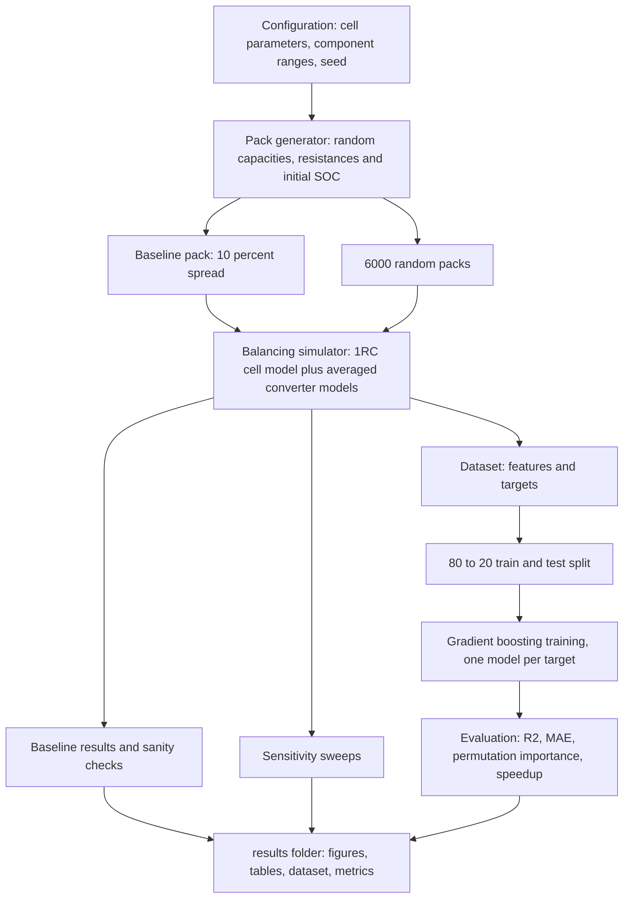

## e. Cell model

Each cell is an LG HG2 18650 (about 2.8 Ah at C/20), modelled as a first-order Thevenin equivalent circuit. An ideal voltage source gives the open circuit voltage, which depends on state of charge. A series resistor R0 captures the instant voltage drop when current flows. One parallel R1 and C1 pair captures the slower voltage change that builds up over tens of seconds.

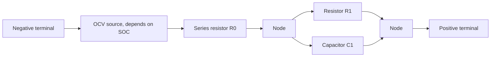

The terminal voltage is the OCV minus the drop across R0 and across the RC pair:

$$
V = \text{OCV}(\text{SOC}) - i \, R_0 - V_1
$$

The voltage across the RC pair relaxes toward i·R1 with time constant τ:

$$
\frac{dV_1}{dt} = -\frac{V_1}{R_1 C_1} + \frac{i}{C_1}, \qquad \tau = R_1 C_1
$$

Over one simulation step Δt the current is held constant, which gives an exact update that stays stable for any step size:

$$
V_1[k+1] = V_1[k] + \left(1 - e^{-\Delta t / \tau}\right)\left(i \, R_1 - V_1[k]\right)
$$

State of charge follows from coulomb counting:

$$
\text{SOC}(t) = \text{SOC}_0 - \frac{1}{3600 \, Q} \int_0^t i \, dt
$$

| Symbol | Meaning | Unit | Value in this project |
| --- | --- | --- | --- |
| $V$ | Terminal voltage | V | |
| $\text{OCV}$ | Open circuit voltage, from a 101-point table measured at C/20 (2.88 V at 0 % to 4.19 V at 100 %) with PCHIP smoothing | V | about 3.74 V at 50 % |
| $\text{SOC}$ | State of charge | fraction, 0 to 1 | starts near 0.5 |
| $i$ | Cell current, positive when discharging | A | |
| $R_0$ | Series (ohmic) resistance | Ω | 11.6 mΩ, ± 10 % cell to cell (assumed) |
| $R_1$ | Polarisation resistance | Ω | 35.2 mΩ (two measured branches combined, section o) |
| $C_1$ | Polarisation capacitance | F | 919 F |
| $V_1$ | Voltage across the RC pair | V | starts at 0 V (cell at rest) |
| $\tau$ | Time constant of the RC pair | s | 32 s |
| $\Delta t$ | Simulation step | s | 1 s |
| $Q$ | Cell capacity | Ah | 2.78 Ah, ± 5 % cell to cell (assumed) |
| $3600$ | Seconds per hour, converting Ah to coulombs | s/h | |

The pack is 4 cells in series at rest, with no external load. For each pack, capacities are drawn within ± 5 % and R0 within ± 10 % of nominal. The four initial SOCs are spread around 50 % with a max-minus-min spread between 2 % and 10 %.

## f. Balancing techniques

All three techniques are simulated with averaged models at a fixed 1 s step. A run stops when the SOC spread falls below 1 %, or at a 48 h cap; no run reached the cap. For every technique the same energy bookkeeping is used, counted as chemical energy (OCV times current):

$$
E_\text{removed} = \int \sum_\text{sources} \text{OCV}_s \, I_s \, dt, \qquad
E_\text{delivered} = \int \sum_\text{sinks} \text{OCV}_k \, I_k \, dt
$$

$$
E_\text{dissipated} = E_\text{removed} - E_\text{delivered}, \qquad
\eta = \frac{E_\text{delivered}}{E_\text{removed}}
$$

Here $\text{OCV}_s$, $I_s$ are the open circuit voltage (V) and current (A) of each cell giving up charge. $\text{OCV}_k$, $I_k$ are the same quantities for each cell receiving charge. $E$ is energy in joules and $\eta$ is efficiency (dimensionless). Because the bookkeeping uses chemical energy, the dissipated energy includes both the balancing circuit losses and the cells' own resistive losses.

### Passive shunt balancing

**Principle.** Every cell has a resistor and a MOSFET switch across it. When a cell's SOC is above the pack average, its switch closes and the resistor drains current from it until it drops to the level of the others. The excess charge is simply turned into heat.

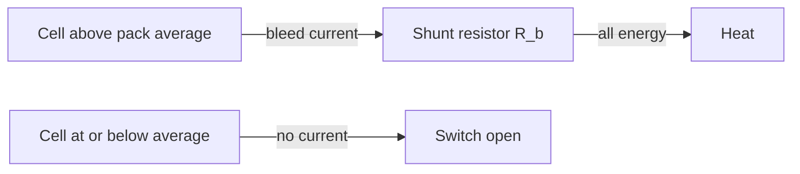

The resistor sees the cell's terminal voltage, so the bleed current and resistor loss are:

$$
I = \frac{V}{R_b} = \frac{\text{OCV} - V_1}{R_b + R_0}, \qquad P_\text{loss} = I^2 R_b
$$

| Symbol | Meaning | Unit |
| --- | --- | --- |
| $I$ | Bleed current | A |
| $V$ | Cell terminal voltage | V |
| $R_b$ | Bleed (shunt) resistance | Ω |
| $\text{OCV}$, $V_1$, $R_0$ | Cell quantities from section e | V, V, Ω |
| $P_\text{loss}$ | Power turned into heat in the resistor | W |

**Advantages:** very simple, cheap and small. Control is a single on or off decision per cell, and it is used in most production BMS designs.

**Drawbacks:**
- All excess energy is wasted as heat, so efficiency is 0 %.
- Balancing is slow, because the bleed current must stay small to limit heat.
- It can only lower the fuller cells, never raise the emptier ones.

**Range used:** R_b from 20 Ω to 100 Ω, which gives bleed currents of about 185 mA down to 37 mA.

### Inductor buck-boost balancing

**Principle.** A small buck-boost converter sits between each pair of neighbouring cells, three converters for four cells. In the first part of each switching cycle a MOSFET connects the fuller cell across an inductor, and current ramps up as energy builds in the inductor's magnetic field. The MOSFET then opens and the inductor current flows into the neighbouring cell, ramping down to zero. Charge reaches distant cells by passing along the chain. A link switches on only when its two cells differ by more than 0.2 % SOC.

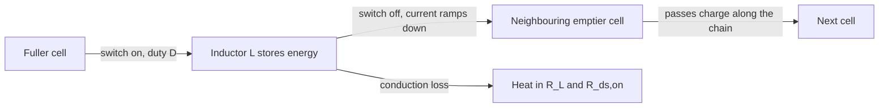

In discontinuous conduction mode the peak and average source currents are:

$$
I_\text{pk} = \frac{V_\text{src} \, D \, T_s}{L}, \qquad
I_\text{avg} = \frac{V_\text{src} \, D^2 \, T_s}{2L} = \frac{D}{2} \, I_\text{pk}, \qquad T_s = \frac{1}{f}
$$

The inductor releases its energy into the sink cell over a second interval, and the conduction loss follows from the RMS value of the two triangular current pulses:

$$
D_2 = D \, \frac{V_\text{src}}{V_\text{sink}}, \qquad
P_\text{cond} = \left(R_L + R_\text{ds,on}\right) I_\text{pk}^2 \, \frac{D + D_2}{3}
$$

$$
P_\text{out} = V_\text{src} \, I_\text{avg} - P_\text{cond}
$$

| Symbol | Meaning | Unit | Value or range |
| --- | --- | --- | --- |
| $V_\text{src}$, $V_\text{sink}$ | Terminal voltage of the giving and receiving cell | V | about 3.7 V |
| $D$ | Duty cycle of the charging switch | dimensionless | 0.4 |
| $D_2$ | Fraction of the period the inductor spends discharging | dimensionless | about 0.4 |
| $T_s$ | Switching period | s | 20 µs to 100 µs |
| $f$ | Switching frequency | Hz | 10 kHz to 50 kHz |
| $L$ | Inductance | H | 10 µH to 100 µH |
| $I_\text{pk}$ | Peak inductor current | A | |
| $I_\text{avg}$ | Average current drawn from the source cell | A | 0.06 A to 3 A |
| $R_L$ | Inductor winding (parasitic) resistance | Ω | 80 mΩ |
| $R_\text{ds,on}$ | MOSFET on resistance | Ω | 20 mΩ |
| $P_\text{cond}$ | Conduction loss | W | |
| $P_\text{out}$ | Power delivered into the sink cell | W | |

**Advantages:**
- Fast, because currents of hundreds of milliamps to amps are possible.
- High efficiency, 96.4 % at mid-range values.
- Transfer does not depend on the voltage difference, so it stays fast right to the end.

**Drawbacks:**
- The most components and the highest cost: inductors, MOSFETs and gate drivers.
- The most complex control: PWM, direction selection and current limits.
- Magnetic components are bulky.
- At small L·f products the peak currents become large and efficiency drops sharply (47 % in the worst dataset case).

**Ranges used:** L from 10 µH to 100 µH, f from 10 kHz to 50 kHz and D fixed at 0.4. The inductor resistance is 80 mΩ and the MOSFET on resistance 20 mΩ.

### Flying capacitor balancing

**Principle.** A capacitor is switched back and forth between two neighbouring cells, three capacitors for four cells. Connected to the fuller cell, it charges to that cell's voltage. Connected to the emptier cell, it discharges into it. Each cycle moves a packet of charge proportional to the voltage difference. As the cells converge, the difference shrinks and so does the current, which is why this technique slows down sharply near the end.

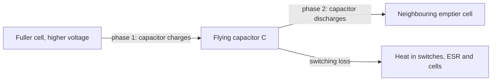

The average current is the charge moved per cycle times the number of cycles per second. The midsem model treated the capacitor as settling to the full voltage difference in every phase, with the loop resistances simply added in series:

$$
I = \frac{\Delta E}{\dfrac{1}{f C} + R_s}, \qquad R_s = 2 R_\text{ds,on} + R_\text{ESR} + R_{0,a} + R_{0,b}
\qquad \text{(midsem formula, `FlyingCapModel.MIDSEM`)}
$$

Phase 2 showed that this is only right when the capacitor settles completely in each half period (the slow-switching limit). At the baseline point (5.5 mF, 5.5 kHz) the phase resistance $R = R_0 + 2R_\text{ds,on} + R_\text{ESR} = 36.6$ mΩ gives a time constant $RC = 0.20$ ms, which is longer than the half period of 0.091 ms. The link is in the fast-switching limit, where the capacitor never settles and the resistance in the loop limits the current much more than $1/(fC)$ does.

**Two-phase derivation.** Let the capacitor be connected to cell a (voltage $V_a$, phase resistance $R_1 = R_{0,a} + 2R_\text{ds,on} + R_\text{ESR}$) for half a period $T/2 = 1/(2f)$, then to cell b ($V_b$, $R_2 = R_{0,b} + 2R_\text{ds,on} + R_\text{ESR}$) for the other half. In each phase the capacitor voltage relaxes exponentially towards the connected cell, so with $a_i = e^{-1/(2 f R_i C)}$:

$$
v_\text{after a} = V_a + (v_0 - V_a)\,a_1, \qquad v_0 = V_b + (v_\text{after a} - V_b)\,a_2
$$

The periodic steady state is $v_0 = \dfrac{V_b (1-a_2) + V_a a_2 (1-a_1)}{1 - a_1 a_2}$. The charge drawn from cell a per period is $Q = C(1-a_1)(V_a - v_0)$, which simplifies to $Q = C\,\dfrac{(1-a_1)(1-a_2)}{1-a_1 a_2}\,\Delta V$, so the mean current is $I = f Q = \Delta V / R_\text{eq}$ with

$$
R_\text{eq} = \frac{1}{f C}\,\frac{1 - a_1 a_2}{(1-a_1)(1-a_2)} = \frac{1}{f C}\left(\frac{1}{1-a_1} + \frac{1}{1-a_2} - 1\right)
$$

For equal phase resistances this is $R_\text{eq} = 1 / \bigl(f C \tanh(1/(4 f R C))\bigr)$. It tends to $1/(fC)$ at low frequency (slow-switching limit) and to $4R$, or $2(R_1 + R_2)$ for unequal phases, at high frequency (fast-switching limit). These two limits correspond to the slow- and fast-switching limits discussed in M. D. Seeman and S. R. Sanders, "Analysis and optimization of switched-capacitor DC-DC converters," IEEE Transactions on Power Electronics, 2008. The exact two-phase interpolation between the limits is derived here, not taken from the paper, and is verified against SPICE in section p.

$R_\text{eq}$ already contains both cell resistances, the switches and the ESR, so there is no separate series term. The energy dissipated per link is $I \Delta E = I^2 R_\text{eq}$ whatever the current waveform. The simulator books $I^2 (R_\text{eq} - R_{0,a} - R_{0,b})$ as converter loss and the cell resistances with the mean link current, as before.

$$
I = \frac{\Delta E}{R_\text{eq}}, \qquad \Delta E = (\text{OCV}_a - V_{1,a}) - (\text{OCV}_b - V_{1,b})
\qquad \text{(default, `FlyingCapModel.TWO_PHASE`)}
$$

| Symbol | Meaning | Unit | Value or range |
| --- | --- | --- | --- |
| $I$ | Average transfer current | A | |
| $f$ | Switching frequency | Hz | 1 kHz to 10 kHz |
| $C$ | Flying capacitance | F | 1 mF to 10 mF |
| $\Delta V_c$ | Voltage swing on the capacitor per cycle | V | |
| $\Delta E$ | Difference in internal cell voltage between cells a and b | V | about 60 mV at 10 % SOC difference |
| $R_s$ | Series resistance of the midsem formula | Ω | about 0.048 Ω |
| $R_\text{eq}$ | Equivalent link resistance of the two-phase formula | Ω | 0.149 Ω at 5.5 mF and 5.5 kHz |
| $R_\text{ds,on}$ | MOSFET on resistance | Ω | 10 mΩ |
| $R_\text{ESR}$ | Capacitor equivalent series resistance | Ω | 5 mΩ |
| $R_{0,a}$, $R_{0,b}$ | Series resistance of the two cells | Ω | about 11.6 mΩ each |

**Advantages:**
- Highest efficiency (99.4 % at mid-range values), because losses scale with the square of a small voltage difference.
- No magnetics and simple fixed-clock control.
- Self-regulating, because current automatically stops when the cells are equal.

**Drawbacks:**
- Balancing slows sharply as the voltage difference shrinks, especially on the flat middle part of the NMC OCV curve.
- Current is limited when cells have similar voltage but different SOC.
- Large capacitors are needed.

**Ranges used:** C from 1 mF to 10 mF and f from 1 kHz to 10 kHz. The MOSFET on resistance is 10 mΩ and the capacitor ESR 5 mΩ.

## g. Comparison

Baseline results for the same pack, which starts with a 10 % SOC spread, using mid-range component values. Component counts are for a 4-cell pack in the adjacent-cell layouts simulated here. Cost and control complexity are qualitative engineering judgements.

| Property | Passive shunt | Inductor buck-boost | Flying capacitor |
| --- | --- | --- | --- |
| Component values | R_b = 60 Ω | L = 55 µH, f = 30 kHz | C = 5.5 mF, f = 5.5 kHz |
| Balancing time | 4.19 h (15068 s) | **1.07 h** (3845 s) | 1.96 h (7069 s) |
| Energy dissipated | 7176 J | 199.9 J | **29.9 J** |
| Efficiency | 0 % | 96.5 % | **99.4 %** |
| Time for last 2 % vs first 2 % of spread | 1.0x | 2.7x | 7.5x |
| Component count | 4 resistors, 4 MOSFETs | 3 inductors, 6 MOSFETs | 3 capacitors, 8 MOSFETs |
| Cost | Low | High | Medium |
| Control complexity | Low: on or off per cell | High: PWM, direction and current limits per link | Low to medium: fixed complementary clock |

Across all 6000 dataset runs, the median balancing time was 1.92 h for passive, 0.30 h for buck-boost and 0.89 h for flying capacitor. The median dissipated energy was 3516 J, 88.0 J and 10.0 J respectively. These numbers and the table above use the fitted parameters; the midsem table is in `results/midsem_reference/baseline_table.csv`.

## h. ML predictor

**What it predicts and why.** Given a pack's state and a candidate balancing circuit, the model predicts how long balancing will take and how much energy it will waste. A real BMS could use this to choose, schedule or tune balancing in real time without running a physics simulation. For example, it could decide whether there is enough parking time to finish balancing, or which of several balancing modes costs the least energy.


**How the dataset is generated.** For each technique, 2000 random packs are created. Each pack's capacities, resistances and initial SOCs are sampled as described in section e. A component value and switching frequency are drawn uniformly from that technique's range. All 2000 packs are simulated together in one vectorized batch, and each pack drops out of the batch as soon as it balances. This takes about 3.6 ms per pack, while the trained model predicts both targets for a pack in about 38 µs (the best of 20 timed repeats).

**Features (model inputs):**

| Feature | Meaning | Unit |
| --- | --- | --- |
| `soc_spread` | Highest minus lowest initial SOC | fraction |
| `soc_std` | Standard deviation of the four initial SOCs | fraction |
| `soc0_1` to `soc0_4` | Initial SOC of each cell, which tells the model where the high and low cells sit in the string | fraction |
| `capacity_1_ah` to `capacity_4_ah` | Capacity of each cell | Ah |
| `r0_1_ohm` to `r0_4_ohm` | Series resistance of each cell | Ω |
| `is_passive`, `is_buck_boost`, `is_flying_capacitor` | One-hot technique flags | 0 or 1 |
| `component_value` | R_b in Ω, L in H or C in F, depending on technique | SI unit |
| `switching_frequency_hz` | Converter switching frequency, 0 for passive | Hz |

**Targets (model outputs):** `balancing_time_s` (seconds until the SOC spread falls below 1 %) and `energy_dissipated_j` (joules turned into heat).

**How gradient boosting works.** The first small decision tree makes a rough guess. The next tree is trained to predict what the first one got wrong, and its correction is added on with a small weight (the learning rate, 0.05). This repeats 500 times. Each tree is simple, but together they model complex, non-linear relationships. The project uses scikit-learn's `HistGradientBoostingRegressor`, one model per target. Because balancing time and energy span several orders of magnitude (from under 1 J to over 10 kJ), each model learns the logarithm of its target. That way small and large values are fitted with equal care.

**Why R² and MAE.**
- **R²** is scale-free and answers "how much of the variation does the model explain?" This makes it comparable across targets with different units.
- **MAE** is in physical units (seconds or joules) and answers "how far off is a typical prediction?" This is what an engineer needs to judge usefulness.

Reporting both, overall and per technique, shows whether a high overall score hides a weak technique.

| Target | Overall | Passive | Buck-boost | Flying capacitor |
| --- | --- | --- | --- | --- |
| Balancing time R² | 0.973 | 0.994 | 0.959 | 0.888 |
| Balancing time MAE | 415 s | 292 s | 181 s | 771 s |
| Energy dissipated R² | 0.995 | 0.984 | 0.954 | 0.996 |
| Energy dissipated MAE | 72.9 J | 201 J | 17.4 J | 0.1 J |

**How to read the feature importance plot.** Each bar shows how much the test R² drops when that one input is randomly shuffled, which breaks its link to the target. A long bar means the model depends heavily on that input. A bar near zero means the model barely uses it. The black whisker shows the variation over 10 shuffles. Importance reflects what *this model* relies on, not physical causation. When two inputs carry overlapping information, such as SOC spread and SOC standard deviation, the credit is shared between them.

## i. Results

The narrative below was written for the midsem `ASSUMED` run. The qualitative behaviour is unchanged with the fitted parameters; the quoted times and ratios are the midsem ones (fitted values are in section g and `results/metrics.json`).

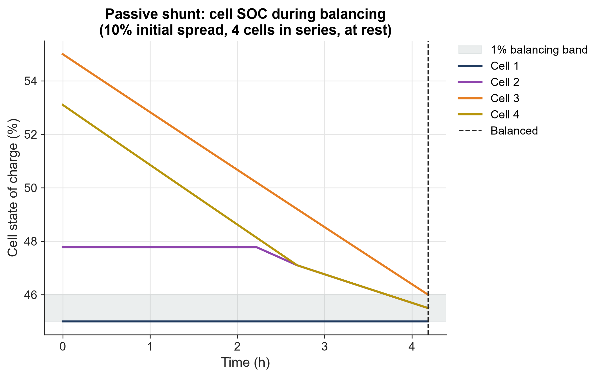

The fuller cells (3 and 4) bleed down at a nearly constant rate while the emptiest cell (1) stays still. Cell 2 joins in once the falling pack average passes it. Passive balancing works by lowering everyone to the weakest cell's level, and it takes 4.56 h to reach the shaded 1 % band.

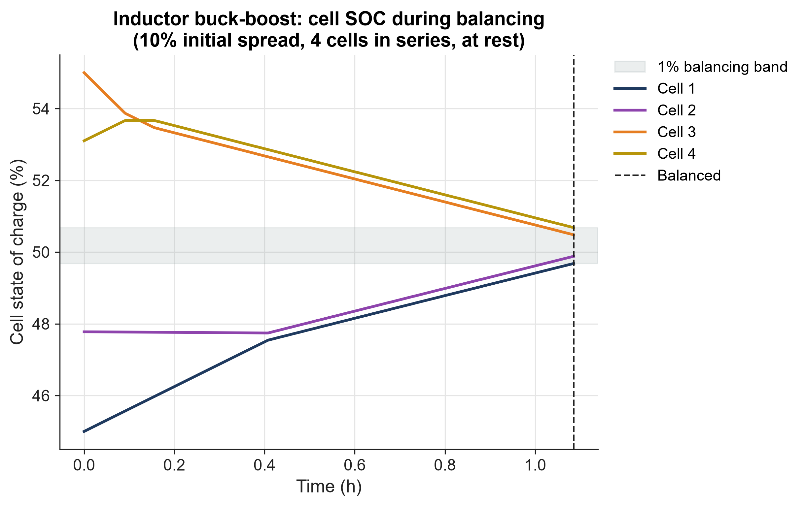

Charge flows from cells 3 and 4 into cells 1 and 2 at a steady rate. The kinks show neighbouring links switching on or off as cells cross each other. All cells meet near the pack average in 1.17 h, the fastest of the three, because the transfer current does not depend on how close the cells already are.

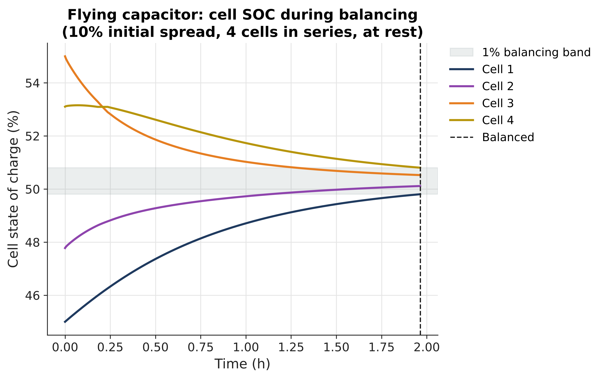

The curves bend like exponential decays. They move fast at first, then flatten as the voltage differences driving the current shrink. The cells converge toward the average without charge being thrown away, balancing in 2.54 h.

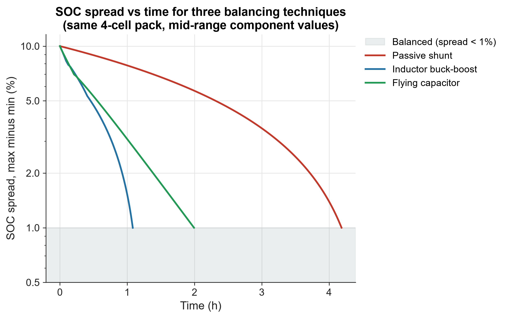

On a logarithmic scale the flying capacitor is a straight line, which confirms exponential decay: its last 2 % of spread takes 8.3 times longer than its first 2 % in the midsem run (7.5 times with the fitted parameters and the two-phase formula). Passive and buck-boost curves bend downward instead, because their current stays roughly constant. The buck-boost is fastest overall and passive is slowest.

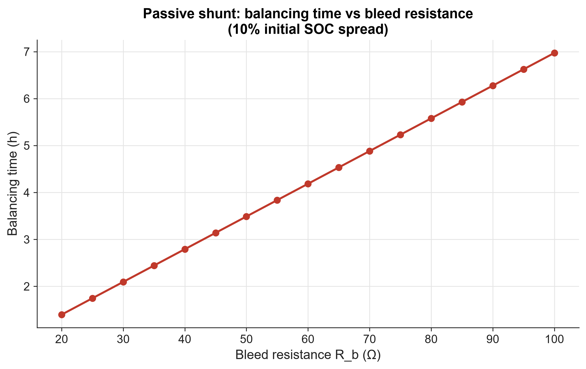

Balancing time rises linearly with bleed resistance, from 1.52 h at 20 Ω to 7.59 h at 100 Ω, because bleed current is inversely proportional to R_b. A smaller resistor balances faster but must dissipate more power as heat at any one moment.

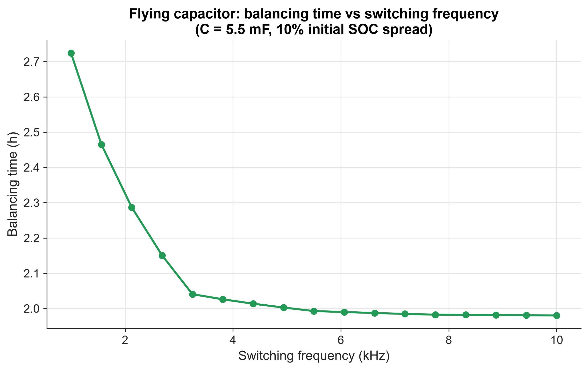

In the midsem run, raising the frequency from 1 kHz to 10 kHz cut balancing time from 5.44 h to 2.25 h, with diminishing returns. With the fitted parameters and the two-phase formula the time falls from 2.70 h at 1 kHz to 1.94 h at 10 kHz (the plot in `results/` is the current one). Above a few kHz the link is in the fast-switching limit, where the equivalent resistance tends to the constant 4R and further frequency increases barely help.

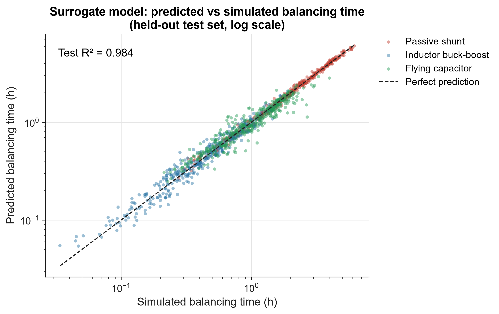

Each point is one test pack the model never saw during training. Points on the dashed line are perfect predictions. Passive and buck-boost points hug the line, while flying capacitor points scatter more, because their exponential tail makes the time sensitive to small differences.

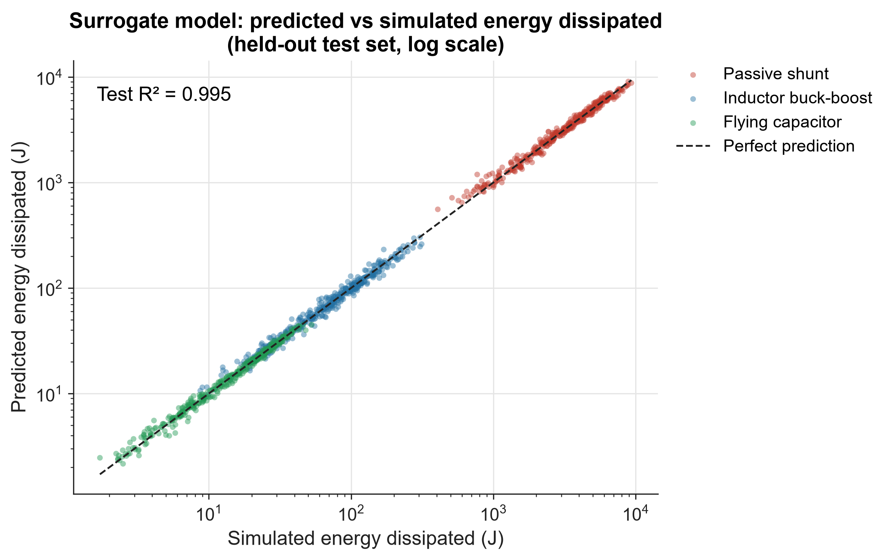

Energy is predicted almost perfectly (R² = 0.995) across four orders of magnitude, from under 1 J to about 10 kJ. The three techniques form separate clusters: flying capacitor at the bottom, buck-boost in the middle and passive at the top.

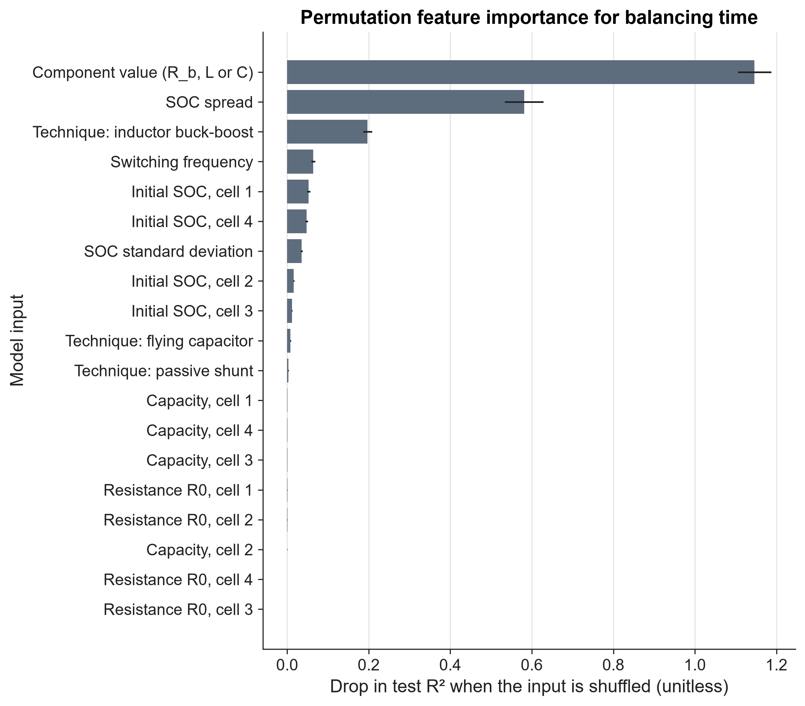

The component value (R_b, L or C) matters most for balancing time, followed by the SOC spread, the technique and the switching frequency. The individual cell SOCs, especially of the end cells 1 and 4, add useful information about how far charge has to travel along the chain. Cell capacities and resistances barely matter within their ± 5 % and ± 10 % tolerances.

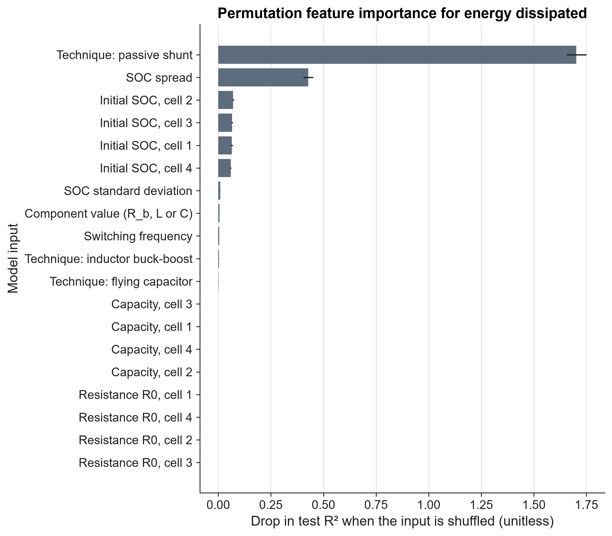

Whether the technique is passive dominates energy, because in the dataset passive wastes a median of about 40 times more than the buck-boost and about 550 times more than the flying capacitor. The SOC spread and the individual cell SOCs come next, since together they set how much charge has to be removed or moved.

## j. Limitations

- **Simulated data only.** The dataset and all results come from models, not from measurements on real cells or real balancing hardware. The ML model is only as accurate as the simulator it imitates.
- **Averaged models.** Converters are represented by their average current and simplified conduction losses, not switching-level waveforms. Gate drive losses, switching transition losses, core losses, dead time and EMI are not modelled.
- **Pack at rest.** Balancing is simulated with no load current. In a vehicle, balancing usually happens while driving or charging, where the load current, voltage sag and SOC estimation error all interact with the balancer.
- **Fixed temperature.** All parameters are for one temperature. In reality internal resistance, capacity and the OCV curve all change with temperature, and balancing losses heat the pack.
- **Other simplifications:**
  - Each cell's SOC is assumed to be known exactly.
  - Cell parameters do not change with SOC or age.
  - Only adjacent-cell topologies are compared.
  - The pack has only four cells.
- **Shared cell resistance in the active links (found in endsem Phase 0).** The averaged buck-boost and flying-capacitor link equations each use the cell's R0 as if that link were the only current through the cell. A middle cell that feeds both neighbours, or passes charge through, really carries the net current, so the R0 loss the model books (R0 times the sum of the squared link currents) differs from the physical loss (R0 times the squared net current). The reported dissipated energy is therefore only as good as this approximation: at baseline it is 220.8 J vs 212.3 J from a net-current ledger for the buck-boost (3.9 %), and 20.5 J vs 15.3 J for the flying capacitor (25 %). See section n. Phase 2 did not change this: with the two-phase flying-capacitor formula the per-link ledger of that technique closes to 0.055 % of the dissipated energy, but the net-current ledger still differs from the reported dissipation by 9.5 % (flying capacitor) and 2.1 % (buck-boost) in the worst of 200 random packs, because the shared cell resistance is still booked per link.

## k. Future work

- **Balancing under drive cycle load:** run the balancers while the pack follows standard driving profiles such as WLTP or UDDS, to see how load current changes their speed and losses.
- **GRU-based SOC estimator:** replace the ideal SOC with a gated recurrent unit neural network that estimates SOC from measured voltage, current and temperature, and study how estimation error affects balancing decisions.
- **Closed-loop technique selection:** connect the surrogate model to the BMS so that it predicts time and energy for each available balancing mode in real time and picks the best one for the current pack state and available time.
- **Reinforcement learning control:** train an agent to choose which links to activate and at what current, learning a policy that trades balancing speed against energy loss better than fixed rules.

## l. How to run

Requires Python 3.13 or newer. It's best to install into a virtual environment:

```bash
pip install -r requirements.txt
```

```bash
python run_all.py
```

To run the tests, the linter and the claims report, install the development requirements:

```bash
pip install -r requirements-dev.txt
```

```bash
python -m pytest
```

```bash
ruff check . && ruff format --check .
```

```bash
python scripts/report_claims.py
```

To re-download and re-fit the measured cell data of section o (needs network access, about 47 MB; the raw files go to the git-ignored `data/raw/hg2/`):

```bash
python scripts/fetch_hg2.py
```

```bash
python -m scripts.identify_hg2
```

To re-run the converter check of section p (needs LTspice or another SPICE; the driver looks for LTspice in its default install folders and prints install steps if it finds nothing), and to verify the vendor datasheet files used for the range checks (needs network access for a missing file; the TI file downloads from a script, the Analog Devices server did not respond, so save that PDF from the vendor page into `data/raw/datasheets/` yourself):

```bash
python -m scripts.run_spice
```

```bash
python scripts/fetch_datasheets.py
```

`run_all.py` never downloads anything and never calls a circuit simulator. It reads the small committed files in `data/processed/` written by those scripts (`spice_measurements.json` holds the LTspice results), and marks the stages that need them `"status": "not_run"` if they are missing, or `"stale_cache"` if the parameters changed since the SPICE run.

The run reproduces every result from the committed inputs and takes about 2 to 2.5 minutes on a typical laptop CPU. The physics checks of section n run in a second process alongside the dataset generation, model training and the evaluation of section q, which uses a few parallel workers. It prints a short summary and writes everything into `results/`, creating the folder if needed. The seed is fixed, so two consecutive runs give a byte-identical `metrics.json`, identical CSV files and identical figures. All wall-clock measurements go to `timing.json`, which is the only output that changes between runs.

| Output file | Content |
| --- | --- |
| `soc_passive.png`, `soc_buck_boost.png`, `soc_flying_capacitor.png` | Baseline per-cell SOC vs time for each technique |
| `soc_spread_comparison.png` / `.svg` | SOC spread vs time for all three techniques |
| `sweep_passive_r_bleed.png` / `.svg` | Passive balancing time vs bleed resistance |
| `sweep_flying_capacitor_frequency.png` / `.svg` | Flying capacitor balancing time vs switching frequency |
| `ml_parity_balancing_time_s.png` / `.svg` | Predicted vs simulated balancing time |
| `ml_parity_energy_dissipated_j.png` / `.svg` | Predicted vs simulated energy dissipated |
| `ml_importance_balancing_time_s.png` | Permutation feature importance for balancing time |
| `ml_importance_energy_dissipated_j.png` | Permutation feature importance for energy dissipated |
| `baseline_table.csv` | Balancing time, energy dissipated and efficiency per technique |
| `dataset.csv` | 6000 simulated runs: features, targets, technique code, efficiency and a balanced flag |
| `metrics.json` | Baseline table, sanity checks, sweep data, ML metrics per technique and physics checks (deterministic; no timings) |
| `timing.json` | Simulation and prediction time per pack, speedup, per-method latency at batch 1 and 1000, physics-check and total runtime (machine dependent) |
| `baseline_assumed_vs_fitted.csv` / `.png` | Baseline time, energy and efficiency with the assumed and the fitted parameters |
| `hg2_raw_overview.png`, `hppc_params_vs_soc.png`, `cell_validation_udds.png`, `cell_validation_summary.png` | Measured-data overview, fitted parameters vs SOC, UDDS validation trace and RMSE per drive cycle (written by `scripts/identify_hg2.py`) |
| `ml_cv_comparison.png`, `ml_out_of_range.png`, `ml_conformal_coverage.png` | Cross-validated MAE of the four models, out-of-range predictions, conformal coverage (section q) |
| `spice_vs_averaged.csv` / `.png` | LTspice vs averaged-model currents and losses at every operating point, parity plot of the mean currents |
| `spice_buckboost_waveform.png`, `spice_flyingcap_waveform.png` | Steady-state LTspice waveforms at the three operating points (written by `scripts/run_spice.py`) |
| `claims.md` | Each claim with its evidence key in `metrics.json`, value, threshold and PASS/FAIL/NOT RUN/NOT SUPPORTED (written by `scripts/report_claims.py`) |
| `midsem_reference/` | Read-only copy of the midsem outputs for before/after comparison |

All PNG figures are 300 dpi, and all figures are saved with empty metadata.

## m. Project structure

```text
.
├── .gitattributes               Line ending normalisation for text files
├── .gitignore                   Excludes Python caches and virtual environments
├── README.md                    This document
├── pyproject.toml               ruff and pytest configuration
├── requirements.txt             Pinned versions of the four libraries used
├── requirements-dev.txt         Adds pinned pytest and ruff
├── run_all.py                   Runs the full pipeline and writes every output
├── src/
│   ├── __init__.py              Marks src as a Python package
│   ├── params.py                Frozen parameter dataclasses and the ASSUMED parameter set
│   ├── fitted.py                Loads FITTED_HG2_25C from data/processed/hg2_25c_params.json
│   ├── hg2.py                   Parser for the measured HG2 cycler CSV files
│   ├── identify.py              OCV extraction, HPPC 1RC and 2RC fits, bootstrap
│   ├── identification.py        Identification pipeline, model selection and validation
│   ├── validate.py              Replay of measured current through a fitted cell model
│   ├── uncertainty.py           Propagation of parameter intervals through the baseline
│   ├── cell_plots.py            Figures for the measured data, fits and validation
│   ├── config.py                Project config (seed, parameter set, specs), constants and plot style
│   ├── cell.py                  1RC Thevenin cell model: OCV curve, RC update, coulomb counting
│   ├── pack.py                  Random 4-cell series pack generation
│   ├── balancing.py             Averaged balancing models and the batched simulator
│   ├── flow.py                  Per-step currents and powers returned by each balancing model
│   ├── ledger.py                Independent element-by-element loss ledger
│   ├── ml_eval.py               Cross-validation, out-of-range, conformal and ablation protocols and timing
│   ├── ml_plots.py              Figures for the ML evaluation
│   ├── switched_cap.py          Midsem and two-phase flying-capacitor link resistance
│   ├── spice.py                 Netlist generation, LTspice raw-file reader and period averaging
│   ├── spice_check.py           Averaged-vs-SPICE comparison, hypothesis test and datasheet range checks
│   ├── spice_plots.py           SPICE waveform and parity figures
│   ├── baselines.py             Closed-form physics baselines (passive balancing time)
│   ├── checks.py                Physics checks written to metrics.json
│   ├── experiments.py           Seeded random streams, baseline pack and baseline runs
│   ├── dataset.py               Randomized dataset generation with features and targets
│   ├── predictor.py             Gradient boosting training, metrics, importance and timing
│   └── plots.py                 Shared figure style and every chart
├── spice/                       Generated LTspice netlists, one per checked operating point
├── scripts/
│   ├── fetch_datasheets.py      Verifies the vendor datasheet files and records them in provenance.json
│   ├── run_spice.py             Generates netlists, runs LTspice and caches the measurements
│   ├── fetch_hg2.py             Verified download of the 25 °C HG2 files into data/raw/hg2
│   ├── identify_hg2.py          Fits and validates the cell model, writes data/processed and figures
│   └── report_claims.py         Writes results/claims.md from results/metrics.json
├── data/
│   ├── raw/                     Downloaded dataset files (git-ignored)
│   └── processed/               provenance.json, fitted parameters, identification summary, bootstrap samples, SPICE measurements, datasheet values
├── tests/                       pytest suite (ledger, closed form, charge, regression, determinism)
└── results/
    ├── baseline_table.csv       Baseline comparison table
    ├── dataset.csv              Simulated training data
    ├── metrics.json             All deterministic numeric results
    ├── timing.json              Wall-clock timings (not deterministic)
    ├── claims.md                Generated claims table
    ├── midsem_reference/        Read-only midsem outputs
    ├── soc_*.png                Baseline SOC traces and spread comparison
    ├── sweep_*.png / .svg       Sensitivity sweeps
    └── ml_*.png / .svg          Model parity and feature importance charts
```

## n. Verification checks (endsem Phase 0)

The numbers in this section were measured in Phase 0 under the `ASSUMED` parameter set (with the midsem flying-capacitor formula). The checks are re-run on every `run_all.py` under whichever set is active (now the fitted one); current values are in `results/metrics.json` and `results/claims.md`.

Phase 0 freezes the midsem behaviour and adds automated physics checks before any physics is changed. No model equation was changed: under the `ASSUMED` parameter set every baseline time, energy and efficiency, every sweep point and every ML metric equals the midsem values exactly (`results/midsem_reference/`, test `test_midsem_regression`).

**Parameters.** All physical and numerical parameters now live in frozen dataclasses in `src/params.py` (`CellParams`, `OCVTable`, `PackSpec`, `PassiveSpec`, `BuckBoostSpec`, `FlyingCapSpec`, `SimSpec`, `MLSpec`, `CheckSpec`), grouped into a named `ParameterSet`. `ASSUMED` holds the midsem values; since Phase 1 the default is `FITTED_HG2_25C` (section o).

**Control rules as implemented.**

- Passive: at every step each cell whose SOC is strictly above the pack mean bleeds through R_b, with I = (OCV - V1) / (R_b + R0), which is the terminal voltage over R_b. The lowest cell is never above the mean, so it never bleeds, and the highest cell always bleeds. Cells that start below the mean join in once the falling mean passes them. In effect every cell drains to within 1 % of the lowest cell.
- Buck-boost and flying capacitor: each adjacent link is on when its two cells differ by more than 0.2 % SOC (the deadband applies to both active schemes) and moves charge from the higher-SOC cell to the lower one.
- Stop: when max SOC minus min SOC is below 1 %, checked at the start of each 1 s step, or at the 48 h cap.

**Independent loss ledger.** Alongside the existing E_dissipated = E_removed - E_delivered, the simulator now integrates I²R over every resistive element the model contains: the bleed resistor, the inductor resistance and switch on-resistance over the on and demagnetising intervals, the switch on-resistance, ESR and 1/(fC) term of the flying capacitor, each cell's R0 on its net current, and the R1 branch as V1²/R1 (integrated exactly over each step for the zero-order-hold current). It adds the energy left in each C1 (½·C1·V1²) at the end.

| Baseline (J) | Removed - delivered | Net-current ledger | Converter or bleed elements | Cell R0, net current | Cell R0, booked per link | R1 branch | C1 stored |
| --- | --- | --- | --- | --- | --- | --- | --- |
| Passive | 7679.87 | 7679.87 | 7674.09 | 4.06 | 4.06 | 1.72 | 0.001 |
| Buck-boost | 220.85 | 212.30 | 199.46 | 9.75 | 18.33 | 3.08 | 0.007 |
| Flying capacitor | 20.50 | 15.35 | 8.82 | 4.45 | 9.60 | 2.08 | 0.000 |

Over 200 seeded random packs per technique (random component values and frequencies in range):

| Technique | max discrepancy / E_removed (threshold 1 %) | max discrepancy / E_dissipated | median / E_dissipated | per-link ledger, max / E_dissipated |
| --- | --- | --- | --- | --- |
| Passive | 0.0002 % (PASS) | 0.0002 % | 0.00005 % | 0.0002 % |
| Buck-boost | 0.70 % (PASS) | 5.4 % | 2.2 % | 0.038 % |
| Flying capacitor | 0.19 % (PASS) | 34 % | 8.4 % | 0.030 % |

The specified check (relative to E_removed) passes for all three techniques. Measured relative to the much smaller dissipated energy, the active schemes do not close. The cause is identified exactly: when R0 is booked per link, as the averaged link equations do, the ledger matches removed minus delivered to 0.04 % or better. The gap is therefore not numerical. Each link equation treats the cell's R0 as carrying only that link's current, while a middle cell carries the net current of both links. The flying capacitor is hit hardest because the two cell R0 values are more than half of its link resistance. A coupled solution of the link currents through the shared R0 would remove the inconsistency; it is a physics change and was not made in Phase 2 either (see section p).

Time-step dependence (20 packs per technique; max discrepancy relative to E_removed):

| Technique | Ledger | dt = 1 s | dt = 0.5 s | dt = 0.25 s |
| --- | --- | --- | --- | --- |
| Passive | net = per link | 2.1e-6 | 1.1e-6 | 5.3e-7 |
| Buck-boost | per link | 9.5e-5 | 4.7e-5 | 2.4e-5 |
| Buck-boost | net | 6.2e-3 | 6.2e-3 | 6.3e-3 |
| Flying capacitor | per link | 1.3e-6 | 6.3e-7 | 3.1e-7 |
| Flying capacitor | net | 1.4e-3 | 1.4e-3 | 1.4e-3 |

The numerical part halves each time dt halves (first order, from evaluating OCV and V1 at the start of each step), while the shared-R0 part does not depend on dt.

**Passive closed form.** The highest cell bleeds without interruption, and a cell that starts below the mean has less to drain. So the balancing time is set by the slowest cell draining continuously from SOC_i to SOC_min + 1 %. With dSOC/dt = -OCV(SOC) / (3600·Q_i·(R_b + R0_i + R1)) once the RC branch has settled (τ = 30 s):

t = max over cells of 3600·Q_i·(R_b + R0_i + R1) · ∫ dSOC / OCV(SOC), from SOC_min + 0.01 to SOC_i

evaluated with the simulator's own OCV curve (`src/baselines.py`). Baseline: 16399.1 s vs 16400 s simulated (0.005 %). Over 200 random packs and random R_b the maximum error is 0.088 % and the median 0.005 % (threshold 3 %). The largest errors are underestimates, which fits cells that start below the mean pausing before they begin to bleed.

**Charge conservation.** For the flying capacitor, charge leaving source cells equals charge entering sink cells, computed from each cell's Q_i·ΔSOC_i, to 5.0e-13 relative over 200 random packs (threshold 1e-9).

**Determinism.** `metrics.json` no longer contains wall-clock values. The midsem `speedup` block holds a pointer to `timing.json`; the key itself is kept so existing keys are never removed. Two consecutive runs give byte-identical `metrics.json`, CSV files and figures (`test_determinism` checks this on a reduced configuration).

**Effect on runtime.** The ledger adds work to every simulation step. Mean simulation time per pack in the dataset rose from about 3.6 ms to about 4.9 ms on the same laptop, so the midsem speedup figure is not comparable with the current timing file and is listed as not supported in `results/claims.md`.

## o. Fitted cell model (endsem Phase 1)

The tables and the explanation of the flying-capacitor numbers in this section are the Phase 1 results, which used the midsem flying-capacitor link formula. Phase 2 (section p) replaced that formula, so the current flying-capacitor baseline is 7069 s, not 4251 s; the other two techniques are unchanged.

Phase 1 replaces the assumed cell parameters with values fitted to measured data and checks the result against drive cycles that were not used in the fit.

**Data.** "LG 18650HG2 Li-ion Battery Data", McMaster University, Mendeley Data, version 2, DOI 10.17632/b5mj79w5w9.2, licence CC BY 4.0 (Kollmeyer, Naguib and Skells). One new 3 Ah LG HG2 cell, tested on a Digatron cycler with 0.1 % of full scale voltage and current accuracy. `scripts/fetch_hg2.py` lists the folders through the public Mendeley API, downloads the 25 °C files that this project uses plus the readme and technical PDF, and checks HTTP status, size and sha256 against the API listing for all 13 files (47 MB). Results are recorded in `data/processed/provenance.json`. The `Mixed1` to `Mixed8` cycles and the charge files were not downloaded.

**What the files contain.** Discharge current is negative in the cycler CSV files (found from the C/20 discharge). Two things differ from the readme:

- The 25 °C HPPC file holds 12 SOC points, not 15. It ends before the 5 %, 2.5 % and 0 % points; the last block sits at 3 % true SOC. The 5 % SOC steps are defined against 3 Ah, so the measured SOC values (from ampere-hour counting against 2.78 Ah) are 100, 94.6, 89.2, 78.4, 67.6, 56.8, 46.0, 35.2, 24.4, 13.6, 8.2 and 2.8 %.
- `551_HWFET.csv` has zero current for its entire 600 s (voltage constant at 4.185 V). It cannot be replayed, so HWFET is excluded and reported as such in `results/claims.md` and `metrics.json`. The matching `.mat` file (37 kB, sha256 equal to the API listing) was downloaded once for a one-off check and also has current, Ah and power identically zero over its 6002 samples; it is not kept in `data/raw/`.

**Capacity.** C/20 discharge 2.781 Ah (the cycler counter; 2.779 Ah by integrating the current), C/20 charge 2.968 Ah, 1C discharges 2.726 Ah and 2.693 Ah. SOC uses the C/20 discharge capacity. The 6.7 % gap between C/20 discharge and charge throughput is larger than expected for a healthy cell, and the two 1C discharges differ by 1.2 %. The data cannot say whether this is current-measurement offset or cell behaviour, so capacity is treated as uncertain; it is not included in the parameter intervals below.

**OCV.** The C/20 discharge and charge curves are corrected for the R0 drop (one iteration: R0 from the HPPC fit, then OCV, then refit; the table moved by at most 0.7 mV), averaged at equal SOC and resampled to 101 points. The measured endpoints are kept: 2.879 V at 0 % and 4.189 V at 100 %. The charge curve is placed on the SOC axis with its own total charge as denominator. Dividing the charge Ah by the discharge capacity instead, as the method note reads literally, puts the charge curve below the discharge curve between 60 and 90 % SOC (negative hysteresis), which is not physical; that variant gives 2.6 mV at 50 % SOC and is stored in `metrics.json` as a diagnostic. Hysteresis (half the charge-minus-discharge gap) at 50 % SOC is **17.0 mV**. The OCV slope at 50 % SOC is **9.35 mV per % SOC**, against **5.93 mV per % SOC** in the assumed table. The HPPC rest voltages before each 1C pulse differ from the OCV table by at most 40.1 mV and 16.1 mV RMS over the 12 points. This is large, because the HPPC and C/20 tests were counted from separate full charges and rest only one hour per step.

**HPPC fit.** For each SOC point the 1C discharge pulse (3 A, 10 s) and its 40 s rest are isolated. R0 is the voltage step across the current step, using the samples 0.10 s apart (the limit on R0 accuracy: a fast branch with a time constant of about 0.2 s has already started to respond). R1 and C1 are fitted with `scipy.optimize.least_squares` on the exact discrete 1RC response to the measured current, in log space, with the time constant bounded to 1 to 300 s. No 1RC fit ends on a bound. Constants are the median over 30 to 70 % SOC (4 points).

| SOC (%) | R0 (mΩ) | 1RC R1 (mΩ) | 1RC τ (s) | 1RC RMSE (mV) | 2RC fast | 2RC slow | 2RC RMSE (mV) |
| --- | --- | --- | --- | --- | --- | --- | --- |
| 100.0 | 13.12 | 16.9 | 2.5 | 8.1 | 11.2 mΩ, 0.21 s | 22.7 mΩ, 35.7 s | 1.6 |
| 94.6 | 12.40 | 14.7 | 1.9 | 6.2 | 10.5 mΩ, 0.26 s | 15.7 mΩ, 30.0 s (at bound) | 1.3 |
| 89.2 | 11.95 | 16.2 | 2.9 | 7.0 | 10.2 mΩ, 0.29 s | 18.8 mΩ, 30.0 s (at bound) | 1.4 |
| 78.4 | 11.61 | 22.1 | 7.0 | 8.7 | 9.9 mΩ, 0.28 s | 27.8 mΩ, 34.5 s | 1.4 |
| 67.6 | 11.55 | 26.2 | 10.6 | 9.4 | 10.0 mΩ, 0.32 s | 36.9 mΩ, 47.3 s | 1.3 |
| 56.8 | 12.22 | 13.7 | 2.9 | 6.6 | 8.7 mΩ, 0.23 s | 18.8 mΩ, 36.6 s | 1.2 |
| 46.0 | 11.55 | 15.6 | 3.7 | 7.7 | 9.3 mΩ, 0.23 s | 23.3 mΩ, 40.2 s | 1.0 |
| 35.2 | 11.60 | 16.9 | 5.0 | 8.4 | 9.2 mΩ, 0.20 s | 28.6 mΩ, 49.6 s | 1.3 |
| 24.4 | 11.77 | 14.7 | 3.1 | 7.8 | 9.3 mΩ, 0.19 s | 25.6 mΩ, 49.5 s | 1.3 |
| 13.6 | 12.55 | 41.9 | 19.4 | 10.8 | 10.8 mΩ, 0.36 s | 74.6 mΩ, 79.3 s | 2.7 |
| 8.2 | 13.62 | 57.9 | 23.1 | 13.0 | 13.1 mΩ, 0.49 s | 123.5 mΩ, 107.4 s | 3.5 |
| 2.8 | 15.06 | 72.6 | 20.8 | 18.6 | 18.7 mΩ, 0.54 s | 171.7 mΩ, 118.7 s | 4.0 |

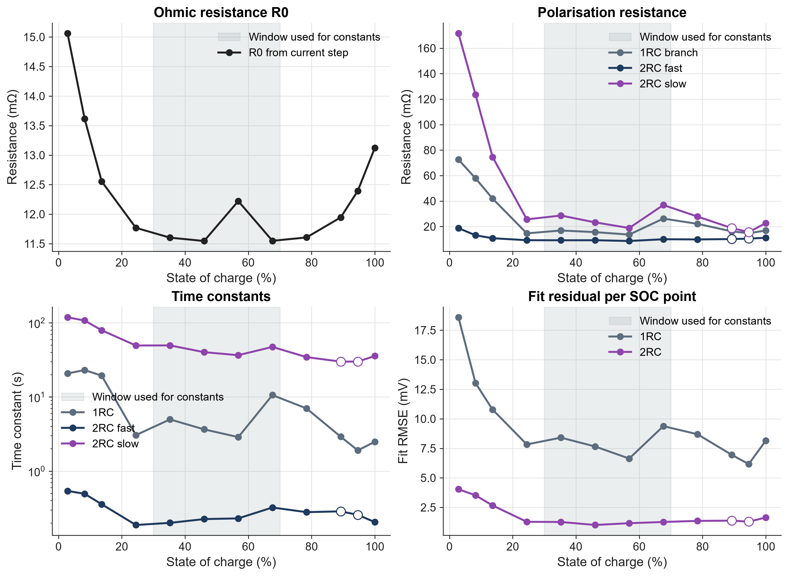

A single RC branch leaves 6 to 19 mV of fit error because the voltage response has a fast part (about 0.2 s) and a slow part (30 to 120 s). Open markers in the figure and "at bound" in the table mark 2RC fits where the slow time constant sits on its lower bound of 30 s (the bounds for the 2RC fit, 0.1 to 30 s and 30 to 3000 s, were chosen before looking at validation results).

**Validation (external check).** The measured current of each drive cycle at 25 °C is replayed through the model with no retuning. The initial SOC comes from inverting the OCV table at the rest voltage before the cycle, and SOC then follows coulomb counting with the fitted capacity. The cycles were not used in any fit. RMSE is over the whole cycle and over the part of the cycle where the model SOC is between 20 and 80 % (57 to 64 % of the samples).

| Cycle | Assumed: whole / window (mV) | Fitted 1RC | Fitted 2RC | 2RC single branch |
| --- | --- | --- | --- | --- |
| UDDS | 92.9 / 56.6 | 37.8 / 28.1 | 28.5 / 16.6 | 31.5 / 21.1 |
| LA92 | 106.7 / 62.0 | 42.5 / 33.7 | 28.8 / 14.4 | 35.0 / 24.7 |
| US06 | 129.3 / 72.6 | 63.5 / 59.5 | 29.9 / 16.6 | 42.6 / 35.1 |

- **Pass limits:** at most 30 mV over the whole cycle and at most 20 mV in the 20 to 80 % window, on UDDS and LA92. US06 is reported without a limit; HWFET cannot be replayed.
- **Result:** the 1RC model fails (UDDS 37.8 mV whole cycle, LA92 42.5 mV). The 2RC model fitted on the same HPPC data passes (UDDS 28.5 / 16.6 mV, LA92 28.8 / 14.4 mV) and is kept. The margin on the whole-cycle limit is small (1.5 and 1.2 mV). Fitted parameters cut the error by a factor of 3 to 4 against the assumed values (93 to 129 mV whole cycle).
- **Systematic errors remain:** the model voltage sits about 10 to 30 mV above the measurement for most of UDDS and drifts up to 100 mV and more below 10 % SOC, where the constant R0 and polarisation values (taken from 30 to 70 % SOC) are too low (see `results/cell_validation_udds.png`). Temperature, hysteresis and diffusion are not modelled.

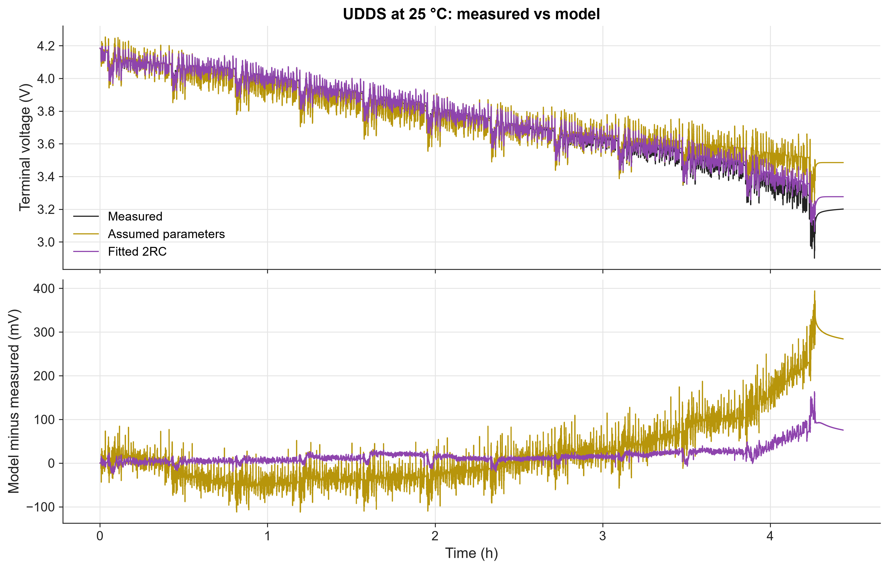

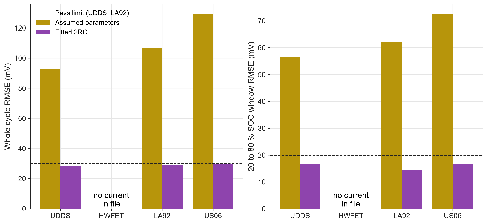

**What the simulator uses.** The balancing simulator has one RC branch, so the 2RC model cannot be used as it is. `FITTED_HG2_25C` takes the fitted R0 and replaces the two branches by one with the same DC resistance (R1 = 35.2 mΩ, the sum of both) and the resistance-weighted time constant (32 s, C1 = 919 F). Replayed through the drive cycles this single-branch form gives 31.5 mV on UDDS and 35.0 mV on LA92 over the whole cycle, so it does not meet the 30 mV limit by itself. `claims.md` lists that as FAIL. The balancing currents are tens of milliamps and change over hours, so the time constants have little effect there; the DC resistance and OCV slope matter. The simulator's R0, R1, C1 and OCV are constant in SOC. The SOC-dependent tables are stored in `data/processed/hg2_25c_params.json` behind a flag (`enabled`, false) and the loader refuses to enable it.

**What is still assumed.** The dataset has one cell, so the cell-to-cell spreads (capacity ± 5 %, R0 ± 10 %) and the balancing hardware values (inductor, MOSFET, capacitor, bleed resistor ranges) remain assumed. This is labelled in `claims.md`.

**Uncertainty.** The HPPC residuals were bootstrapped 500 times with a fixed seed (moving blocks of 50 samples, so that autocorrelated misfit is kept together; R0 also gets noise drawn from the voltage scatter during the preceding rest). Each resample re-fits the blocks in the 30 to 70 % window and takes the median. The OCV slope at 50 % SOC is bootstrapped from the dense C/20 data between 45 and 55 % SOC. The 500 resampled parameter sets were pushed through the baseline simulation as one batch of 500 packs per technique:

| Quantity | Median | 95 % interval |
| --- | --- | --- |
| R0 (mΩ) | 11.78 | 11.37 to 12.20 |
| R1, both branches (mΩ) | 36.6 | 34.9 to 38.6 |
| C1, equivalent (F) | 937 | 864 to 997 |
| OCV slope at 50 % SOC (mV per %) | 9.28 | 9.17 to 9.38 |

| Baseline | Balancing time (h) | Energy dissipated (J) |
| --- | --- | --- |
| Passive shunt | 4.186 (4.186 to 4.186) | 7175.8 (7175.4 to 7176.0) |
| Inductor buck-boost | 1.068 (1.068 to 1.069) | 200.3 (199.9 to 200.7) |
| Flying capacitor | 1.195 (1.174 to 1.217) | 30.0 (29.6 to 30.3) |

These intervals are narrow because they contain only the scatter of the HPPC fit and of the OCV slope. They do not include the 6.7 % capacity question above, instrument accuracy (0.1 % of full scale), temperature or cell-to-cell spread. They are not a measure of how well the model predicts a different cell.

**Baseline with assumed and fitted parameters.** `results/baseline_assumed_vs_fitted.csv` and the figure below hold the numbers.

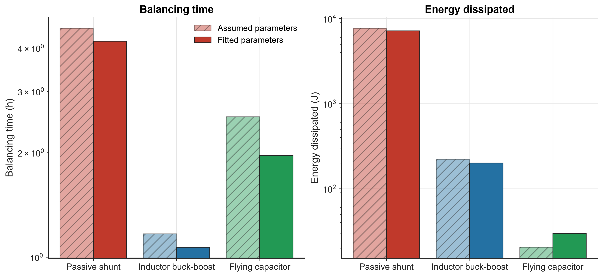

| | Passive | Buck-boost | Flying capacitor |
| --- | --- | --- | --- |
| Time, assumed to fitted | 16400 s to 15068 s (0.92x) | 4203 s to 3845 s (0.91x) | 9140 s to 4251 s (0.47x) |
| Energy dissipated, assumed to fitted | 7680 J to 7176 J (0.93x) | 220.8 J to 199.9 J (0.91x) | 20.5 J to 29.9 J (1.46x) |

Why each number moved:

- **Capacity (3.0 to 2.78 Ah)** shrinks every SOC difference per ampere-hour moved, so each technique is about 7 % faster. It explains most of the passive change: bleed current is set by the absolute cell voltage and R_b, not by R0 or the OCV slope, so passive time follows capacity and the slightly lower mid-SOC voltage (3.74 V is the measured value at 50 % SOC against the assumed 3.71 V, so bleed current is a little higher).
- **Buck-boost** also tracks capacity. Its source current depends on the source cell's own voltage and the inductor, not on the voltage difference between cells. Lower R0 (11.6 against 30 mΩ) makes the source terminal voltage a little higher, which adds to the speedup.
- **Flying capacitor** is the only technique whose current depends on the voltage difference between neighbouring cells. Two things raise its current: the OCV slope at 50 % SOC is 1.58 times steeper (9.35 against 5.93 mV per %), so the same SOC gap gives a bigger voltage gap, and the loop resistance falls from 0.118 Ω to about 0.081 Ω because the two cell resistances drop by 37 mΩ together. Together these raise the link current about 2.3x, and the smaller capacity adds 1.08x to the rate of SOC change; the deadband and the slow tail reduce the net effect to the observed 2.15x speedup.
- **Flying-capacitor energy** rises by 1.46x. The energy lost moving charge dq across a voltage difference ΔE is the integral of ΔE dq. The charge moved scales with capacity (0.93x) and ΔE with the slope (1.58x), and 0.93 x 1.58 = 1.46. A steeper OCV curve makes the same charge transfer cost more energy; lower resistance does not offset it, because the loss depends only weakly on resistance.
- **Buck-boost energy** falls by 0.91x, in line with the smaller capacity (less charge to move) and the lower cell-resistance loss.

The machine learning surrogate is retrained on the new simulations. Its R² for balancing time rose from 0.973 to 0.989, and for energy stayed at 0.995 (MAE 250 s and 67 J).

**Re-run checks under the fitted set (Phase 1, with the midsem flying-capacitor formula).** The ledger discrepancy against the energy removed was 0.0005 % (passive), 0.27 % (buck-boost) and 0.10 % (flying capacitor), all within 1 %. The passive closed form was within 0.065 % over 200 packs and the midsem regression under `ASSUMED` was unchanged. One diagnostic that passed in Phase 0 failed in Phase 1: the per-link ledger of the flying capacitor differed from the reported dissipation by 0.156 % against a 0.1 % limit, which was reported and not tuned away. Phase 2 replaced the flying-capacitor formula (section p) and that diagnostic now passes at 0.055 %.

## p. Converter models checked against LTspice (endsem Phase 2)

**Tool.** LTspice 26.1.1 in batch mode (`LTspice -b`). ngspice was not installed, so LTspice was used. It is a switching-level simulator: the switches open and close in time and the inductor and capacitor currents are solved at every step. `scripts/run_spice.py` writes one netlist per operating point into `spice/`, runs it and stores the averaged results in `data/processed/spice_measurements.json`. `run_all.py` reads that file and never calls the simulator.

**Circuits.** Two cells are DC sources at the fitted OCV for 55 % and 50 % SOC (second case 51 % and 50 %), each with the fitted series R0 (11.58 mΩ); the cell RC branch is slow (32 s) and is not part of a microsecond-scale switching circuit.

- *Buck-boost link:* the source cell charges the 80 mΩ inductor through a voltage-controlled switch (Ron 20 mΩ, Roff 1 MΩ) for D·Ts with D = 0.4, and the inductor then discharges into the sink cell through a freewheel path. The freewheel path is an **ideal-diode approximation** (an LTspice diode with Ron 20 mΩ, Roff 1 MΩ and zero forward voltage), not a synchronous switch, so its conduction interval is set by the circuit rather than by the averaged equations.
- *Flying-capacitor link:* the capacitor (5 mΩ ESR) sits across the source cell in phase 1 and across the sink cell in phase 2, through four switches with Ron 10 mΩ, on two complementary 50 % phases. No dead time was needed or added; the two phase signals are exact complements and the measured overlap is 0.
- *Measurement:* maximum step Ts/400, 60 periods averaged after a settling run, results compared at the same OCV difference as the averaged equations.

**Quality of the SPICE runs** (all pass): cycle-to-cycle change in mean current at most 3.8e-04 (limit 1e-3); halving the maximum step changes the means by at most 3.1e-06; the power balance (OCV power out minus power in, against the I²R of every resistor) closes to 0.10 % of the removed power (diagnostic limit 0.5 %, chosen after the first runs and not part of the plan; the residual is largest at the 10 µH point and was not traced to a single cause); the buck-boost is in discontinuous conduction, with the inductor current idle for at least 21 % of every period.

**Results at the 55 % / 50 % SOC link.** Currents are the mean current into the sink cell (the source-cell current is checked in `metrics.json` too). Loss is the total power dissipated in the link (cell R0, switches, inductor, ESR) as measured from I²R in SPICE and as `removed − delivered` in the averaged model. The pass rule from the plan is 5 % on the current and 15 % on the loss at all three points.

| Link | SPICE (A) | Averaged (A) | Current error | SPICE loss (mW) | Averaged loss (mW) | Loss error | Verdict |
| --- | --- | --- | --- | --- | --- | --- | --- |
| Buck-boost, 10 µH, 50 kHz | 0.5306 | 0.5454 | +2.79 % | 241.25 | 253.23 | +5.0 % | PASS |
| Buck-boost, 55 µH, 30 kHz | 0.1778 | 0.1798 | +1.14 % | 24.23 | 23.39 | -3.5 % | PASS |
| Buck-boost, 100 µH, 10 kHz | 0.2852 | 0.2899 | +1.63 % | 64.38 | 63.56 | -1.3 % | PASS |
| Flying capacitor (midsem), 1 mF, 1 kHz | 0.0491 | 0.0468 | -4.59 % | 2.41 | 2.30 | -4.6 % | PASS |
| Flying capacitor (two-phase), 1 mF, 1 kHz | 0.0491 | 0.0491 | +0.01 % | 2.41 | 2.41 | -0.0 % | PASS |
| Flying capacitor (midsem), 5.5 mF, 5.5 kHz | 0.3300 | 0.6046 | +83.21 % | 16.20 | 29.69 | +83.2 % | FAIL |
| Flying capacitor (two-phase), 5.5 mF, 5.5 kHz | 0.3300 | 0.3300 | +0.00 % | 16.20 | 16.20 | +0.0 % | PASS |
| Flying capacitor (midsem), 10 mF, 10 kHz | 0.3351 | 0.8443 | +151.98 % | 16.45 | 41.46 | +152.0 % | FAIL |
| Flying capacitor (two-phase), 10 mF, 10 kHz | 0.3351 | 0.3351 | +0.00 % | 16.45 | 16.45 | +0.0 % | PASS |

At the 51 % / 50 % link the results are the same in kind (buck-boost within 2.9 % and the two-phase flying capacitor within 0.04 % on the mean currents, total loss within 4.9 % and 0.0 %); all 18 rows are in `results/spice_vs_averaged.csv`.

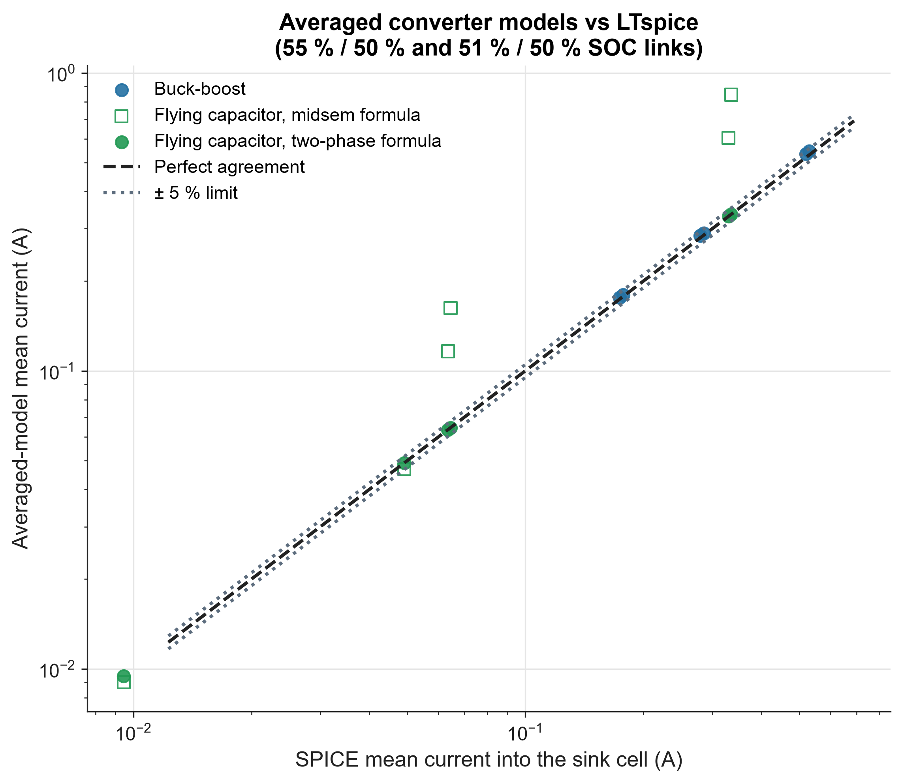

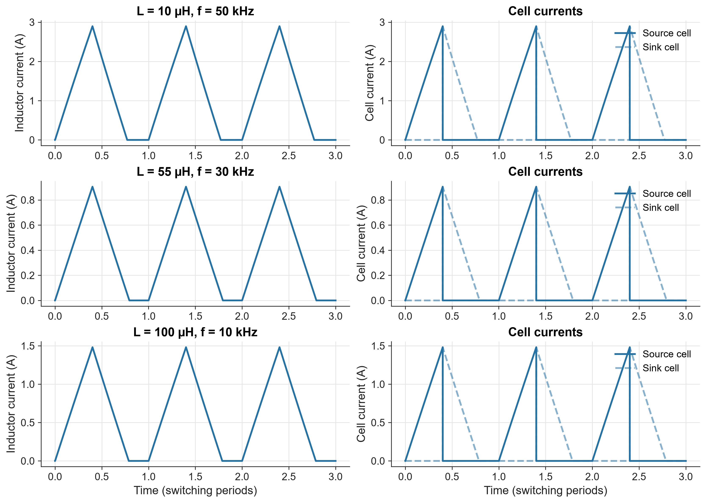

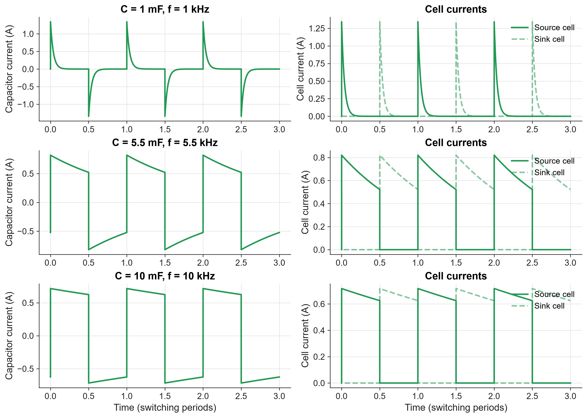

**Buck-boost: passes unchanged.** The averaged equations are within 2.9 % of SPICE on the mean currents and 5.0 % on the total loss. The waveforms confirm discontinuous conduction. The measured freewheel interval is a little shorter than the averaged D·V_source/V_sink (for example 0.371 against 0.405 of the period at 10 µH and 50 kHz), because the averaged equations neglect the resistive voltage drops in the volt-second balance; the mean currents still agree within the limit. The split of the loss between cells and converter differs by up to 14 % at the 10 µH point, which is not part of the pass rule.

**Flying capacitor: the midsem formula fails, the two-phase formula passes.** The hypothesis was tested, not assumed. At the baseline point the phase time constant (0.201 ms) exceeds the half period (0.091 ms), so the link is in the fast-switching limit and the midsem formula should overstate the current. SPICE agrees: the midsem formula is +83 % off at the baseline point and +152 % off at 10 mF and 10 kHz, so it overstates the current by a factor of 1.83 at the baseline. It passes only in the slow-switching case (1 mF, 1 kHz, -4.6 %). The two-phase formula of section f is within 0.04 % of SPICE at all six points. It is an exact solution of the ideal circuit, so agreement to the SPICE solver tolerance is expected; the agreement also confirms that the netlists and the averaging are correct.

| Point | Phase RC vs half period | Regime | Midsem R (Ω) | Two-phase R_eq (Ω) | SPICE ΔV/I (Ω) |
| --- | --- | --- | --- | --- | --- |
| 1 mF, 1 kHz | 0.037 ms vs 0.500 ms | slow | 1.0482 | 1.0000 | 1.0001 |
| 5.5 mF, 5.5 kHz | 0.201 ms vs 0.091 ms | fast | 0.0812 | 0.1488 | 0.1488 |
| 10 mF, 10 kHz | 0.366 ms vs 0.050 ms | fast | 0.0582 | 0.1465 | 0.1465 |

The 0.22 Ω against 0.118 Ω in the plan were estimated with the midsem assumed R0; with the fitted R0 the corresponding numbers are 0.149 Ω and 0.081 Ω.

**Effect on the baseline and sweep.** The corrected formula is the default; the midsem formula is `FlyingCapModel.MIDSEM` and is used by `ASSUMED` so that the midsem regression test is unchanged. Under the fitted parameters:

| Flying capacitor baseline | Midsem formula | Two-phase formula | Ratio |
| --- | --- | --- | --- |
| Balancing time (s) | 4251 | 7069 | 1.66x |
| Energy dissipated (J) | 29.94 | 29.94 | 0.9999x |

The time is 1.66 times longer, a little less than the 1.83 times lower current because the SOC deadband and the slow tail do not scale with the current. As predicted, the energy dissipated does not change: the energy lost moving charge dq across a voltage difference ΔE is the integral of ΔE dq, which does not depend on how long it takes. The frequency sweep flattens, because in the fast-switching limit the resistance no longer falls with frequency:

| Frequency (kHz) | Balancing time, midsem (s) | Balancing time, two-phase (s) | Ratio |
| --- | --- | --- | --- |
| 1 | 10343 | 9736 | 0.94x |
| 3.25 | 5188 | 7253 | 1.40x |
| 5.5 | 4251 | 7069 | 1.66x |
| 7.75 | 3857 | 7019 | 1.82x |
| 10 | 3641 | 6999 | 1.92x |

The dataset (6000 runs) and the surrogate were regenerated. The surrogate's R² is 0.989 for balancing time and 0.995 for energy. The per-link ledger diagnostic of the flying capacitor that failed in Phase 1 now passes (0.055 % against 0.1 %). The shared-R0 coupling described in section n is not fixed: the net-current ledger still differs from the reported dissipation (stricter diagnostic in `claims.md`).

**Datasheet range checks.** These are range checks only; the topologies differ. Values quoted from the documents (page numbers are the printed page numbers, the same as the PDF page index); they are transcribed in `data/processed/datasheet_values.json`, and the files are recorded in `data/processed/provenance.json`.

- *TI BQ76952* (SLUSE13B, January 2020, revised November 2021, `https://www.ti.com/lit/ds/symlink/bq76952.pdf`). Section 7.20 Cell Balancing, page 18: internal cell balancing resistance R(CB) = 15 Ω (min), 28 Ω (typ), 46 Ω (max), measured as the RDS(ON) of the internal FET at V(VC(n)) − V(VC(n−1)) = 1.5 V. Absolute maximum ratings, page 8: maximum cell balancing current through a single cell 100 mA. Page 18 also states that the balancing current must be limited by sizing the off-chip cell input resistors. Our passive bleed range of 20 to 100 Ω gives 37 to 187 mA at 50 % SOC (up to 209 mA at 100 % SOC). Only the part of the range with a total resistance above 37.4 Ω (78 % of it) stays within the 100 mA limit. Through the internal FET alone at 50 % SOC the current would be 249, 134 and 81 mA at 15, 28 and 46 Ω, so the shunt designs above about 100 mA need an external resistor or an external bypass FET. The application note "Cell Balancing With BQ769x2 Battery Monitors" is listed in the datasheet (page 79) and was not downloaded.
- *ADI LTC3300-1* (Rev. C, `https://www.analog.com/media/en/technical-documentation/data-sheets/LTC3300-1.pdf`). Page 1 (features): "Up to 10A Balancing Current (Set by Externals)" and "Up to 92% Charge Transfer Efficiency"; page 10 has a "Balancer Efficiency vs Cell Voltage" figure for the DC2064A demo board at 2.5 A whose efficiency axis runs from 89 % to 93 %. The curve values were not read. It is a transformer-based bidirectional flyback balancer, a different topology from ours. The SPICE efficiency of our buck-boost is 89.1 % at 0.53 A; 96.4 % at 0.18 A; 94.3 % at 0.29 A at the three operating points. The two operating points above 92 % exceed the vendor's best figure. This is expected, because the averaged model and the SPICE circuit omit switching-transition, gate-drive and core losses, so our efficiency is an upper bound; it should not be read as better than the commercial part. Our currents (0.18 to 0.53 A) are far below the 10 A the part supports.

**Limits of this check.** The six points per converter do not cover continuous-conduction operation, other duty ratios, other voltage differences or other capacitors; the SPICE circuits use ideal DC sources and ideal-threshold switches, so the check validates the averaged equations against a switching circuit, not against hardware. The split of the flying-capacitor loss between cell R0 heating and converter heating differs by 23 to 43 % from SPICE, because the averaged model books R0 loss with the mean current while the real current is pulsed; the total dissipated power agrees to 0.03 %. The converter component values themselves (inductor and switch resistances, ESR, duty) remain assumed.

## q. ML against physics baselines (endsem Phase 3)

The midsem reported that the gradient-boosting model predicts balancing time and wasted energy with R² of 0.97 to 0.995, but never compared it with a simple formula that uses the same inputs. Phase 3 adds physics baselines, trains three more predictors and evaluates all four honestly: cross-validation, extrapolation, calibrated intervals, timing and a feature ablation. The dataset is the 6000 simulated runs of section h, regenerated with the fitted parameters and the two-phase flying-capacitor formula. Code: `src/baselines.py`, `src/ml_eval.py`, `src/ml_plots.py`.

### Physics baselines

All three are vectorised over packs and use the same inputs as the simulator (initial SOCs, capacities, R0, component value, frequency). Two identities carry most of the derivations.

*Energy identity.* Every technique moves charge between cells, and the energy dissipated (energy removed from the cells at their OCV minus energy delivered at their OCV, the quantity the simulator reports) is exactly the energy that left the cells: $E = 3600\sum_j Q_j\,[G(x_{0,j}) - G(x_{T,j})]$, where $G(s) = \int_0^s \text{OCV}(u)\,du$, $Q_j$ is in Ah and $x_{0}, x_{T}$ are the initial and final SOCs. Each baseline therefore only has to predict the final SOCs and the time. (For the flying capacitor this equals $\sum_\text{links} \int \Delta E\, dq$ from the linear solution; the form above uses the actual OCV curve instead of its tangent.)

*Passive.* Time is the closed form of section n. The bleed rule drives every cell above the running mean down to that mean, so at the stop the last cell (the initial maximum) sits at min + 1 % and the other bleeding cells at the mean, min + 0.5 %; the energy follows from the identity. With "all cells at min + 1 %" the median energy error was 8 %; with this final state it is 0.01 %.

*Buck-boost.* In discontinuous conduction the source cell supplies $I_s = V G/(1 + G R_0)$ with $G = D^2/(2 L f)$, the leading-order $I = V D^2 T_s / (2 L)$. The link delivers $I_\text{sink} < I_s$ (the efficiency correction), taken from the averaged equations at the pack's mean OCV. The charge that must cross each link comes from the capacity-weighted SOC excess, $C_k = \sum_{i \le k} Q_i (x_{0,i} - x_{T,i})$, where $x_T$ is the minimal-transport end state that puts every cell inside a 1 % band: each cell is clipped to $[L, L + 0.01]$ with $L$ fixed by charge conservation. The time is $\max_k 3600\,|C_k| / I_\text{sink}$. The energy uses the same identity, with the source cells drawing $I_s/I_\text{sink}$ times the charge the sink cells receive. It sees only the net charge across each link, so where neighbouring cells exchange charge in opposite directions (those flows cancel in the net) it under-predicts.

*Flying capacitor.* Linearise the OCV at the capacity-weighted mean SOC with slope $m$. With the link resistances $R_k$ of section f and the cell RC branch at its steady state ($v_1 = R_1 i_\text{cell}$), the link currents satisfy $A\,i = m\,\Delta x$ with $A = \text{diag}(R_k) + R_1 \Delta\Delta^\top$, and the SOCs obey $Q\,\dot x = -K x$ with $K = (m/3600)\,\Delta^\top A^{-1} \Delta$ symmetric. Symmetrising with the capacity matrix, $S = Q^{-1/2} K Q^{-1/2} = U \Lambda U^\top$, gives $x(t) = Q^{-1/2} U e^{-\Lambda t} U^\top Q^{1/2} x_0$ exactly (a batched `eigh`). The balancing time is the first time the SOC spread falls below 1 %, found on a log time grid and refined by vectorised bisection; the energy comes from the identity at $x(T)$.

Accuracy against the simulator (positive means the formula over-predicts):

| Technique | Baseline pack: time error | energy error | Dataset median % error: time | energy | 95th percentile: time | energy |
| --- | --- | --- | --- | --- | --- | --- |
| Passive | -0.00 % | -0.00 % | 0.01 % | 0.01 % | 0.0 % | 6.5 % |
| Buck-boost | -0.80 % | +3.96 % | 6.39 % | 10.12 % | 36.7 % | 32.8 % |
| Flying cap. | -0.74 % | -0.03 % | 1.04 % | 0.05 % | 6.2 % | 0.5 % |

The passive time and energy and the flying-capacitor energy are essentially exact, the flying-capacitor time is within 1 % in the median, and the buck-boost is the weak one (-0.8 % and +4.0 % on the baseline pack, with long tails). The passive check of the plan (within 3 % on the baseline pack) passes for time (-0.0002 %) and for energy (-0.0010 %).

### Four models

(a) the physics formula; (b) per-technique linear regression of log y on log spread, log component value, log frequency (not for passive, where it is constant) and log of the physics prediction; (c) the midsem HGB on the 19 features (log target); (d) the hybrid: an HGB with the same settings on the 19 features plus log of the physics prediction, trained to predict log(y / physics), so the physics formula is the starting point and the HGB learns the correction.

### 5-fold cross-validation

Stratified by technique, fixed seed. Metrics are R², MAE and median absolute percentage error per technique, mean ± std over folds.

Mean absolute error, mean ± std over the 5 folds (balancing time):

| Model | Overall MAE (s) | Passive | Buck-boost | Flying capacitor | Overall R² | Overall median % error |
| --- | --- | --- | --- | --- | --- | --- |
| Physics formula | 51.2 ± 2.62 | 0.462 ± 0.00898 | 93.5 ± 7.06 | 59.7 ± 2.34 | 0.9995 | 0.81 % |
| Log-linear regression | 39.9 ± 1.33 | 0.299 ± 0.00329 | 70.1 ± 2.98 | 49.4 ± 2.09 | 0.9997 | 0.98 % |
| HGB (midsem model) | 299 ± 16.9 | 304 ± 24 | 172 ± 20.2 | 421 ± 24.8 | 0.9860 | 6.74 % |
| Hybrid (HGB on log(y / physics)) | 32.6 ± 0.748 | 14.1 ± 1.21 | 46.9 ± 2 | 36.9 ± 1.81 | 0.9998 | 0.69 % |

Mean absolute error, mean ± std over the 5 folds (energy dissipated):

| Model | Overall MAE (J) | Passive | Buck-boost | Flying capacitor | Overall R² | Overall median % error |
| --- | --- | --- | --- | --- | --- | --- |
| Physics formula | 15.3 ± 1.25 | 27.7 ± 1.79 | 18.3 ± 4.03 | 0.00806 ± 0.000532 | 0.9995 | 0.13 % |
| Log-linear regression | 19.1 ± 0.747 | 45.1 ± 1.57 | 12.1 ± 2.05 | 0.00831 ± 0.000753 | 0.9997 | 0.96 % |
| HGB (midsem model) | 65.8 ± 2.15 | 180 ± 7.47 | 16.9 ± 4.83 | 0.208 ± 0.0117 | 0.9953 | 3.46 % |
| Hybrid (HGB on log(y / physics)) | 13.6 ± 1.08 | 31.4 ± 1.72 | 9.46 ± 2.27 | 0.0306 ± 0.00219 | 0.9997 | 0.62 % |

A model "beats" another only if its MAE is lower in all 5 folds and the mean fold-by-fold gain exceeds one fold standard deviation (the larger of the two models' fold standard deviations is used, the conservative reading of the rule). The verdicts are written to `claims.md`; the three that matter are:

| Target | Technique | HGB beats physics | Hybrid beats HGB | Hybrid beats physics |
| --- | --- | --- | --- | --- |
| balancing time | Passive | no | yes | no |
| balancing time | Buck-boost | no | yes | yes |
| balancing time | Flying cap. | no | yes | yes |
| energy dissipated | Passive | no | yes | no |
| energy dissipated | Buck-boost | no | yes | yes |
| energy dissipated | Flying cap. | no | yes | no |

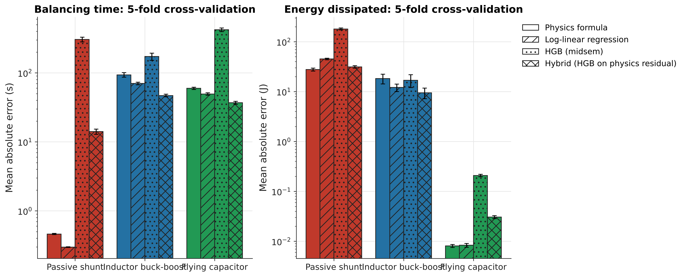

What this shows. The midsem HGB alone is the worst model in nearly every cell of the table: for balancing time its error is about 2 times (buck-boost), 7 times (flying capacitor) and 650 times (passive) that of the physics formula, and it never beats the physics formula on time. Its high R² (0.986) hid this, because R² over four orders of magnitude is dominated by the large values. A log-linear regression that only rescales the physics prediction already beats the physics formula on time for every technique. The hybrid has the lowest overall MAE for both targets and beats the plain HGB in all six cases, but it is not the best for every technique, and it beats the physics formula only where the formula is imperfect (the buck-boost time and energy, and the flying-capacitor time): for the passive shunt and for the flying-capacitor energy the physics is already accurate to a small fraction of a percent in the median and no ML model improves on it. So the honest statement is that the ML adds value as a correction on top of physics, not as a replacement for it.

### Out of range

For each technique the models are trained on component values up to the 80th percentile of that technique and tested above it, and separately trained on initial spreads up to 8 % and tested above. Median absolute percentage error over all three techniques:

| Model | Component > p80: time | energy | Spread > 8 %: time | energy |
| --- | --- | --- | --- | --- |
| Physics formula | 0.85 % | 0.13 % | 0.59 % | 0.05 % |
| Log-linear regression | 0.99 % | 1.09 % | 0.65 % | 0.86 % |
| HGB (midsem model) | 12.73 % | 3.72 % | 15.64 % | 11.78 % |
| Hybrid (HGB on log(y / physics)) | 0.65 % | 0.68 % | 0.50 % | 0.63 % |

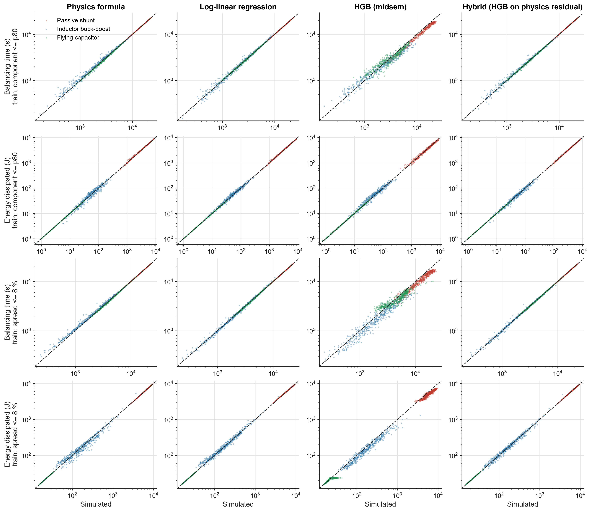

The plain HGB degrades by an order of magnitude and flattens at the edge of its training range: for the 8 % spread split, 17 % of the passive test times exceed the largest time seen in training, yet 0 % of the HGB predictions do, and its median prediction-to-truth ratio falls from 0.91 near the edge to 0.77 at the far end (flying capacitor energy: 21 % of the truth above the training maximum, none of the predictions). Trees cannot predict above the largest value they saw. The hybrid, the log-linear regression and the physics formula do not have this problem, because the physics prediction carries the trend.

### Prediction intervals

Split-conformal intervals on the best model per target (chosen by cross-validated MAE: the hybrid for both), with the training data split into a fit set (75 %) and a calibration set (25 %), Mondrian by technique, absolute residuals of log y, nominal 90 %. The pass rule is test coverage between 87 % and 93 % for each technique. A single test set of 400 packs per technique has a standard error of about 2 percentage points, so the table also shows the coverage over 10 further random splits.

| Target (best model) | Technique | Test coverage, spec split | Coverage over random splits | Interval factor | Verdict |
| --- | --- | --- | --- | --- | --- |
| balancing time (Hybrid) | Passive | 88.00 % | 90.8 ± 1.7 % | x1.006 | PASS |
| balancing time (Hybrid) | Buck-boost | 90.00 % | 88.5 ± 2.4 % | x1.132 | PASS |
| balancing time (Hybrid) | Flying cap. | 88.25 % | 91.2 ± 1.6 % | x1.035 | PASS |
| energy dissipated (Hybrid) | Passive | 85.25 % | 89.4 ± 1.6 % | x1.029 | FAIL |
| energy dissipated (Hybrid) | Buck-boost | 86.50 % | 90.0 ± 2.8 % | x1.159 | FAIL |
| energy dissipated (Hybrid) | Flying cap. | 91.50 % | 90.3 ± 1.0 % | x1.011 | PASS |

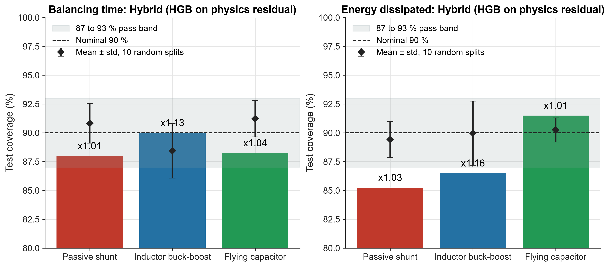

On the specified split two of the six cases (energy for the passive shunt and the buck-boost) fall just below 87 % and are reported as FAIL; the rule and the split were not changed. Over repeated splits the mean coverage is 88.5 to 91.2 % for every case, so the intervals are calibrated and the misses are sampling noise at this test-set size, not a systematic shortfall. The interval factors are tight: the 90 % interval is within a few percent of the prediction for the passive shunt and the flying capacitor, and about ±13 to 16 % for the buck-boost, the technique with the least exact physics.

### Timing

Per-pack latency on the host CPU (labelled "host CPU, not target hardware"), median of repeated runs, same machine; the simulator is timed once at batch 1000 because one run takes about 8 s. Batch 1 is the median over one pack per technique. Full numbers are in `results/timing.json`.

| Method | Batch 1: µs per pack | speedup | Batch 1000: µs per pack | speedup |
| --- | --- | --- | --- | --- |
| Simulator | 747,125 | 1x | 8,120 | 1x |
| Physics formulas | 2,444 | 306x | 24 | 341x |
| HGB (both targets) | 7,244 | 103x | 50 | 163x |
| Hybrid (physics + HGB) | 9,743 | 77x | 114 | 71x |

The speedups are machine- and batch-dependent. The physics formulas are faster than the HGB model and the hybrid costs the sum of both. The comparison is also flattered by the simulator being a Python loop over 1 s steps.

### Feature design

Retraining the HGB without the four individual cell SOCs (15 instead of 19 features) on the current data:

| Target | Overall MAE change (CV) | Passive | Buck-boost | Flying capacitor | Overall R² change |
| --- | --- | --- | --- | --- | --- |
| balancing time | +124 % | +16 % | +112 % | +206 % | -0.045 |
| energy dissipated | +300 % | +321 % | +74 % | +41 % | -0.077 |

The error rises for both targets and for every technique (the holdout split of section h gives the same picture, +134 % for time and +294 % for energy), so the individual SOCs carry information that spread and standard deviation alone do not: which cells are high and which are low, and so how much charge crosses each link. This replaces the midsem "before" numbers, which are not in the results files.

### What this does and does not show

All of it is about the simulator: the models predict the output of the averaged-equation simulation, so "physics formula" means a closed form of the same equations, not of a real pack. The conclusions are that (1) the midsem HGB should not be presented as better than physics, (2) a hybrid is the right way to use the ML, and (3) the intervals are calibrated for this simulated distribution. They say nothing about real packs, other cells or longer strings.
