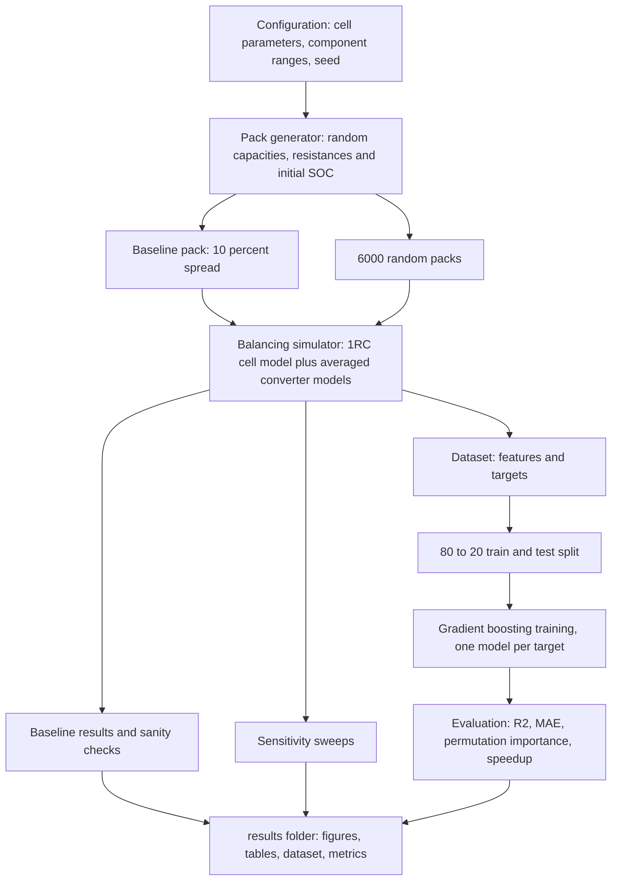
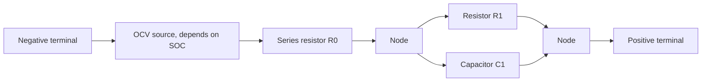
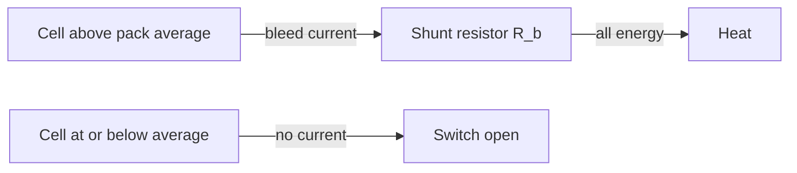
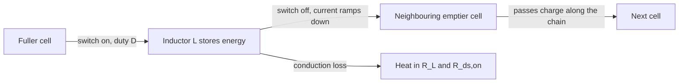
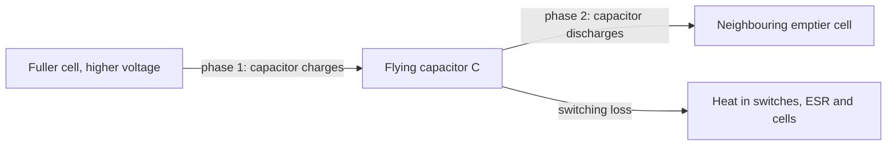

# Cell Balancing in EV Battery Packs: Simulation, LTspice Validation and Learned Models

**Summary.** Passive shunt, inductor buck-boost and flying-capacitor balancing of a 4-cell series pack, with a cell model fitted to measured LG HG2 data (Mendeley dataset, DOI 10.17632/b5mj79w5w9.2, licence CC BY 4.0), checked against switching-level LTspice circuits with real MOSFETs, gate drive and dead time, and compared with learned surrogates, SOC estimators and RL controllers. Everything is deterministic: one simulation seed (2026) and seeds 0 to 2 for the learned models.

- **Baseline** (10 % SOC spread, mid-range components, circuit-calibrated models; the gate drive is powered from the cell pack and booked separately): passive 4.19 h and 7176 J; buck-boost 1.08 h and 221 J (205 J cell side plus 15.4 J gate drive), 96.2 % efficient; flying capacitor 1.99 h and 39.5 J (29.9 J cell side plus 9.6 J gate drive), 99.3 % efficient.
- **LTspice validation:** the series formula for a flying-capacitor link is wrong by up to 160.48 % and the exact switched-capacitor (coth) form holds within 3.37 %; the averaged buck-boost currents hold within 4.88 % where an inductor saturation rule is met, but the averaged losses miss gate drive and switching by up to 16.63 %, so circuit-calibrated models are the default and the calibrated loss error is 6.87 %.
- **Learned models:** plain neural surrogates lose to gradient boosting (balancing-time R2 0.9530 for the cell GRU against 0.9825); learning only the residual over the closed-form physics lifts every model to 0.9997 or better; an EKF plus GRU hybrid cuts SOC error from 2.06 % to 0.89 % on Test A and keeps it at int8 weights; PPO controllers do not beat the hand-written rule on every cycle.
- **Controller headroom bound:** a rule-based controller already sits within 0.88 % (buck-boost) and 0.79 % (flying capacitor) of an ideal-transfer reference in delivered Ah at 4 cells, so there is no meaningful room for a learned controller there; the median gap grows with string length to 1.45 % and 2.57 % at 96 cells, where room exists, and SOC estimation error widens it further for the buck-boost (4.74 %).
- **Claims:** 289 rows in `results/claims.md`: 163 PASS, 102 FAIL, 24 NOT SUPPORTED. FAIL rows are findings and are kept; section p lists them.

## Contents

A. Background (sections a to f): motivation, glossary, architecture, cell model, the three techniques.
B. Results (sections g to o): baseline comparison, ML predictor, verification, fitted cell model, LTspice validation and calibrated models, deep learning, system-level studies, controller headroom bound, model comparison.
C. Limitations (section p), how to run (section q), project structure (section r), data and licence (section s).

## Reproduce

```bash
pip install -r requirements-dev.txt         # requirements.txt runs run_all.py; the dev file adds pytest, ruff, PyTorch and stable-baselines3
python scripts/fetch_hg2.py --group all     # downloads the measured data files that the training scripts need
python run_all.py                           # about 5 minutes on 16 threads, no LTspice needed
python -m scripts.report_claims
python -m scripts.check_readme
python -m pytest
ruff check .
```

`run_all.py` never calls a simulator or trains a network: it reads the committed caches (`results/ltspice/*.csv`, `data/processed/*.json`) and stops with an error naming any cache that was built from different inputs. With LTspice 26.1.1 installed, run `python -m scripts.ltspice_flying_cap`, `scripts.ltspice_buck_boost`, `scripts.ltspice_shunt` and `scripts.ltspice_checks` one after the other (about 15 minutes) to rebuild the circuit results, and `python -m scripts.ltspice_schematics` for the `.asc` files. Section q lists the training and long jobs.

## a. Overview

A battery pack is only as good as its weakest cell. When cells in a series string drift to different charge levels, usable capacity shrinks and some cells are stressed. This project simulates three ways of pulling cells back into line (passive shunt, inductor buck-boost and flying-capacitor balancing) on a 4-cell pack of 18650 lithium-ion cells, compares how fast each balances and how much energy it wastes, validates the averaged models against circuit simulation, and trains learned models that predict the results, estimate SOC and try to control the balancing.

## b. Motivation

An electric vehicle pack contains hundreds or thousands of lithium-ion cells. Many of them are connected in series to reach a high voltage, typically 400 V or 800 V. Every cell must stay inside a safe window of voltage, current and temperature. A **battery management system (BMS)** is the electronics and software that watches every cell and keeps the pack inside that window. It measures voltages, estimates how full each cell is, protects against faults and balances the cells.

No two cells are identical. Small manufacturing differences in capacity, internal resistance and self-discharge rate, plus temperature differences across the pack, make cells drift apart over hundreds of cycles. This drift is **cell imbalance**: cells in the same string end up holding different fractions of their charge.

In a series string, the same current flows through every cell. This has two consequences:

- **Charging must stop when the fullest cell reaches its upper voltage limit,** even though the others are not yet full.
- **Discharging must stop when the emptiest cell reaches its lower voltage limit,** even though the others still hold energy.

The weakest cell therefore sets the usable capacity of the whole pack. A 10 % imbalance can cost roughly 10 % of driving range.

Balancing matters for three reasons:

- **Range:** it restores the capacity that the weakest cell would otherwise lock away.
- **Safety:** it prevents individual cells from being overcharged or overdischarged, which can cause lithium plating, gas generation or thermal runaway.
- **Lifespan:** it stops a few cells from working harder than the rest and ageing faster, which would make the imbalance worse over time.

## c. Glossary

| Term | Definition |
| --- | --- |
| Active balancing | Balancing that moves charge from fuller cells into emptier cells instead of burning it off. It needs more circuitry but wastes little energy. |
| Averaged model | A model that replaces fast switching waveforms with their average value over one switching period. It captures behaviour over minutes and hours without simulating every microsecond pulse. |
| Balancing | Any method that equalises the state of charge of the cells in a series string. |
| Bleed current | The current drawn out of a cell through a shunt resistor during passive balancing. |
| BMS (battery management system) | The electronics and software that monitor, protect and balance a battery pack. |
| Buck-boost converter | A switching power converter that can transfer energy from a source to a load at a higher or lower voltage. Here it stores energy from one cell in an inductor and releases it into the neighbouring cell. |
| C rate | Current expressed relative to cell capacity. 1C on a 3 Ah cell is 3 A, a current that would fully discharge it in one hour. |
| Cell | A single electrochemical unit, here a cylindrical 18650 lithium-ion cell (18 mm diameter, 65 mm long). |
| Cell imbalance | A difference in state of charge between cells in the same series string. |
| Coulomb counting | Estimating state of charge by integrating the current flowing in or out of a cell over time. |
| Drive cycle | A standard speed-versus-time profile, such as WLTP or UDDS, used to test vehicles under repeatable driving conditions. |
| Dataset | A table of examples used to train and test a model. Here each row is one simulated balancing run. |
| Deadband | A small band inside which a controller does nothing, to avoid switching back and forth. Here a converter link turns off when its two cells differ by less than 0.2 % SOC. |
| Decision tree | A model that predicts a value by asking a sequence of yes or no questions about the inputs, such as "is the SOC spread above 6 %?", and returning the average answer stored in the leaf it reaches. |
| Discontinuous conduction mode (DCM) | An operating mode of an inductor converter where the inductor current falls to zero before each new switching cycle starts. |
| Duty cycle | The fraction of each switching period during which a switch is on. This project uses D = 0.4. |
| EMI (electromagnetic interference) | Unwanted electrical noise radiated or conducted by fast-switching circuits. |
| Efficiency | Energy delivered into the receiving cells divided by energy taken from the source cells, as a percentage. |
| Energy dissipation | Energy turned into heat instead of being stored, in joules (J). |
| Equivalent circuit model | A model that represents a battery's electrical behaviour with ideal circuit elements (voltage source, resistors and capacitors) instead of chemistry equations. |
| ESR (equivalent series resistance) | The small unavoidable resistance of a real capacitor. |
| Feature | One input variable given to a machine learning model, such as SOC spread or inductance. |
| Flying capacitor | A capacitor that is switched back and forth between two cells. It charges from the fuller cell and discharges into the emptier one. |
| GRU (gated recurrent unit) | A type of neural network designed for sequences, able to remember past measurements when estimating a present quantity such as SOC. |
| Gradient boosting | A machine learning method that builds many small decision trees one after another, each correcting the errors left by the trees before it. |
| Inductor | A coil that stores energy in its magnetic field. Its current cannot change instantly, which is what lets switching converters move energy. Unit: henry (H). |
| Internal resistance | The resistance inside a cell that causes its terminal voltage to drop under load and turns part of the energy into heat. Unit: ohm (Ω). |
| Learning rate | In gradient boosting, the weight given to each new tree's correction. Small values learn slowly but generalise better. |
| Log transform | Training a model on the logarithm of a target instead of the raw value, so that errors on small and large values carry similar weight. |
| MAE (mean absolute error) | The average size of the prediction error, in the same unit as the target (seconds or joules). |
| MOSFET | A transistor used as a fast electronic switch in power circuits. |
| NMC | Lithium nickel manganese cobalt oxide, a common high-energy cathode chemistry for EV cells, with an operating voltage of about 3.0 V to 4.2 V. |
| OCV (open circuit voltage) | The voltage of a cell at rest with no current flowing. It rises with state of charge and is the main clue a BMS uses to estimate SOC. |
| On resistance | The small resistance of a MOSFET when it is switched on, written R_ds,on. |
| One-hot encoding | Representing a category such as "technique" as several 0 or 1 columns, one per option, with exactly one set to 1. |
| Parasitic resistance | Unwanted resistance in real components, such as inductor winding resistance, MOSFET on resistance and capacitor ESR. It causes conduction losses. |
| Passive balancing | Balancing by burning off excess charge from fuller cells as heat in resistors. |
| PCHIP interpolation | A smooth curve through table points that never overshoots between them, used here to turn the OCV table into a smooth curve. |
| Permutation feature importance | A way to measure how much a model relies on an input. The input's values are shuffled randomly and the drop in accuracy is recorded. |
| PWM (pulse width modulation) | Controlling a switch by varying how long it stays on in each fixed-length period. |
| R² (coefficient of determination) | A score of how much of the variation in the true values a model explains. 1 is perfect, 0 is no better than always guessing the average. |
| Reinforcement learning | A machine learning approach where an agent learns a control policy by trial and error, guided by a reward signal. |
| RMS (root mean square) | The effective value of a varying current. The resistive loss of a waveform equals RMS current squared times resistance. |
| RC pair | A resistor and a capacitor in parallel. In a cell model it represents slow voltage effects that build up and relax over tens of seconds. |
| Seed | A fixed starting number for the random number generator, so that every run produces identical results. |
| Series pack | Cells connected end to end so their voltages add and the same current flows through all of them. |
| Shunt resistor | A resistor switched in parallel with a cell to drain current from it. |
| SOC (state of charge) | How full a cell is, from 0 % (empty) to 100 % (full). |
| SOC spread | The highest cell SOC minus the lowest cell SOC in a pack. This project calls a pack balanced when the spread is below 1 %. |
| SOH (state of health) | A cell's present capacity compared with its capacity when new. It describes ageing. |
| Speedup | Simulation time per pack divided by model prediction time per pack. |
| Surrogate model | A fast approximate model trained to reproduce the outputs of a slower, more detailed model. |
| Switched capacitor | The general family of circuits that move charge by switching capacitors between nodes. A flying capacitor balancer is one example. |
| Switching frequency | How many on and off cycles a converter performs per second. Unit: hertz (Hz). |
| Target | The quantity a model is trained to predict. Here: balancing time and energy dissipated. |
| Thermal runaway | A self-accelerating overheating reaction inside a lithium-ion cell that can lead to fire. |
| Thevenin model | An equivalent circuit made of a voltage source, a series resistor and one or more RC pairs. This project uses one RC pair (a 1RC model). |
| Time constant | The time an RC circuit takes to cover about 63 % of a step change, τ = R·C. Unit: seconds (s). |
| Training and test split | Dividing the dataset so the model learns from one part (80 %) and is scored on a part it has never seen (20 %). |
| Vectorization | Writing code that processes whole arrays at once instead of looping over elements one by one. This project simulates thousands of packs in parallel this way. |

## d. System architecture



## e. Cell model

Each cell is an LG HG2 18650 (about 2.8 Ah at C/20), modelled as a first-order Thevenin equivalent circuit. An ideal voltage source gives the open circuit voltage, which depends on state of charge. A series resistor R0 captures the instant voltage drop when current flows. One parallel R1 and C1 pair captures the slower voltage change that builds up over tens of seconds.



The terminal voltage is the OCV minus the drop across R0 and across the RC pair:

$$
V = \text{OCV}(\text{SOC}) - i \, R_0 - V_1
$$

The voltage across the RC pair relaxes toward i·R1 with time constant τ:

$$
\frac{dV_1}{dt} = -\frac{V_1}{R_1 C_1} + \frac{i}{C_1}, \qquad \tau = R_1 C_1
$$

Over one simulation step Δt the current is held constant, which gives an exact update that stays stable for any step size:

$$
V_1[k+1] = V_1[k] + \left(1 - e^{-\Delta t / \tau}\right)\left(i \, R_1 - V_1[k]\right)
$$

State of charge follows from coulomb counting:

$$
\text{SOC}(t) = \text{SOC}_0 - \frac{1}{3600 \, Q} \int_0^t i \, dt
$$

| Symbol | Meaning | Unit | Value in this project |
| --- | --- | --- | --- |
| $V$ | Terminal voltage | V | |
| $\text{OCV}$ | Open circuit voltage, from a 101-point table measured at C/20 (2.88 V at 0 % to 4.19 V at 100 %) with PCHIP smoothing | V | about 3.74 V at 50 % |
| $\text{SOC}$ | State of charge | fraction, 0 to 1 | starts near 0.5 |
| $i$ | Cell current, positive when discharging | A | |
| $R_0$ | Series (ohmic) resistance | Ω | 11.6 mΩ, ± 10 % cell to cell (assumed) |
| $R_1$ | Polarisation resistance | Ω | 35.2 mΩ (two measured branches combined, section j) |
| $C_1$ | Polarisation capacitance | F | 919 F |
| $V_1$ | Voltage across the RC pair | V | starts at 0 V (cell at rest) |
| $\tau$ | Time constant of the RC pair | s | 32 s |
| $\Delta t$ | Simulation step | s | 1 s |
| $Q$ | Cell capacity | Ah | 2.78 Ah, ± 5 % cell to cell (assumed) |
| $3600$ | Seconds per hour, converting Ah to coulombs | s/h | |

The pack is 4 cells in series at rest, with no external load. For each pack, capacities are drawn within ± 5 % and R0 within ± 10 % of nominal. The four initial SOCs are spread around 50 % with a max-minus-min spread between 2 % and 10 %.

## f. Balancing techniques

All three techniques are simulated with averaged models at a fixed 1 s step. A run stops when the SOC spread falls below 1 %, or at a 48 h cap; no run reached the cap. For every technique the same energy bookkeeping is used, counted as chemical energy (OCV times current):

$$
E_\text{removed} = \int \sum_\text{sources} \text{OCV}_s \, I_s \, dt, \qquad
E_\text{delivered} = \int \sum_\text{sinks} \text{OCV}_k \, I_k \, dt
$$

$$
E_\text{dissipated} = E_\text{removed} - E_\text{delivered}, \qquad
\eta = \frac{E_\text{delivered}}{E_\text{removed}}
$$

Here $\text{OCV}_s$, $I_s$ are the open circuit voltage (V) and current (A) of each cell giving up charge. $\text{OCV}_k$, $I_k$ are the same quantities for each cell receiving charge. $E$ is energy in joules and $\eta$ is efficiency (dimensionless). Because the bookkeeping uses chemical energy, the dissipated energy includes both the balancing circuit losses and the cells' own resistive losses. For the active circuits the current drawn from a source cell also includes the current that powers the gate drivers of its links, so gate-drive energy is part of $E_\text{removed}$ and is reported as a separate loss line next to the cell-side losses.

### Passive shunt balancing

**Principle.** Every cell has a resistor and a MOSFET switch across it. When a cell's SOC is above the pack average, its switch closes and the resistor drains current from it until it drops to the level of the others. The excess charge is simply turned into heat.



The resistor sees the cell's terminal voltage, so the bleed current and resistor loss are:

$$
I = \frac{V}{R_b} = \frac{\text{OCV} - V_1}{R_b + R_0}, \qquad P_\text{loss} = I^2 R_b
$$

| Symbol | Meaning | Unit |
| --- | --- | --- |
| $I$ | Bleed current | A |
| $V$ | Cell terminal voltage | V |
| $R_b$ | Bleed (shunt) resistance | Ω |
| $\text{OCV}$, $V_1$, $R_0$ | Cell quantities from section e | V, V, Ω |
| $P_\text{loss}$ | Power turned into heat in the resistor | W |

**Advantages:** very simple, cheap and small. Control is a single on or off decision per cell, and it is used in most production BMS designs.

**Drawbacks:**
- All excess energy is wasted as heat, so efficiency is 0 %.
- Balancing is slow, because the bleed current must stay small to limit heat.
- It can only lower the fuller cells, never raise the emptier ones.

**Range used:** R_b from 20 Ω to 100 Ω, which gives bleed currents of about 185 mA down to 37 mA.

### Inductor buck-boost balancing

**Principle.** A small buck-boost converter sits between each pair of neighbouring cells, three converters for four cells. In the first part of each switching cycle a MOSFET connects the fuller cell across an inductor, and current ramps up as energy builds in the inductor's magnetic field. The MOSFET then opens and the inductor current flows into the neighbouring cell, ramping down to zero. Charge reaches distant cells by passing along the chain. A link switches on only when its two cells differ by more than 0.2 % SOC.



In discontinuous conduction mode the peak and average source currents are:

$$
I_\text{pk} = \frac{V_\text{src} \, D \, T_s}{L}, \qquad
I_\text{avg} = \frac{V_\text{src} \, D^2 \, T_s}{2L} = \frac{D}{2} \, I_\text{pk}, \qquad T_s = \frac{1}{f}
$$

The inductor releases its energy into the sink cell over a second interval, and the conduction loss follows from the RMS value of the two triangular current pulses:

$$
D_2 = D \, \frac{V_\text{src}}{V_\text{sink}}, \qquad
P_\text{cond} = \left(R_L + R_\text{ds,on}\right) I_\text{pk}^2 \, \frac{D + D_2}{3}
$$

$$
P_\text{out} = V_\text{src} \, I_\text{avg} - P_\text{cond}
$$

| Symbol | Meaning | Unit | Value or range |
| --- | --- | --- | --- |
| $V_\text{src}$, $V_\text{sink}$ | Terminal voltage of the giving and receiving cell | V | about 3.7 V |
| $D$ | Duty cycle of the charging switch | dimensionless | 0.4 |
| $D_2$ | Fraction of the period the inductor spends discharging | dimensionless | about 0.4 |
| $T_s$ | Switching period | s | 20 µs to 100 µs |
| $f$ | Switching frequency | Hz | 10 kHz to 50 kHz |
| $L$ | Inductance | H | 10 µH to 100 µH |
| $I_\text{pk}$ | Peak inductor current | A | |
| $I_\text{avg}$ | Average current drawn from the source cell | A | 0.06 A to 3 A |
| $R_L$ | Inductor winding (parasitic) resistance | Ω | 80 mΩ |
| $R_\text{ds,on}$ | MOSFET on resistance | Ω | 20 mΩ |
| $P_\text{cond}$ | Conduction loss | W | |
| $P_\text{out}$ | Power delivered into the sink cell | W | |

**Advantages:**
- Fast, because currents of hundreds of milliamps to amps are possible.
- High efficiency, 96.2 % at mid-range values.
- Transfer does not depend on the voltage difference, so it stays fast right to the end.

**Drawbacks:**
- The most components and the highest cost: inductors, MOSFETs and gate drivers.
- The most complex control: PWM, direction selection and current limits.
- Magnetic components are bulky.
- At small L·f products the peak currents become large and efficiency drops (89.7 % in the worst dataset case, after the saturation rule of section k has pruned the range).

**Ranges used:** L from 10 µH to 100 µH, f from 10 kHz to 50 kHz and D fixed at 0.4. The inductor resistance is 80 mΩ and the MOSFET on resistance 20 mΩ.

### Flying capacitor balancing

**Principle.** A capacitor is switched back and forth between two neighbouring cells, three capacitors for four cells. Connected to the fuller cell, it charges to that cell's voltage. Connected to the emptier cell, it discharges into it. Each cycle moves a packet of charge proportional to the voltage difference. As the cells converge, the difference shrinks and so does the current, which is why this technique slows down sharply near the end.



The average current is the charge moved per cycle times the number of cycles per second. The simplest model treats the capacitor as settling to the full voltage difference in every phase, with the loop resistances simply added in series:

$$
I = \frac{\Delta E}{\dfrac{1}{f C} + R_s}, \qquad R_s = 2 R_\text{ds,on} + R_\text{ESR} + R_{0,a} + R_{0,b}
\qquad \text{(series form, `FlyingCapModel.SERIES`)}
$$

The circuit simulations (section k) show that this is only right when the capacitor settles completely in each half period (the slow-switching limit). At the baseline point (5.5 mF, 5.5 kHz) the phase resistance $R = R_0 + 2R_\text{ds,on} + R_\text{ESR} = 36.6$ mΩ gives a time constant $RC = 0.20$ ms, which is longer than the half period of 0.091 ms. The link is in the fast-switching limit, where the capacitor never settles and the resistance in the loop limits the current much more than $1/(fC)$ does.

**Two-phase derivation.** Let the capacitor be connected to cell a (voltage $V_a$, phase resistance $R_1 = R_{0,a} + 2R_\text{ds,on} + R_\text{ESR}$) for half a period $T/2 = 1/(2f)$, then to cell b ($V_b$, $R_2 = R_{0,b} + 2R_\text{ds,on} + R_\text{ESR}$) for the other half. In each phase the capacitor voltage relaxes exponentially towards the connected cell, so with $a_i = e^{-1/(2 f R_i C)}$:

$$
v_\text{after a} = V_a + (v_0 - V_a)\,a_1, \qquad v_0 = V_b + (v_\text{after a} - V_b)\,a_2
$$

The periodic steady state is $v_0 = \dfrac{V_b (1-a_2) + V_a a_2 (1-a_1)}{1 - a_1 a_2}$. The charge drawn from cell a per period is $Q = C(1-a_1)(V_a - v_0)$, which simplifies to $Q = C\,\dfrac{(1-a_1)(1-a_2)}{1-a_1 a_2}\,\Delta V$, so the mean current is $I = f Q = \Delta V / R_\text{eq}$ with

$$
R_\text{eq} = \frac{1}{f C}\,\frac{1 - a_1 a_2}{(1-a_1)(1-a_2)} = \frac{1}{f C}\left(\frac{1}{1-a_1} + \frac{1}{1-a_2} - 1\right)
$$

For equal phase resistances this is $R_\text{eq} = 1 / \bigl(f C \tanh(1/(4 f R C))\bigr)$. It tends to $1/(fC)$ at low frequency (slow-switching limit) and to $4R$, or $2(R_1 + R_2)$ for unequal phases, at high frequency (fast-switching limit). These two limits correspond to the slow- and fast-switching limits discussed in M. D. Seeman and S. R. Sanders, "Analysis and optimization of switched-capacitor DC-DC converters," IEEE Transactions on Power Electronics, 2008. The exact two-phase interpolation between the limits is derived here, not taken from the paper, and is verified against SPICE in section p.

$R_\text{eq}$ already contains both cell resistances, the switches and the ESR, so there is no separate series term. The energy dissipated per link is $I \Delta E = I^2 R_\text{eq}$ whatever the current waveform. The simulator books $I^2 (R_\text{eq} - R_{0,a} - R_{0,b})$ as converter loss and the cell resistances with the mean link current, as before.

$$
I = \frac{\Delta E}{R_\text{eq}}, \qquad \Delta E = (\text{OCV}_a - V_{1,a}) - (\text{OCV}_b - V_{1,b})
\qquad \text{(default, `FlyingCapModel.TWO_PHASE`)}
$$

| Symbol | Meaning | Unit | Value or range |
| --- | --- | --- | --- |
| $I$ | Average transfer current | A | |
| $f$ | Switching frequency | Hz | 1 kHz to 10 kHz |
| $C$ | Flying capacitance | F | 1 mF to 10 mF |
| $\Delta V_c$ | Voltage swing on the capacitor per cycle | V | |
| $\Delta E$ | Difference in internal cell voltage between cells a and b | V | about 60 mV at 10 % SOC difference |
| $R_s$ | Series resistance of the series form | Ω | about 0.038 Ω |
| $R_\text{eq}$ | Equivalent link resistance of the two-phase formula | Ω | 0.149 Ω at 5.5 mF and 5.5 kHz |
| $R_\text{ds,on}$ | MOSFET on resistance | Ω | 10 mΩ |
| $R_\text{ESR}$ | Capacitor equivalent series resistance | Ω | 5 mΩ |
| $R_{0,a}$, $R_{0,b}$ | Series resistance of the two cells | Ω | about 11.6 mΩ each |

**Advantages:**
- Highest efficiency (99.3 % at mid-range values), because losses scale with the square of a small voltage difference.
- No magnetics and simple fixed-clock control.
- Self-regulating, because current automatically stops when the cells are equal.

**Drawbacks:**
- Balancing slows sharply as the voltage difference shrinks, especially on the flat middle part of the NMC OCV curve.
- Current is limited when cells have similar voltage but different SOC.
- Large capacitors are needed.

**Ranges used:** C from 1 mF to 10 mF and f from 1 kHz to 10 kHz. The MOSFET on resistance is 10 mΩ and the capacitor ESR 5 mΩ.
## g. Baseline comparison

Baseline results for the same pack, which starts with a 10 % SOC spread, using mid-range component values and the circuit-calibrated models. Component counts are for a 4-cell pack in the adjacent-cell layouts simulated here. Cost and control complexity are qualitative engineering judgements.

| Property | Passive shunt | Inductor buck-boost | Flying capacitor |
| --- | --- | --- | --- |
| Component values | R_b = 60 Ω | L = 55 µH, f = 30 kHz | C = 5.5 mF, f = 5.5 kHz |
| Balancing time | 4.19 h (15068 s) | **1.08 h** (3897 s) | 1.99 h (7174 s) |
| Energy dissipated, total | 7176 J | 220.5 J | **39.5 J** |
| of which cell side (conduction, R0 heating, switching) | 7176 J | 205.1 J | 29.9 J |
| of which gate drive (drawn from the pack) | 0 J | 15.4 J | 9.6 J |
| Efficiency | 0 % | 96.2 % | **99.3 %** |
| Component count | 4 resistors, 4 MOSFETs | 3 inductors, 6 MOSFETs | 3 capacitors, 8 MOSFETs |
| Cost | Low | High | Medium |
| Control complexity | Low: on or off per cell | High: PWM, direction and current limits per link | Low to medium: fixed complementary clock |

The ranking is buck-boost fastest, flying capacitor lowest loss, passive slowest and wasteful. The gate drivers are powered from the source cell of each active link, so their energy leaves the pack as extra source current and appears as its own loss line; the charge balance of the flying capacitor and the energy ledger both include it. Sweeping the passive bleed resistor from 20 Ω to 100 Ω moves the passive time from 5031 s to 25106 s; the flying-capacitor frequency sweep is in `results/sweep_flying_capacitor_frequency.png`. Across the 6000 dataset runs the techniques rank the same way.

## h. ML predictor

**What it predicts and why.** Given a pack's initial state and a candidate balancing circuit, the model predicts how long balancing will take and how much energy it will waste, so a BMS could choose or tune a technique without running the simulation. The dataset is 6000 random packs (2000 per technique): each has random capacities, resistances and initial SOCs as in section e, and a component value and switching frequency drawn uniformly from the technique's range. The buck-boost range is pruned by the inductor saturation rule (section k). There are 19 features (spread, SOC standard deviation, the four initial SOCs, capacities and R0s, three technique flags, component value, frequency) and two targets (`balancing_time_s`, `energy_dissipated_j`). Model: histogram gradient boosting on the log of each target, 500 trees, learning rate 0.05, 80/20 split, one seed.

| Target | Overall R2 | Overall MAE | Passive R2 | Buck-boost R2 | Flying-capacitor R2 |
| --- | --- | --- | --- | --- | --- |
| Balancing time | 0.9836 | 310.8 s | 0.9947 | 0.9523 | 0.8691 |
| Energy dissipated | 0.9952 | 62.1 J | 0.9850 | 0.9697 | 0.9894 |

The surrogate is far faster than simulating (timings are machine dependent and live in `results/timing.json`; they are not a claim). Closed-form physics formulas written for the same simulator match it closely, so the useful comparison is against them (section o): plain boosting does not beat the physics formula for passive, buck-boost or flying-capacitor balancing time, and a hybrid that learns a correction on top of physics is the better design. Out-of-range packs (largest 20 % of component values, smallest spread) raise the error for every technique, and 90 % conformal intervals reach nominal coverage for most targets (`results/ml_conformal_coverage.png`; the passive-energy interval undercovers at 85.25 %).

## i. Verification

Before anything is built on the simulator it is checked against closed forms and conservation laws; the checks run on every `run_all.py` and are rows in `results/claims.md`.

- Passive balancing time follows t = max_i 3600 Q_i (R_b + R0_i + R1) times the OCV integral to 0.06486 % over 200 random packs.
- Flying-capacitor charge is conserved, with a worst relative imbalance of 5.06e-13 once the gate-drive charge is counted separately.
- An independent element-by-element energy ledger (`src/ledger.py`) closes within 1 % of the energy removed from the source cells for all three techniques, and within 0.1 % per link; time-step halving reduces the passive residual in proportion.
- Two consecutive runs of `run_all.py` give byte-identical `metrics.json`, CSV files and figures (`tests/test_determinism.py`).
- A strict diagnostic books the cell resistance with the net current of each cell instead of per link. With the per-link model, which sums the squared link currents, the energy dissipated differs from that net-current ledger by 1.967 % (buck-boost) and 7.276 % (flying capacitor) in the worst of 200 packs: these two rows FAIL. The cause is an approximation, not a bug: a middle cell that feeds both neighbours carries the net current, but the per-link model books R0 once per link. The optional net-current link model (`src/coupled_links.py`) removes the difference, and its own ledger gap is 0.11 % (buck-boost) and 0.09 % (flying capacitor); the per-link ledger of the flying capacitor against the mean-current form of R0 heating is off by 5.1 % at the baseline.

## j. Fitted cell model

The simulator's cell is fitted to one measured LG HG2 18650 cell (C/20 discharge, HPPC pulses, UDDS and LA92 drive cycles, 25 degrees C). The C/20 discharge gives the OCV curve (2.88 V at 0 % to 4.19 V at 100 %) and a capacity of 2.781 Ah. The HPPC pulses give R0 (11.6 mΩ at 50 % SOC) and one or two RC branches; the 1RC and 2RC models are compared by replaying UDDS and LA92 current, which are held out of the fit, with limits of 30 mV RMSE over the whole cycle and 20 mV in the 20 to 80 % SOC window.

| Model | UDDS whole | UDDS window | LA92 whole |
| --- | --- | --- | --- |
| Assumed generic cell (pre-fit) | 92.9 mV | 56.6 mV | 106.7 mV |
| 1RC | 37.8 mV (FAIL) | 28.1 mV | 42.5 mV |
| 2RC (kept) | **28.5 mV** | **16.63 mV** | **28.8 mV** |
| Single-branch equivalent of the 2RC (what the simulator uses) | 31.5 mV (FAIL) | | 35.0 mV (FAIL) |

The simulator has one RC branch, so the single-branch equivalent misses the 30 mV limit by 1.5 mV (UDDS) and 5 mV (LA92); this is reported as FAIL. Cell-to-cell spreads (capacity plus or minus 5 %, R0 plus or minus 10 %) are assumptions because the data set has one cell. Fits at 0, 10, 25 and 40 degrees C follow an Arrhenius law for R0 with an activation energy of 0.201 eV, but the largest relative deviation of that single law is 13.48 %, above the 10 % limit (FAIL; the form comparison gives a residual of 12.5 %), and a log-quadratic form does better (0.7 % leave-one-temperature-out). The kept model fails the 30 mV and 20 mV limits at 0 and 10 degrees C; a nonlinear calibrated model reduces the error (UDDS whole cycle at 0 degrees C: 21.3 mV, LA92: 32.4 mV; 10 degrees C UDDS window: 20.03 mV; 25 degrees C: 16.6 mV; 40 degrees C: 13.1 mV). Balancing results at 0, 10 and 40 degrees C are NOT SUPPORTED.

## k. Circuit-level validation with LTspice and the calibrated converter models

**Circuits.** Each converter link is built in LTspice (`src/lt_circuits.py`) with each cell as a DC source at the fitted OCV in series with R0. Flying capacitor: four BSZ100N03LS MOSFETs per link with floating gate drivers (5 V, 2.2 Ω), 0.25 µs dead time, 5 mΩ ESR; C from 1 to 10 mF, f from 1 to 10 kHz, SOC spread 1 to 10 %, real and ideal switches. Buck-boost: FDS4410 high-side switch and either a synchronous FDS4410 with zero-current turn-off or an MBRS340 Schottky diode, 80 mΩ inductor, L from 10 to 100 µH, f from 10 to 50 kHz, three operating points including 4.2 V into 3.0 V. Passive: resistor and MOSFET. In total 434 runs; each is measured over whole switching periods after two start-up windows, V times I is integrated exactly per device for piecewise-linear signals, and MOSFET loss is split into conduction, transition (including off-state leakage) and gate drive. The measurement quality checks (stationarity over 60 periods, step independence, energy balance, DCM idle fraction, no phase overlap) all pass; the worst energy balance residual of any run is 0.89% of the removed power. Schematics are in `ltspice/*.asc`, one net label per pin.

**Flying capacitor.** The series formula 1/(f C) + series resistances is refuted: with real parts it is off by up to 160.48 % (median 75%). The exact switched-capacitor form R_eq = (1/(f C)) coth(1/(4 f R C)) of Seeman and Sanders, with R = R0 + 2 Rds,on + ESR, holds within 3.37 % on real parts and 1.01 % on ideal switches. At the baseline point the series form gives 152 % more link resistance than the exact form and a balancing time ratio of 1.66. The averaged loss still misses the 15 % tolerance with real parts (worst 56.6%) because of gate drive and switching, and booking the R0 heating with the mean link current is wrong by up to 1245% (current ripple). At the baseline link LTspice gives 0.3214 A.

**Buck-boost.** The converter stays in discontinuous conduction over the whole grid (D + D2 at most 0.961). The averaged currents hold within 4.88 % where the peak current stays below an inductor saturation rule (I_sat = sqrt(2 · 50 µJ / L)), which holds for 20 of 48 real-part synchronous points; over the whole grid the sink current error is up to 28%, so 56 of 96 (L, f, operating point) combinations are unrealistic and the dataset range is pruned. The averaged loss error is 16.63 % in range (FAIL against 15 %). At the baseline link LTspice gives 0.1758 A.

**Decision and effect.** The rule was fixed in advance: if the averaged formulas miss the 5 % current or 15 % loss tolerance against the real-part circuits, correction maps built from the LTspice results become the default. They do. The maps (log-grid bilinear interpolation of effective resistance and gate power over C and f for the flying capacitor; current ratio, overhead power and gate power over L and f for the buck-boost) lower the buck-boost loss error to 6.87 % and the flying-capacitor current error to 0.10 % (in sample). On the baseline pack the calibrated models change the buck-boost to 1.08 h and 221 J and the flying capacitor to 39.5 J (39.5 J), against 200 J and 29.9 J for the uncalibrated formulas; the ranking is unchanged. The uncalibrated models are kept as a named option, and the row "The uncalibrated averaged converter models stay inside the 5 % current and 15 % loss tolerances" is a FAIL.

**Earlier ideal-switch check.** A first LTspice check with ideal switches at six operating points (`src/spice*.py`, `scripts/run_spice.py`, `spice/`) passes for all six buck-boost points and for the two-phase flying-capacitor form; the series form passes only 2 of 6. Python converter audits (`src/converter_audit.py`) add that booking the buck-boost loss with the RMS ripple current raises the baseline energy to 236.1 J (a median 6.3 % over the dataset), the worst peak current over the L and f range is 16.8 A and D + D2 reaches 0.96 at most.

## l. Deep learning against boosting

All models use the same 6000-run dataset, an equal four-trial tuning budget, three seeds and a held-out test set that tuning never touches.

**Surrogates.** Plain MLP, cell-sequence GRU and cell-token Transformer models lose to gradient boosting: balancing-time R2 0.9530 for the cell GRU against 0.9825 for boosting (flying capacitor is the hard case). Learning only the log residual over the closed-form physics lifts every model to 0.9997 or better (0.9998 for the GRU); on the residual, boosting is as good as the networks to within 1e-4, so the value is in the physics, not in the architecture. Plain boosting reaches 0.9825, short of the 0.99 target (FAIL).

**Trajectories.** GRU and Transformer decoders predict the whole SOC-spread trajectory of a pack within 0.219 percentage points RMSE and reproduce the three shapes (linear passive, steady buck-boost, exponential-tail flying capacitor), but the absolute time to a 1 % spread is off by 13 to 15 % median (FAIL against 10 %).

**SOC estimation.** On the measured UDDS and LA92 data (Test A at 25 degrees C, Test B at 10 degrees C, unseen): coulomb counting with a 0.5 % full-scale offset ends 25.2 % RMSE off; a 1RC EKF gives 4.96 % and 6.18 %; the 2RC EKF with hysteresis 2.06 % and 2.11 %; a GRU 2.49 % and 2.97 %; and an EKF plus GRU hybrid 0.89 % and 1.43 %. Post-training quantisation keeps the hybrid within 5 % of its float32 RMSE at int8 (4560 bytes of weights; lower widths are in `results/metrics.json`). The 2RC EKF recovers from a 20 % wrong start to 2.39 % error after 300 s (limit 2 %, FAIL). Balancing on an estimated SOC leaves most packs above the 1 % true-spread target (hybrid, passive: 72.5 %); the median final true spread is 2.9 % for passive on the 2RC EKF and 3.6 % for the buck-boost on the GRU.

**Reinforcement learning.** PPO controllers (residual on the rule and imitation start, each with and without potential-based shaping, 3 seeds, 150 000 steps, 4 and 8 cells) are evaluated on the four held-out cycles against no balancing, the rule, greedy maximum transfer and an ideal-transfer reference. None beats the rule on every cycle (all eight variants FAIL); the best 8-cell imitation policy gains 0.0023 Ah per pack on average, within noise. On Mixed 7 the pack delivers 1.291 Ah with no balancing, 1.335 Ah with the rule and 1.356 Ah in the ideal reference; the first PPO attempt on UDDS reached 1.267 Ah. Learned control improving balancing under load is NOT SUPPORTED.

## m. System-level studies

**Drive cycles.** Balancing during the measured Mixed 1 driving current (repeated until a cell hits a limit) and 0.5C charging, on the baseline pack: usable capacity is 1.232 Ah with no balancing and 1.324 Ah (buck-boost, gain 0.092 Ah) or 1.358 Ah (flying capacitor, gain 0.126 Ah) with balancing; a charge-equalised pack reaches 1.395 Ah. Over 200 random packs the median driving gain is 0.072 Ah (buck-boost) and 0.074 Ah (flying capacitor); during charging the median gain is 0.068 Ah for passive and 0.078 Ah for the buck-boost. Passive balancing does not help while driving.

**Scaling to longer strings.** For 4 to 96 cells with a step-shaped initial profile the balancing time follows the derived laws: flying capacitor with slope 1.87 (theory 2) and buck-boost with slope 0.90 (theory 1). With random initial SOCs the buck-boost slope is 0.22 against a theory of 0.5 (outside the 0.25 tolerance, FAIL) and the flying-capacitor slope 0.90; the flying-capacitor N-squared law for random cells is NOT SUPPORTED. The 4-cell surrogate does not extend to other N.

**Rest-voltage balancing.** Balancing on cell rest voltage with sensor error stops when the voltage-implied spread falls below a threshold. With a 0.5 % stopping threshold, the largest sensor error that still brings 95 % of packs to the 1 % true spread is about 1.7 mV (passive) and 1.6 mV (buck-boost), and 2.1 mV with a 0.25 % threshold; stopping at the 1 % target itself never reaches 95 %. At 2, 5 and 10 mV sensor error the 95 % requirement fails (FAIL rows); at 1 mV the median energy dissipated by passive balancing is 4043 J.

**Technique selector.** A selector that picks the technique with the surrogate under a parking-time budget agrees with simulation on 92.7 % of packs at a 1 h budget, misses the budget on 6.8 % of the packs where some technique meets it (FAIL against 5 %), and spends 59.5 J on average at 1 h and 85.6 J at 0.5 h.

## n. Controller headroom bound

**Question.** How much usable capacity could any controller (rule, RL, MPC or a digital twin) still add over the rule-based controller, and does SOC estimation error change that? The thresholds were fixed before the run: "no meaningful headroom" means the median relative gap (reference minus rule) / reference in delivered Ah is below 1 %; "headroom exists" means the 90th percentile gap exceeds 2 %.

**Method.** Strings of N = 4, 8, 16, 32 and 96 cells, 50 random packs per N, the Mixed 1 and Mixed 7 measured currents, all three techniques, with the pooled gap over both cycles. The reference is the charge-equalised pack with no balancing, an upper bound on what lossless ideal transfer could deliver. Strategies: none, the rule (balancing active only while the SOC spread exceeds the 1 % tolerance), greedy (always transfer maximum), and the rule fed with an SOC estimate whose error has the standard deviation of the best estimator (hybrid, Test A RMSE 0.89 %). Code: `src/headroom.py`, `scripts/run_headroom.py`.

| Technique | N | Rule median gap | Rule 90th percentile | Greedy median | Rule with estimation error, median | Verdict |
| --- | --- | --- | --- | --- | --- | --- |
| Passive | 4 | 5.07 % | 10.04 % | 5.07 % | 5.25 % | headroom exists |
| Passive | 8 | 6.38 % | 10.40 % | 6.38 % | 6.74 % | headroom exists |
| Passive | 16 | 7.19 % | 10.44 % | 7.19 % | 7.19 % | headroom exists |
| Passive | 32 | 8.05 % | 11.57 % | 8.05 % | 8.05 % | headroom exists |
| Passive | 96 | 8.25 % | 11.77 % | 8.25 % | 8.25 % | headroom exists |
| Buck-boost | 4 | 0.88 % | 1.48 % | 0.45 % | 1.60 % | no meaningful headroom |
| Buck-boost | 8 | 1.11 % | 2.40 % | 0.73 % | 2.44 % | headroom exists |
| Buck-boost | 16 | 1.30 % | 2.31 % | 0.79 % | 3.16 % | headroom exists |
| Buck-boost | 32 | 1.33 % | 2.52 % | 1.00 % | 3.82 % | headroom exists |
| Buck-boost | 96 | 1.45 % | 3.21 % | 1.33 % | 4.74 % | headroom exists |
| Flying capacitor | 4 | 0.79 % | 1.34 % | 0.31 % | 0.49 % | no meaningful headroom |
| Flying capacitor | 8 | 1.15 % | 2.64 % | 1.02 % | 1.27 % | headroom exists |
| Flying capacitor | 16 | 1.69 % | 3.36 % | 1.69 % | 1.80 % | headroom exists |
| Flying capacitor | 32 | 2.16 % | 3.73 % | 2.16 % | 2.22 % | headroom exists |
| Flying capacitor | 96 | 2.57 % | 4.36 % | 2.57 % | 2.76 % | headroom exists |

**Result.** For the active techniques at 4 cells the rule is within 0.88 % (buck-boost) and 0.79 % (flying capacitor) of the ideal reference, so a learned controller has no meaningful room there, which is consistent with the PPO null results in section l. From 8 cells the median gap is above 1 % and the 90th percentile above 2 %, reaching 1.45 % and 2.57 % at 96 cells, so headroom exists for longer strings. SOC estimation error costs the buck-boost an additional 3.29 percentage points at 96 cells and the flying capacitor almost nothing. The passive shunt leaves a median gap of 5.1 % to 8.3 %: it wastes capacity as heat, and an active technique, not a smarter passive controller, is what closes it.

**Implication and caveat.** A learned or model-predictive controller for a 4-cell pack can recover at most the gap in the first rows of the table, which is below 1 % of delivered Ah; the case for RL, MPC or a digital twin therefore rests on long strings, on estimation error and on goals other than usable capacity (loss, temperature), not on the 4-cell capacity result. The reference assumes lossless, instantaneous ideal transfer and is therefore an upper bound that no real controller reaches, so the table over-states the true headroom. We did not find this bound stated in the sources we cite; that is the extent of any novelty claim.

## o. Model comparison

| Task | Best model | Notes |
| --- | --- | --- |
| Balancing time and energy (sim to sim) | Physics formula plus a learned residual (boosting or any network) | R2 0.9997 to 0.9998; plain networks and plain boosting are worse |
| Pack-level trajectory | GRU or Transformer decoder | spread RMSE 0.219 percentage points; absolute time 13 to 15 % off |
| SOC estimation | EKF plus GRU hybrid | 0.89 % (Test A), 1.43 % (Test B); 2.06 % for the 2RC EKF |
| Balancing control, 4 to 8 cells | The hand-written rule | no PPO variant beats it on every cycle; headroom bound below 1 % at 4 cells |
| Technique choice under a time budget | Surrogate selector | 92.7 % agreement at 1 h, budget violated on 6.8 % |

The physics-residual result is the main modelling lesson: the closed form carries nearly all the information, and a learner is useful only for what the closed form misses. Details and every per-model number are in `results/metrics.json` (`deep_models`, `ml_eval`) and `results/claims.md`.

## p. Limitations (from the FAIL and NOT SUPPORTED rows)

- One measured cell at 25 degrees C plus per-temperature fits; the fitted parameters do not describe other cells, lots or aged cells, and the model fails its voltage limit at 0 and 10 degrees C. Cell-to-cell spreads are assumed.
- The simulator uses a single-branch equivalent of the 2RC fit, which misses its 30 mV limit by up to 5 mV.
- The converters are validated against circuit simulation, not hardware. Efficiency, loss and component values are NOT SUPPORTED as measurements of a built converter. The inductor is linear with no core loss; the saturation rule prunes the range instead.
- The averaged buck-boost loss misses its 15 % tolerance in range (16.63 %) and over the whole grid the sink current error reaches 28%; the calibrated maps are fitted in sample.
- The default per-link model differs from the net-current ledger by up to 1.967 % (buck-boost) and 7.276 % (flying capacitor); the reported dissipated energy is therefore not exact.
- Plain boosting does not beat the physics formula, and the plain surrogate degrades outside its training range and for strings other than 4 cells.
- Trajectory decoders give the absolute time to a 1 % spread only within 13 to 15 %.
- Balancing on an estimated SOC leaves most packs above the 1 % target; rest-voltage balancing needs sensor accuracy better than 2 mV.
- No PPO variant beats the rule; learned control improving balancing under load is NOT SUPPORTED. The headroom reference is an upper bound.
- Drive-cycle gains do not extend to other packs, spreads, cycles or temperatures; the 4-cell results do not extend to longer strings except where section m says so.
- Nothing here runs on a microcontroller; memory sizes are stated, latency is not claimed.

All 102 FAIL and 24 NOT SUPPORTED rows are in `results/claims.md` with their evidence keys.

## q. How to run

| Command | What it does | Needs |
| --- | --- | --- |
| `python scripts/fetch_hg2.py --group all` | Downloads the measured HG2 files (`--group base` fetches the 25 degrees C files, `--group all` every group; the script prints the total size) and verifies checksums | network |
| `python scripts/fetch_datasheets.py` | Downloads the vendor datasheets used for range checks | network |
| `python run_all.py` | Regenerates `results/` from the committed caches | CPU |
| `python -m scripts.report_claims` | Rebuilds `results/claims.md` from `metrics.json` | CPU |
| `python -m scripts.check_readme` | Checks every number in this README and the repo map against the metrics | CPU |
| `python -m scripts.ltspice_flying_cap`, `ltspice_buck_boost`, `ltspice_shunt`, `ltspice_checks` | LTspice sweeps, run sequentially | LTspice 26.1.1 |
| `python -m scripts.ltspice_schematics` | Writes the `.asc` files | CPU |
| `python -m scripts.identify_hg2`, `identify_temperature` | Refit the cell model | HG2 files |
| `python -m scripts.run_scaling`, `run_voltage_balancing`, `run_headroom` | Long system studies, cached | CPU, up to 1 h |
| `python -m scripts.train_deep_surrogates`, `train_trajectory`, `train_soc_hybrid`, `train_rl`, `train_rl2`, `evaluate_rl2`, `train_gru` | Learned-model training and evaluation | GPU optional |
| `python -m pytest`, `ruff check .` | Tests and lint | CPU |

Each cache stores a hash of its inputs. `run_all.py` raises an error naming any cache whose inputs changed instead of reporting stale numbers, and the tests cover that check.

## r. Project structure

```text
.
├── .gitattributes               Line ending normalisation for text files
├── .gitignore                   Excludes caches, virtual environments, raw data and LTspice raw files
├── README.md                    This document
├── pyproject.toml               ruff and pytest configuration
├── requirements.txt             Pinned versions of the libraries run_all.py needs
├── requirements-dev.txt         Adds pinned pytest, ruff, PyTorch, gymnasium, stable-baselines3
├── run_all.py                   Runs the full pipeline and writes every output
├── src/
│   ├── __init__.py                  Marks src as a Python package
│   ├── balancing.py                 Averaged balancing models, the calibrated parameter stack and the batched simulator
│   ├── baselines.py                 Closed-form physics baselines (time and energy per technique)
│   ├── calibration.py               Correction maps built from results/ltspice, saturation rule and range pruning
│   ├── cell.py                      1RC Thevenin cell model: OCV curve, RC update, coulomb counting
│   ├── cell_plots.py                Figures for the measured data, fits and validation
│   ├── checks.py                    Physics checks written to metrics.json
│   ├── cold_model.py                Cell model at 0, 10 and 40 degrees C
│   ├── config.py                    Project config (seed, parameter set, specs), constants and plot style
│   ├── converter_audit.py           Converter model audit in Python (RMS current flag, peak current, coth form)
│   ├── coupled_links.py             Net-current link model, overhead booking and calibration parameter unpacking
│   ├── dataset.py                   Randomized dataset generation with features, targets and the pruned buck-boost range
│   ├── deep_plots.py                Figures for the surrogates, trajectories, SOC hybrid and second RL attempt
│   ├── deep_report.py               Reads the deep-learning caches into metrics.json with verdicts
│   ├── deep_surrogate.py            MLP, cell GRU and cell Transformer surrogates, splits, training loop and scores
│   ├── drive_cycle.py               Balancing under measured drive and charge current
│   ├── drive_plots.py               Drive-cycle figures
│   ├── experiments.py               Seeded random streams, baseline pack and baseline runs
│   ├── fingerprint.py               Newline-normalised file hashes for cache freshness
│   ├── fitted.py                    Loads FITTED_HG2_25C (circuit-calibrated converter models) from data/processed
│   ├── flow.py                      Per-step currents and powers returned by each balancing model
│   ├── headroom.py                  Gap between rule, greedy, estimated-SOC control and the ideal-transfer reference
│   ├── headroom_plots.py            Headroom figure
│   ├── hg2.py                       Parser for the measured HG2 cycler CSV files
│   ├── identification.py            Identification pipeline, model selection and validation
│   ├── identify.py                  OCV extraction, HPPC 1RC and 2RC fits, bootstrap
│   ├── ledger.py                    Independent element-by-element loss ledger
│   ├── lt_asc.py                    Writes one .asc schematic per netlist, one net label per pin
│   ├── lt_circuits.py               LTspice netlists: flying capacitor, buck-boost (sync and diode), shunt
│   ├── lt_measure.py                spicelib runner, raw parsing, windowed means, per-device losses
│   ├── lt_plots.py                  LTspice waveform, parity and loss-breakdown figures
│   ├── lt_report.py                 ltspice_validation block of metrics.json and the default-model decision
│   ├── lt_runs.py                   Run timing, steady-state windows and result rows for each converter
│   ├── ml_eval.py                   Cross-validation, out-of-range, conformal and ablation protocols and timing
│   ├── ml_plots.py                  Figures for the ML evaluation
│   ├── pack.py                      Random 4-cell series pack generation
│   ├── params.py                    Frozen parameter dataclasses and the ASSUMED parameter set
│   ├── plots.py                     Shared figure style and every chart
│   ├── predictor.py                 Gradient boosting training, metrics, importance and timing
│   ├── quantize.py                  Post-training weight quantisation to 8, 4 and 1 bits
│   ├── resample.py                  Charge-preserving averaging of the 0.1 s cycler data
│   ├── rl_env.py                    Gymnasium environment, rule-based and greedy controllers
│   ├── rl_plots.py                  RL figures
│   ├── rl_report.py                 Cached RL results and verdicts
│   ├── rl_residual.py               Residual and imitation PPO environments with potential-based shaping
│   ├── rl_sim.py                    Vectorised pack simulator with commanded buck-boost links
│   ├── scaling.py                   Strings of 4 to 96 cells, theory slopes and block builder
│   ├── scaling_plots.py             Scaling figure
│   ├── selector.py                  Technique selector under a parking time budget
│   ├── selector_plots.py            Technique selector figure
│   ├── soc_error.py                 SOC-error sensitivity study (fixed bias per cell)
│   ├── spice.py                     Earlier ideal-switch check: netlist generation, raw reader, period averaging
│   ├── spice_check.py               Averaged-vs-SPICE comparison, hypothesis test and datasheet range checks
│   ├── spice_plots.py               Figures of the earlier ideal-switch check
│   ├── stepper.py                   Reusable vectorised step(state, pack_current, control) with the loss ledger
│   ├── switched_cap.py              Series, two-phase, coth and circuit-calibrated flying-capacitor link resistance
│   ├── table_io.py                  Deterministic CSV writing and reading for results/ltspice
│   ├── temperature.py               Cached per-temperature fits, Arrhenius fit and block builder
│   ├── temperature_plots.py         Temperature and SOC-error figures
│   ├── trajectory.py                Trajectory dataset and the GRU and Transformer decoders
│   ├── uncertainty.py               Propagation of parameter intervals through the baseline
│   ├── validate.py                  Replay of measured current through a fitted cell model
│   ├── voltage_balancing.py         Voltage-based rest balancing with sensor error
│   ├── voltage_plots.py             Voltage-balancing figure
│   └── soc_estimation/          EKF, GRU, hybrid, evaluation and reports:
│       ├── __init__.py              Marks the package
│       ├── coulomb.py               Coulomb counting
│       ├── data.py                  Cycle loading from the HG2 recordings
│       ├── ekf.py                   1RC extended Kalman filter
│       ├── ekf2.py                  2RC extended Kalman filter with hysteresis, returns all four states
│       ├── evaluate.py              Scenarios, error sums and EKF runs
│       ├── feedthrough.py           Effect of SOC error on balancing
│       ├── gru.py                   Plain GRU estimator
│       ├── hybrid.py                EKF plus GRU hybrid and augmented GRU sequences
│       ├── plots.py                 SOC estimation figures
│       ├── report.py                Cached SOC results and freshness check
├── ltspice/                     One .asc schematic per LTspice circuit (generated)
├── spice/                       Netlists of the earlier ideal-switch check
├── scripts/
│   ├── check_readme.py                  Checks README, FIGURES and claims numbers against metrics.json
│   ├── claims_base.py                   Claim dataclass and threshold helpers
│   ├── claims_deep.py                   Claims about the deep-learning comparison
│   ├── claims_headroom.py               Claims about the controller headroom bound
│   ├── claims_ltspice.py                Claims about the LTspice validation
│   ├── evaluate_rl.py                   Evaluates the first controllers on the test episodes
│   ├── evaluate_rl2.py                  Evaluates the second-attempt controllers against the rule
│   ├── evaluate_soc.py                  EKF tuning, all estimator metrics, feed-through, caches results
│   ├── fetch_datasheets.py              Verifies the vendor datasheet files and records them in provenance.json
│   ├── fetch_hg2.py                     Verified download of HG2 file groups into data/raw/hg2
│   ├── identify_hg2.py                  Fits and validates the cell model, writes data/processed and figures
│   ├── identify_temperature.py          Fits the cell at 0, 10, 25, 40 degrees C, Arrhenius fit, bootstrap
│   ├── ltspice_buck_boost.py            Buck-boost sweep (L, f, operating point, 4 variants) to results/ltspice/buck_boost.csv
│   ├── ltspice_checks.py                Timestep and tolerance sensitivity, hand checks, waveforms, schematic netlist check
│   ├── ltspice_flying_cap.py            Flying-capacitor sweep (C, f, dV, real and ideal) to results/ltspice/flying_cap.csv
│   ├── ltspice_schematics.py            Writes ltspice/*.asc from the generated netlists
│   ├── ltspice_shunt.py                 Passive shunt check at 20, 60 and 100 ohm to results/ltspice/shunt.csv
│   ├── make_soc_splits.py               Writes the fixed SOC-estimation splits before any training
│   ├── prepare_drive_profiles.py        1 s measured current profiles cached in data/processed
│   ├── report_claims.py                 Writes results/claims.md from results/metrics.json
│   ├── run_headroom.py                  Runs the controller headroom bound and caches it
│   ├── run_scaling.py                   Runs the string-length study and caches it
│   ├── run_spice.py                     Earlier ideal-switch check: generates netlists, runs LTspice, caches the measurements
│   ├── run_voltage_balancing.py         Voltage-based balancing study
│   ├── train_deep_surrogates.py         Trains boosting, MLP, cell GRU, cell Transformer and physics-residual versions
│   ├── train_gru.py                     Trains the plain GRU (3 seeds, two window lengths)
│   ├── train_rl.py                      Trains the first PPO policies
│   ├── train_rl2.py                     Trains residual and imitation PPO for 4 and 8 cells (2 configurations each)
│   ├── train_soc_hybrid.py              Trains the EKF plus GRU hybrid and the augmented GRU, evaluates, quantises
│   ├── train_trajectory.py              Trains the GRU and Transformer trajectory decoders
├── data/
│   ├── raw/                     Downloaded dataset files and LTspice scratch (git-ignored)
│   └── processed/               Provenance, fitted parameters, result caches, small checkpoints
├── tests/                       pytest suite (ledger, closed form, charge, LTspice harness, calibration, deep models, freshness, headroom)
└── results/
    ├── ltspice/                 CSV results of every LTspice sweep and the waveforms
    ├── metrics.json             All deterministic numeric results
    ├── timing.json              Wall-clock timings (not deterministic)
    ├── claims.md                Generated claims table
    ├── FIGURES.md               One line per figure
    ├── dataset.csv              Simulated training data
    ├── baseline_table.csv       Baseline comparison table
    └── *.png / *.svg            Figures
```

## s. Data and licence

The measured data are the LG 18650HG2 data set of the Mendeley Data record DOI 10.17632/b5mj79w5w9.2, released under CC BY 4.0, and are downloaded by `scripts/fetch_hg2.py` with checksum verification, not committed. Converter datasheet values come from the vendor datasheets fetched by `scripts/fetch_datasheets.py`. Everything else in the repository is generated by the code in it.
